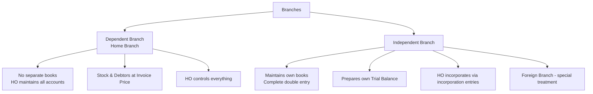

# UNIT 13: BRANCH ACCOUNTS-I

**Block 4: Hire Purchase and Inland Branches** | **PYQ Priority: 🔴 HIGHEST** (10/10 papers - 100% frequency - Branch Account appears in EVERY paper)

---

## 13.1 INTRODUCTION

**Branch Accounting** deals with maintaining accounts for **branches** of a business. Branches are separate locations/units operating under the same ownership but at different places.

---

## 13.2 TYPES OF BRANCHES



### **Comparison:**

| Basis | **Dependent Branch** | **Independent Branch** |
|-------|---------------------|------------------------|
| **Books of Account** | Not maintained | Maintains complete books |
| **Control** | HO controls fully | Operates independently |
| **Stock/Goods** | Supplied by HO at Cost/IP | May purchase locally too |
| **Cash** | Remitted to HO daily | Own bank account |
| **Expenses** | Paid by HO or reimbursed | Paid by branch |
| **Trial Balance** | Not prepared | Prepares own TB |
| **Accounting Method** | Debtor System / Stock & Debtors / Wholesale Branch | Incorporation in HO books |

---

## 13.3 METHODS OF ACCOUNTING FOR DEPENDENT BRANCH

### **1. Debtors System (Simplest)**
- Only **Branch Account** in HO books
- Shows: Opening balances, Goods sent, Cash sales, Credit sales, Cash received, Expenses, Closing balances
- Profit = Difference between Dr. and Cr. sides

### **2. Stock and Debtors System (Detailed)**
- **Branch Stock Account** (at Invoice Price)
- **Branch Debtors Account**
- **Branch Adjustment Account** (Loading)
- **Goods Sent to Branch Account**
- **Branch P&L Account**

### **3. Wholesale Branch Method**
- Branch acts as wholesaler to retail branches
- Goods supplied at wholesale price

### **4. Final Accounts System**
- Branch prepares Trading & P&L, Balance Sheet
- HO incorporates via journal entries

---

## 13.4 INVOICE PRICE METHOD (MOST COMMON IN EXAMS) 🔴 HIGHEST PRIORITY

### **Concept:**
- HO sends goods to branch at **Invoice Price** (Cost + Profit Margin)
- **Loading** = Invoice Price - Cost Price
- **Loading %** = (IP - Cost) / IP × 100

### **Loading Calculations:**
| Markup on Cost | Loading on IP |
|----------------|---------------|
| Cost + 20% = IP | 16.67% |
| Cost + 25% = IP | **20%** |
| Cost + 33⅓% = IP | **25%** |
| Cost + 50% = IP | 33.33% |

**Formula:** `Loading % = Markup % / (100 + Markup %) × 100`

---

## 13.5 BRANCH STOCK ACCOUNT (at Invoice Price) 🔴 HIGHEST PRIORITY

### **Format:**

```
DR.                              BRANCH STOCK ACCOUNT (at Invoice Price)                              CR.
Particulars                          Amount          Particulars                          Amount
To Opening Stock (IP)                    xxx         By Cash Sales (IP)                       xxx
To Goods Sent to Branch (IP)             xxx         By Credit Sales (IP)                     xxx
To Goods Sent (Loading)                  xxx         By Goods Returned to HO (IP)             xxx
To Gross Profit (on Loading)             xxx         By Abnormal Loss (IP)                    xxx
                                                     By Shortage/Pilferage (IP)               xxx
                                                     By Closing Stock (IP)                    xxx
                                             ----                                       ----
                                             Total                                      Total
```

### **Key Points:**
- **All entries at Invoice Price**
- **Gross Profit** = Loading on goods sold (Credit Sales + Cash Sales - Returns)
- **Balancing figure** = Gross Profit (if credit > debit) or Gross Loss

---

## 13.6 BRANCH DEBTORS ACCOUNT

### **Format:**

```
DR.                              BRANCH DEBTORS ACCOUNT                              CR.
Particulars                          Amount          Particulars                          Amount
To Opening Debtors                       xxx         By Cash Received from Debtors          xxx
To Credit Sales (IP)                     xxx         By Discount Allowed                    xxx
                                                     By Bad Debts                           xxx
                                                     By Returns Inward (IP)                 xxx
                                                     By Bills Receivable                    xxx
                                                     By Closing Debtors                     xxx
                                             ----                                       ----
                                             Total                                      Total
```

---

## 13.7 BRANCH ADJUSTMENT ACCOUNT (LOADING ACCOUNT) 🔴 HIGHEST PRIORITY

### **Format:**

```
DR.                              BRANCH ADJUSTMENT ACCOUNT                              CR.
Particulars                          Amount          Particulars                          Amount
To Stock Reserve (Opening)             xxx         By Stock Reserve (Closing)             xxx
To Gross Profit (on Loading)           xxx         By Loading on Goods Sent               xxx
To Loading on Goods Returned           xxx         By Loading on Abnormal Loss            xxx
To Loading on Shortage                 xxx
To Branch P&L (Net Profit)             xxx
                                             ----                                       ----
                                             Total                                      Total
```

### **Stock Reserve:**
- **Opening Stock Reserve** = Opening Stock (IP) × Loading %
- **Closing Stock Reserve** = Closing Stock (IP) × Loading %

---

## 13.8 GOODS SENT TO BRANCH ACCOUNT

### **Format:**

```
DR.                              GOODS SENT TO BRANCH ACCOUNT                              CR.
Particulars                          Amount          Particulars                          Amount
To Branch Adjustment (Loading)         xxx         By Branch Stock (IP)                   xxx
To Trading A/c (Cost - Net)            xxx         By Branch Stock Returns (IP)           xxx
                                             ----                                       ----
                                             Total                                      Total
```

---

## 13.9 BRANCH PROFIT & LOSS ACCOUNT

### **Format:**

```
DR.                              BRANCH PROFIT & LOSS ACCOUNT                              CR.
Particulars                          Amount          Particulars                          Amount
To Branch Expenses (Paid by HO)        xxx         By Branch Adjustment (Net Profit)      xxx
To Branch Expenses (Paid by Branch)    xxx
To Depreciation on Branch Assets       xxx
To Bad Debts                           xxx
To Discount Allowed                    xxx
To Shortage/Pilferage (Cost)           xxx
To Net Profit (transferred to HO)      xxx
                                             ----                                       ----
                                             Total                                      Total
```

---

## 13.10 BRANCH ACCOUNT (FINAL - DEBTORS SYSTEM)

### **Format:**

```
DR.                              BRANCH ACCOUNT                              CR.
Particulars                          Amount          Particulars                          Amount
To Opening Stock                       xxx         By Cash Sales                          xxx
To Opening Debtors                     xxx         By Cash Received from Debtors          xxx
To Opening Petty Cash                  xxx         By Goods Returned to HO                xxx
To Goods Sent to Branch                xxx         By Closing Stock                       xxx
To Cash Sent to Branch (Expenses)      xxx         By Closing Debtors                     xxx
To Cash Sent (Petty Cash)              xxx         By Closing Petty Cash                  xxx
To Branch P&L (Profit)                 xxx
                                             ----                                       ----
                                             Total                                      Total
```

---

## 13.11 JOURNAL ENTRIES IN HO BOOKS (INVOICE PRICE METHOD)

| Transaction | Journal Entry |
|-------------|---------------|
| **1. Goods Sent to Branch** | Branch Stock A/c Dr. (IP)<br>To Goods Sent to Branch A/c (IP) |
| **2. Loading on Goods Sent** | Branch Adjustment A/c Dr. (Loading)<br>To Goods Sent to Branch A/c (Loading) |
| **3. Cash Sales by Branch** | Cash/Bank A/c Dr.<br>To Branch Stock A/c (IP) |
| **4. Credit Sales by Branch** | Branch Debtors A/c Dr. (IP)<br>To Branch Stock A/c (IP) |
| **5. Cash Received from Debtors** | Cash/Bank A/c Dr.<br>To Branch Debtors A/c |
| **6. Expenses Paid by HO** | Branch P&L A/c Dr.<br>To Cash/Bank A/c |
| **7. Expenses Paid by Branch** | Branch P&L A/c Dr.<br>To Branch Cash A/c |
| **8. Goods Returned by Branch** | Goods Sent to Branch A/c Dr. (IP)<br>To Branch Stock A/c (IP) |
| **9. Loading on Returns** | Branch Stock A/c Dr. (Loading)<br>To Branch Adjustment A/c (Loading) |
| **10. Bad Debts** | Branch P&L A/c Dr.<br>To Branch Debtors A/c |
| **11. Discount Allowed** | Branch P&L A/c Dr.<br>To Branch Debtors A/c |
| **12. Depreciation on Assets** | Branch P&L A/c Dr.<br>To Branch Asset A/c |
| **13. Abnormal Loss (IP)** | Branch P&L A/c Dr. (Cost)<br>Branch Adjustment A/c Dr. (Loading)<br>To Branch Stock A/c (IP) |
| **14. Closing Stock Reserve** | Branch Stock A/c Dr. (Loading on Cl Stock)<br>To Branch Adjustment A/c |
| **15. Gross Profit** | Branch Stock A/c Dr. (Gross Profit)<br>To Branch Adjustment A/c |
| **16. Net Profit** | Branch Adjustment A/c Dr.<br>To Branch P&L A/c |
| **17. Transfer Net Profit to HO** | Branch P&L A/c Dr.<br>To HO / Profit & Loss A/c |

---

## 13.12 STEP-BY-STEP PROBLEM SOLVING APPROACH

### **Given Data Usually Includes:**
- Opening Stock (IP), Opening Debtors, Petty Cash
- Goods Sent to Branch (IP)
- Cash Sales, Credit Sales
- Cash Received from Debtors
- Expenses paid by HO / Branch
- Goods Returned by Branch / Debtors
- Bad Debts, Discount Allowed
- Closing Stock (IP), Closing Debtors, Closing Petty Cash
- Depreciation on Assets
- Loading Rate (e.g., Cost + 25% = IP)

### **Steps:**
1. **Calculate Loading %** from markup given
2. **Prepare Branch Stock A/c** (IP) - Find Gross Profit
3. **Prepare Branch Debtors A/c** - Find Closing Debtors
4. **Prepare Branch Adjustment A/c** - Find Net Profit
5. **Prepare Goods Sent to Branch A/c**
6. **Prepare Branch P&L A/c** - Verify Net Profit
7. **Prepare Branch Account** (Debtors System) - Verify

---

## 13.13 IMPORTANT EXAM QUESTIONS (From PYQ Analysis)

### **2 Marks Questions:**
1. What is a Dependent Branch?
2. What is an Independent Branch?
3. What is Invoice Price Method?
4. What is Loading?
5. Name the methods of Branch Accounting.
6. What is Branch Adjustment Account?
7. What is Stock Reserve?
8. Difference between Dependent and Independent Branch.

### **5 Marks Questions:**
1. Explain the types of branches.
2. Distinguish between Debtors System and Stock & Debtors System.
3. Explain the Wholesale Branch Method.
4. How is Loading calculated?
5. Explain the treatment of Abnormal Loss in Branch Accounts.

### **10 Marks Questions:**
1. **Types of Branches / Methods of Branch Accounting.** (Dec 2022, June 2024, June 2025 - 5+15 / 10 marks)

### **15+5 / 20 Marks Practical (Standard Format - EVERY YEAR):**
- Complete Branch Account problem (Invoice Price Method)
- Prepare: Branch Stock, Branch Debtors, Branch Adjustment, Goods Sent to Branch, Branch P&L, Branch Account
- 15-20 transactions with adjustments
- Sometimes: Branch Fixed Assets at HO level (Dec 2025)

---

## 13.14 KEY POINTS FOR REVISION

- ✅ **Dependent Branch** = HO maintains accounts, goods at Invoice Price
- ✅ **Independent Branch** = Own books, incorporation entries
- ✅ **3 Methods:** Debtors System, Stock & Debtors System, Wholesale Branch
- ✅ **Invoice Price Method** = Most common in exams (100% frequency)
- ✅ **Loading** = IP - Cost; **Loading %** = Markup/(100+Markup)×100
- ✅ **4 Key Accounts:** Branch Stock (IP), Branch Debtors, Branch Adjustment (Loading), Goods Sent to Branch
- ✅ **Branch Stock A/c** = Main account, balancing figure = Gross Profit
- ✅ **Branch Adjustment A/c** = Loading account, balancing figure = Net Profit
- ✅ **Stock Reserve** = Loading on Opening/Closing Stock
- ✅ **Branch P&L** = Expenses vs Net Profit from Adjustment

---

## 13.15 MEMORY AIDS

### **Loading: "MARKUP OVER 100+MARKUP"**
- Cost + 25% = IP → Loading = 25/125 = 20%
- Cost + 33⅓% = IP → Loading = 33.33/133.33 = 25%

### **4 Accounts: "SDAG"**
- **S**tock (Branch Stock)
- **D**ebtors (Branch Debtors)
- **A**djustment (Branch Adjustment)
- **G**oods Sent to Branch

### **Branch Stock A/c: "OPENING + GOODS SENT + LOADING = SALES + RETURNS + CLOSING + GROSS PROFIT"**

### **Branch Adjustment A/c: "OPENING RESERVE + GROSS PROFIT + LOADING ON RETURNS = CLOSING RESERVE + LOADING ON GOODS SENT + NET PROFIT"**

---

## 13.16 QUICK REFERENCE - LOADING CALCULATIONS

| Markup on Cost | Invoice Price | Loading on IP | Stock Reserve % |
|----------------|---------------|---------------|-----------------|
| 20% | 120 | 16.67% | 16.67% |
| **25%** | **125** | **20%** | **20%** |
| **33⅓%** | **133.33** | **25%** | **25%** |
| 50% | 150 | 33.33% | 33.33% |
| 100% | 200 | 50% | 50% |

**Example:**
Cost ₹1,00,000, Markup 25% → IP ₹1,25,000, Loading ₹25,000 (20% of IP)

---

*End of Unit 13 Notes*