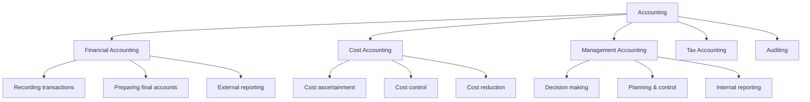
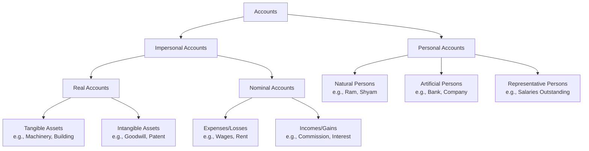

# UNIT 1: NATURE AND SCOPE OF ACCOUNTING

**Block 1: Theoretical Framework** | **PYQ Priority: 🔴 HIGH** (Appears in 6/10 papers for definition/objectives, 5/10 for Double Entry, 4/10 for Qualitative Characteristics)

---

## 1.1 INTRODUCTION

Accounting is often called the **"Language of Business"** because it communicates financial information about a business entity to various stakeholders. Just as language helps people communicate, accounting helps businesses communicate their financial position and performance to owners, managers, creditors, government, and other interested parties.

---

## 1.2 NEED FOR ACCOUNTING

### Why is Accounting Necessary?

1. **Human Memory is Limited** - Cannot remember thousands of transactions over a year
2. **Control Over Business** - Prevents theft, fraud, misappropriation when outsiders are employed
3. **Legal Requirement** - Companies Act, Income Tax Act, GST Act require proper books
4. **Decision Making** - Management needs information for planning, controlling, evaluating
5. **External Reporting** - Banks, creditors, investors, tax authorities need financial info
6. **Profit Ascertainment** - Primary objective of business is to earn profit
7. **Financial Position** - Know what business owns (assets) and owes (liabilities)

---

## 1.3 OBJECTIVES OF ACCOUNTING

### Four Main Objectives:

| Objective | Description | Output |
|-----------|-------------|--------|
| **1. Systematic Records** | Keep chronological record of all financial transactions | Journal, Ledger, Subsidiary Books |
| **2. Ascertain Profit/Loss** | Determine net result of business operations | Profit & Loss Account (Income Statement) |
| **3. Financial Position** | Show assets, liabilities, capital on a given date | Balance Sheet (Position Statement) |
| **4. Provide Information** | Supply accounting info to various users | Financial Reports, Ratios, Analysis |

---

## 1.4 DEFINITION AND SCOPE OF ACCOUNTING

### **Definitions:**

**American Accounting Association (AAA):**
> "Accounting is the process of identifying, measuring and communicating economic information to permit informed judgments and decisions by users of the information."

**AICPA (Committee on Terminology):**
> "Accounting is the art of recording, classifying and summarizing in a significant manner and in terms of money, transactions and events which are, in part at least of financial character and interpreting the results thereof."

### **Comprehensive Definition:**
> **Accounting is the process of identifying, measuring, recording, classifying, summarising, analysing, interpreting, and communicating financial transactions and events in monetary terms.**

### **Scope of Accounting (8 Steps):**


1. **Identifying** - Through vouchers (bills, receipts)
2. **Measuring** - Express in monetary terms
3. **Recording** - Journal (book of original entry) or Subsidiary Books
4. **Classifying** - Ledger (separate account for each item)
5. **Summarising** - Trial Balance → Trading, P&L Account, Balance Sheet
6. **Analysing** - Ratio analysis, comparative statements
7. **Interpreting** - Explaining meaning of results
8. **Communicating** - Reports to stakeholders

---

## 1.5 BOOK-KEEPING, ACCOUNTING AND ACCOUNTANCY

| Term | Meaning | Scope |
|------|---------|-------|
| **Book-Keeping** | Record keeping / maintaining books of account | Only first 4 activities: Identifying, Measuring, Recording, Classifying |
| **Accounting** | Actual process of preparing and presenting accounts | All 8 activities including summarising, analysing, interpreting, communicating |
| **Accountancy** | Systematised knowledge of accounting (academic subject) | Explains "why to do" and "how to do" - science/body of knowledge |

**Relationship:** Accountancy → (Knowledge) → Accounting → (Process) → Book-keeping → (Recording)

> **Note:** In general usage, Accountancy and Accounting are used as synonyms, but "Accounting" is becoming more popular.

---

## 1.6 USERS OF FINANCIAL ACCOUNTING INFORMATION

### **Internal Users:**
| User | Information Need |
|------|------------------|
| **Owners/Shareholders** | Profitability, return on investment, dividend capacity |
| **Management** | Planning, controlling, decision-making, performance evaluation |
| **Employees** | Job security, bonus, profit sharing, wage negotiation |

### **External Users:**
| User | Information Need |
|------|------------------|
| **Banks/Financial Institutions** | Creditworthiness, repayment capacity, security |
| **Creditors/Suppliers** | Short-term liquidity, payment capability |
| **Government/Tax Authorities** | Tax assessment (Income Tax, GST), regulatory compliance |
| **Investors** | Return on investment, growth potential, risk |
| **Regulatory Bodies** | Compliance with Companies Act, SEBI, ICAI standards |
| **Researchers/Analysts** | Industry analysis, benchmarking |

---

## 1.7 ACCOUNTING AS AN INFORMATION SYSTEM

```
INPUT → PROCESSING → OUTPUT
```

**Inputs:** Business transactions (vouchers, invoices, receipts)
**Processing:** Recording, classifying, summarising
**Outputs:** Financial statements (Trading, P&L, Balance Sheet), Reports, Ratios

**Qualitative Characteristics (IASB Framework) - 🔴 HIGH PRIORITY:**

| Characteristic | Meaning |
|----------------|---------|
| **1. Relevance** | Influences decisions; predictive & confirmatory value |
| **2. Faithful Representation** | Complete, neutral, free from error |
| **3. Comparability** | Across entities and time periods |
| **4. Verifiability** | Different observers reach same conclusion |
| **5. Timeliness** | Available to decision-makers in time |
| **6. Understandability** | Clear to users with reasonable knowledge |

---

## 1.8 BRANCHES OF ACCOUNTING



---

## 1.9 ADVANTAGES AND LIMITATIONS OF ACCOUNTING

### **Advantages:**
1. **Complete & Systematic Record** - All transactions recorded
2. **Ascertainment of Profit/Loss** - True business result
3. **Financial Position** - Assets & liabilities known
4. **Comparative Study** - Inter-period, inter-firm comparison
5. **Control Over Assets** - Prevents misuse, theft
6. **Evidence in Court** - Books accepted as legal evidence
7. **Facilitates Loans** - Banks rely on audited accounts
8. **Helps in Taxation** - Correct tax liability computation
9. **Valuation of Business** - For sale, merger, partnership admission
10. **Decision Making** - Reliable info for management

### **Limitations:**
1. **Historical Nature** - Records past transactions, not future
2. **Monetary Only** - Non-monetary facts (employee morale, reputation) ignored
3. **Subjectivity** - Estimates (depreciation, provisions) involve judgment
4. **Window Dressing** - Accounts can be manipulated
5. **Inflation Ignored** - Historical cost doesn't reflect current values
6. **Not Fully Objective** - Choice of methods affects results

---

## 1.10 BASES OF ACCOUNTING 🔴 HIGH PRIORITY (3/10 papers)

### **Cash Basis vs Accrual Basis**

| Basis | Cash Basis | Accrual Basis |
|-------|------------|---------------|
| **Revenue Recognition** | When cash is **received** | When **earned** (right to receive arises) |
| **Expense Recognition** | When cash is **paid** | When **incurred** (obligation arises) |
| **Outstanding Expenses** | **Ignored** | **Recorded** as liability |
| **Prepaid Expenses** | **Ignored** | **Recorded** as asset |
| **Accrued Income** | **Ignored** | **Recorded** as asset |
| **Income Received in Advance** | **Ignored** | **Recorded** as liability |
| **Profit Determination** | **Inaccurate** | **Accurate** (Matching Concept) |
| **Legal Recognition** | Not accepted by Companies Act | **Mandatory** under Companies Act |
| **Example** | Rent paid Jan 2025 for Dec 2024 → Expense in 2025 | Rent for Dec 2024 → Expense in 2024 (outstanding) |

> **Key Point:** Accrual basis follows the **Matching Concept** - expenses of a period matched with revenues of the same period.

---

## 1.11 FUNCTIONS OF ACCOUNTING

1. **Recording** - Systematic recording of transactions
2. **Classifying** - Grouping similar transactions in Ledger
3. **Summarising** - Preparing Trial Balance, Final Accounts
4. **Analysing** - Ratio analysis, trend analysis
5. **Interpreting** - Explaining financial results
6. **Communicating** - Reporting to stakeholders
7. **Controlling** - Budgetary control, variance analysis

---

## 1.12 DOUBLE ENTRY SYSTEM 🔴 HIGH PRIORITY (5/10 papers)

### **Definition:**
Every transaction has **two aspects** - **Debit** (receiving) and **Credit** (giving). For every debit there is an equal credit. **Total Debits = Total Credits**.

### **Principle:**
> "For every debit there must be an equal and corresponding credit and vice versa."

### **Example:**
- Machinery purchased for cash ₹50,000
- **Receiving:** Machinery (Debit)
- **Giving:** Cash (Credit)

### **Advantages (Memorize for 5-10 marks):**

| # | Advantage | Explanation |
|---|-----------|-------------|
| 1 | **Complete Record** | Both aspects (receiving & giving) recorded |
| 2 | **Arithmetical Accuracy** | Trial Balance verifies Debits = Credits |
| 3 | **Profit/Loss Ascertainment** | Nominal accounts show true result |
| 4 | **Financial Position** | Real/Personal accounts show assets/liabilities |
| 5 | **Fraud Prevention** | Dual recording reduces errors/fraud |
| 6 | **Comparative Study** | Year-wise comparison possible |
| 7 | **Decision Making** | Reliable info for management |
| 8 | **Legal Acceptance** | Recognized by Companies Act, Tax Laws |

---

## 1.13 CLASSIFICATION OF ACCOUNTS (From Unit 2 - Important Foundation)



### **Rules of Debit and Credit:**

| Class of Account | Debit | Credit |
|------------------|-------|--------|
| **Personal** | The Receiver | The Giver |
| **Real** | What Comes In | What Goes Out |
| **Nominal** | Expenses & Losses | Incomes & Gains |

---

## 1.14 IMPORTANT EXAM QUESTIONS (From PYQ Analysis)

### **2 Marks Questions:**
1. Define Accounting.
2. What is Book-keeping?
3. What is Accountancy?
4. Name two internal and two external users of accounting information.
5. What is Cash Basis of Accounting?
6. What is Accrual Basis of Accounting?
7. State the Principle of Double Entry.
8. What are the three classes of accounts?

### **5 Marks Questions:**
1. Explain the objectives of Accounting.
2. Distinguish between Book-keeping, Accounting and Accountancy.
3. Explain the functions of Accounting.
4. State the advantages of Double Entry System.
5. Explain the qualitative characteristics of accounting information.
6. Distinguish between Cash Basis and Accrual Basis with examples.

### **10 Marks Questions:**
1. **Define Accounting. Explain its objectives and scope.** (Dec 2021, Dec 2022, June 2024)
2. **Explain Double Entry System. State its advantages.** (Dec 2021, Dec 2024, June 2025, Dec 2025, June 2026)
3. **Explain Qualitative Characteristics of Accounting Information.** (June 2022, Dec 2025)
4. **Distinguish between Cash Basis and Accrual Basis of Accounting with examples.** (Dec 2021, Dec 2022, June 2024)

### **12+8 / 10+10 Marks Questions:**
1. Define Accounting (12) + Objectives and Scope (8) - [Dec 2021]
2. Double Entry System definition (5) + Advantages (5) - [Dec 2021, Dec 2024, Dec 2025]
3. Functions of Accounting (8) + Bases of Accounting (12) - [June 2024]

---

## 1.15 KEY POINTS FOR REVISION

- ✅ **Accounting = Process** (8 steps: Identify → Measure → Record → Classify → Summarise → Analyse → Interpret → Communicate)
- ✅ **Book-keeping** = Only recording part (first 4 steps)
- ✅ **Accountancy** = Knowledge/science behind accounting
- ✅ **6 Qualitative Characteristics**: Relevance, Faithful Representation, Comparability, Verifiability, Timeliness, Understandability
- ✅ **3 Classes of Accounts**: Personal (Debit Receiver, Credit Giver), Real (Debit What Comes In, Credit What Goes Out), Nominal (Debit Expenses/Losses, Credit Incomes/Gains)
- ✅ **Double Entry**: Every debit has equal credit
- ✅ **Cash Basis** = Cash received/paid; **Accrual Basis** = Earned/incurred (Legal requirement)
- ✅ **Advantages of Double Entry**: Complete record, Accuracy, Profit/Loss, Financial Position, Fraud prevention, Comparison, Decision making, Legal acceptance

---

## 1.16 FORMULAS & RULES SUMMARY

| Concept | Rule |
|---------|------|
| **Double Entry Principle** | Total Debits = Total Credits |
| **Personal Account** | Debit Receiver, Credit Giver |
| **Real Account** | Debit What Comes In, Credit What Goes Out |
| **Nominal Account** | Debit Expenses/Losses, Credit Incomes/Gains |
| **Revenue Recognition (Accrual)** | When earned (not when cash received) |
| **Expense Recognition (Accrual)** | When incurred (not when cash paid) |

---

*End of Unit 1 Notes*