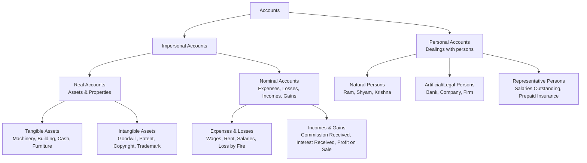

# UNIT 2: ACCOUNTING PROCESS AND RULES

**Block 1: Theoretical Framework** | **PYQ Priority: 🟡 MEDIUM** (Foundation for Units 5, 6, 7 - Regular appearance in practical questions)

---

## 2.1 INTRODUCTION

The accounting process is a series of steps that starts with recording transactions and ends with preparing financial statements. Understanding the **classification of accounts** and **rules of debit and credit** is the foundation for all practical accounting problems.

---

## 2.2 CLASSIFICATION OF ACCOUNTS

All business transactions are classified into three categories:
1. **Transactions relating to persons** → Personal Accounts
2. **Transactions relating to property/assets** → Real Accounts
3. **Transactions relating to incomes/expenses** → Nominal Accounts



---

## 2.3 DETAILED CLASSIFICATION WITH EXAMPLES

### **Personal Accounts**
Accounts showing dealings with persons (natural, artificial, or representative).

| Type | Examples |
|------|----------|
| **Natural Persons** | Ram's A/c, Shyam's A/c, Krishna's A/c |
| **Artificial Persons** | Indian Bank A/c, Nagarjuna Finance Ltd A/c, ABC Ltd A/c |
| **Representative Persons** | Salaries Outstanding A/c, Prepaid Insurance A/c, Rent Received in Advance A/c, Commission Outstanding A/c, Interest Outstanding A/c |
| **Capital & Drawings** | Capital A/c (owner's claim), Drawings A/c (owner's withdrawal) |

> **Key Point:** Representative Personal Accounts represent a person or group of persons but are impersonal in name.

### **Real Accounts**
Accounts relating to properties/assets owned by the business.

| Type | Examples |
|------|----------|
| **Tangible Real Accounts** | Machinery A/c, Building A/c, Furniture A/c, Cash A/c, Stock A/c, Vehicles A/c, Land A/c |
| **Intangible Real Accounts** | Goodwill A/c, Patent A/c, Copyright A/c, Trademark A/c |

> **Key Point:** Cash Account is a Real Account because cash is an asset (property).

### **Nominal Accounts**
Accounts relating to expenses, losses, incomes, and gains.

| Type | Examples |
|------|----------|
| **Expenses** | Wages A/c, Salaries A/c, Rent A/c, Electricity Charges A/c, Advertising A/c, Carriage A/c, Postage A/c |
| **Losses** | Loss by Fire A/c, Loss by Theft A/c, Loss on Sale of Asset A/c |
| **Incomes** | Commission Received A/c, Interest Received A/c, Rent Received A/c, Discount Received A/c |
| **Gains** | Profit on Sale of Asset A/c |

---

## 2.4 PRINCIPLE OF DOUBLE ENTRY

### **Core Concept:**
Every business transaction involves **transfer of money or money's worth** between two parties/accounts. It has **two aspects**:
1. **Receiving Aspect** (Debit)
2. **Giving Aspect** (Credit)

### **Principle:**
> **"For every debit there must be an equal and corresponding credit and vice versa."**

### **Dual Aspect Examples:**

| Transaction | Receiving Aspect (Debit) | Giving Aspect (Credit) |
|-------------|--------------------------|------------------------|
| Machinery purchased for cash | Machinery comes in | Cash goes out |
| Goods sold on credit to Ajay | Ajay (Receiver) | Goods go out |
| Rent paid | Rent (Expense incurred) | Cash goes out |
| Commission received | Cash comes in | Commission (Income earned) |

---

## 2.5 RULES OF DEBIT AND CREDIT 🔴 CRITICAL FOUNDATION

These rules are applied **after** identifying the class of account.

| Class of Account | **Debit** | **Credit** |
|------------------|-----------|------------|
| **Personal Accounts** | **The Receiver** | **The Giver** |
| **Real Accounts** | **What Comes In** | **What Goes Out** |
| **Nominal Accounts** | **Expenses & Losses** | **Incomes & Gains** |

### **Application Examples:**

| Transaction | Accounts Affected | Classification | Debit | Credit |
|-------------|-------------------|----------------|-------|--------|
| Paid cash to Ram ₹5,000 | Ram A/c, Cash A/c | Personal, Real | Ram (Receiver) | Cash (Goes out) |
| Received cash from Shyam ₹1,000 | Cash A/c, Shyam A/c | Real, Personal | Cash (Comes in) | Shyam (Giver) |
| Paid rent ₹1,000 | Rent A/c, Cash A/c | Nominal, Real | Rent (Expense) | Cash (Goes out) |
| Received commission ₹400 | Cash A/c, Commission A/c | Real, Nominal | Cash (Comes in) | Commission (Income) |
| Purchased goods from Mohan on credit ₹2,000 | Goods A/c, Mohan A/c | Real, Personal | Goods (Comes in) | Mohan (Giver) |
| Sold goods to Sohan on credit ₹3,000 | Sohan A/c, Goods A/c | Personal, Real | Sohan (Receiver) | Goods (Goes out) |
| Purchased furniture for cash ₹4,000 | Furniture A/c, Cash A/c | Real, Real | Furniture (Comes in) | Cash (Goes out) |
| Paid salaries ₹6,000 | Salaries A/c, Cash A/c | Nominal, Real | Salaries (Expense) | Cash (Goes out) |

---

## 2.6 JOURNAL - BOOK OF ORIGINAL ENTRY

### **Definition:**
Journal is the **book of prime entry** (book of original entry) where all business transactions are recorded **first** in **chronological order**.

### **Format of Journal:**

```
JOURNAL
Date        Particulars                    L.F.    Debit (₹)    Credit (₹)
2024
Jan 1       Cash Account              Dr.              50,000
            To Capital Account                       50,000
            (Being business started with cash)
```

### **Columns Explained:**
1. **Date** - Year at top, month below, date for each entry (use ditto marks "")
2. **Particulars** - Account to be debited (close to left, write "Dr."), account to be credited (next line, indented, prefix "To"), narration in brackets
3. **L.F. (Ledger Folio)** - Page number in Ledger where posted (filled at posting time)
4. **Debit Amount** - Amount to be debited
5. **Credit Amount** - Amount to be credited

### **Steps in Journalising:**
1. **Analyze** transaction from business entity viewpoint
2. **Identify** two accounts affected
3. **Classify** each account (Personal/Real/Nominal)
4. **Apply** rules of debit and credit
5. **Record** in journal with proper narration

### **Compound Journal Entry:**
When a transaction affects **more than two accounts** - one entry with multiple debits/credits.

**Example:** Paid ₹5,000 to Ram in full settlement of ₹5,200
```
Ram A/c           Dr.    5,200
    To Cash A/c                5,000
    To Discount Received A/c     200
```

### **Opening Entry:**
Entry passed at the **beginning of a new accounting year** to bring forward assets and liabilities.
```
Assets Accounts          Dr.    (individual amounts)
    To Liabilities Accounts           (individual amounts)
    To Capital Account                (balancing figure)
```

---

## 2.7 LEDGER - BOOK OF SECONDARY ENTRY

### **Definition:**
Ledger is the **principal book of accounts** where all transactions from Journal are **posted** account-wise. It contains all Personal, Real, and Nominal accounts.

### **Format of Ledger Account:**

```
DR.                              MACHINERY ACCOUNT                              CR.
Date       Particulars           J.F.    Amount (₹)      Date       Particulars           J.F.    Amount (₹)
2024
Jan 1      To Cash A/c                      50,000       Dec 31     By Depreciation A/c       5,000
                                                     Dec 31     By Balance c/d            45,000
                                                     ----                    ----
                                                     Total                   50,000       Total                   50,000
```

### **Key Features:**
- **Two sides:** Left = Debit (Dr.), Right = Credit (Cr.)
- **"To"** used on Debit side, **"By"** used on Credit side
- **Balancing:** Difference between two sides = Balance
  - Debit side > Credit side → **Debit Balance** (Asset, Expense)
  - Credit side > Debit side → **Credit Balance** (Liability, Income, Capital)

### **Posting Rules:**
1. **Debit entry in Journal** → Post to **Debit side** of that account in Ledger (write "To [Other Account]")
2. **Credit entry in Journal** → Post to **Credit side** of that account in Ledger (write "By [Other Account]")
3. Enter **Journal page number** in L.F. column of Ledger
4. Enter **Ledger page number** in L.F. column of Journal

---

## 2.8 TRIAL BALANCE

### **Definition:**
A statement showing **debit and credit balances** of all ledger accounts to **test arithmetical accuracy**.

### **Objectives:**
1. Check arithmetical accuracy of ledger postings
2. Help locate errors
3. Basis for preparing final accounts
4. Summary of all account balances

### **Methods of Preparation:**
1. **Total Method** - Total of debit/credit sides of each account
2. **Balance Method** - Only net balances (commonly used)
3. **Compound Method** - Both totals and balances

### **Format:**
```
TRIAL BALANCE AS ON 31ST MARCH, 2024

| Account Name          | L.F. | Debit Balance (₹) | Credit Balance (₹) |
|-----------------------|------|-------------------|--------------------|
| Cash A/c              |      | 10,000            |                    |
| Capital A/c           |      |                   | 50,000             |
| Purchases A/c         |      | 30,000            |                    |
| Sales A/c             |      |                   | 45,000             |
| ...                   |      |                   |                    |
| TOTAL                 |      | 1,00,000          | 1,00,000           |
```

### **Limitations:**
- Does not prove **absolute accuracy** (compensating errors, errors of principle, omission not detected)
- Only proves **arithmetical accuracy** (Debits = Credits)

---

## 2.9 ACCOUNTING EQUATION

### **Fundamental Equation:**
> **Assets = Liabilities + Capital**

Or: **Assets = Equities** (Equities = Liabilities + Owner's Equity)

### **Expanded Equation:**
> **Assets = Liabilities + Capital + Revenue - Expenses - Drawings**

### **Effect of Transactions:**
Every transaction maintains the equation balance.

| Transaction | Effect on Equation |
|-------------|-------------------|
| Started business with cash ₹50,000 | Assets ↑ (Cash) = Capital ↑ |
| Purchased goods for cash ₹10,000 | Assets ↑ (Stock), Assets ↓ (Cash) |
| Sold goods on credit ₹15,000 (cost ₹10,000) | Assets ↑ (Debtors ₹15,000), Assets ↓ (Stock ₹10,000), Capital ↑ (Profit ₹5,000) |
| Paid rent ₹2,000 | Assets ↓ (Cash), Capital ↓ (Expense) |

---

## 2.10 IMPORTANT EXAM QUESTIONS

### **2 Marks Questions:**
1. What is a Journal?
2. What is a Ledger?
3. What is Trial Balance?
4. Define Personal/Real/Nominal Account with one example each.
5. What is a Compound Journal Entry?
6. What is an Opening Entry?
7. State the rules of Debit and Credit for Personal Accounts.
8. State the rules of Debit and Credit for Real Accounts.
9. State the rules of Debit and Credit for Nominal Accounts.
10. What is the Accounting Equation?

### **5 Marks Questions:**
1. Explain the classification of accounts with examples.
2. Explain the Principle of Double Entry with examples.
3. Distinguish between Journal and Ledger.
4. What is Trial Balance? State its objectives.
5. Explain the limitations of Trial Balance.
6. Show the effect of 5 transactions on Accounting Equation.

### **10 Marks Questions:**
1. **Explain the rules of Debit and Credit with suitable examples.** (Foundation for all practical questions)
2. **What is Journal? Explain the steps in Journalising.** (June 2022 - Why journal sub-divided)
3. **Prepare Journal Entries for the following transactions...** (June 2023, June 2024 - 20 marks practical)

### **15+5 / 20 Marks Practical:**
- Journal entries for 10-15 transactions
- Posting to Ledger and balancing
- Preparing Trial Balance from given balances

---

## 2.11 KEY POINTS FOR REVISION

- ✅ **3 Classes of Accounts:** Personal (Debit Receiver, Credit Giver), Real (Debit What Comes In, Credit What Goes Out), Nominal (Debit Expenses/Losses, Credit Incomes/Gains)
- ✅ **Journal** = Book of original entry (chronological), **Ledger** = Book of secondary entry (account-wise)
- ✅ **Compound Entry** = More than 2 accounts in one entry
- ✅ **Opening Entry** = Bring forward Assets/Liabilities at year start
- ✅ **Trial Balance** = Check arithmetical accuracy (Debits = Credits)
- ✅ **Accounting Equation:** Assets = Liabilities + Capital
- ✅ **Representative Personal A/c** = Outstanding/Prepaid expenses/incomes
- ✅ **Cash A/c** is a Real Account (asset)
- ✅ **Capital & Drawings** are Personal Accounts (represent owner)

---

## 2.12 QUICK REFERENCE TABLE

| Account Name | Class | Debit/Credit Rule |
|--------------|-------|-------------------|
| Ram's A/c | Personal | Debit Receiver / Credit Giver |
| Bank A/c | Personal (Artificial) | Debit Receiver / Credit Giver |
| Cash A/c | Real | Debit What Comes In / Credit What Goes Out |
| Machinery A/c | Real | Debit What Comes In / Credit What Goes Out |
| Furniture A/c | Real | Debit What Comes In / Credit What Goes Out |
| Goodwill A/c | Real (Intangible) | Debit What Comes In / Credit What Goes Out |
| Purchases A/c | Real | Debit What Comes In / Credit What Goes Out |
| Sales A/c | Real | Debit What Comes In / Credit What Goes Out |
| Wages A/c | Nominal | Debit Expenses / Credit Incomes |
| Salaries A/c | Nominal | Debit Expenses / Credit Incomes |
| Rent A/c | Nominal | Debit Expenses / Credit Incomes |
| Commission Received A/c | Nominal | Debit Expenses / Credit Incomes |
| Interest Paid A/c | Nominal | Debit Expenses / Credit Incomes |
| Discount Allowed A/c | Nominal | Debit Expenses / Credit Incomes |
| Discount Received A/c | Nominal | Debit Expenses / Credit Incomes |
| Capital A/c | Personal (Representative) | Debit Receiver / Credit Giver |
| Drawings A/c | Personal (Representative) | Debit Receiver / Credit Giver |
| Outstanding Salaries A/c | Personal (Representative) | Debit Receiver / Credit Giver |
| Prepaid Insurance A/c | Personal (Representative) | Debit Receiver / Credit Giver |

---

*End of Unit 2 Notes*