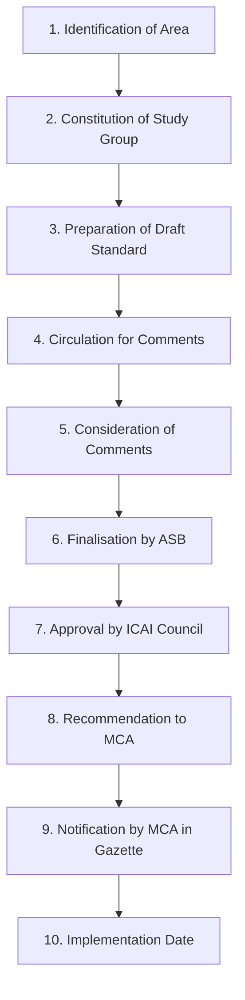

# UNIT 4: ACCOUNTING STANDARDS

**Block 1: Theoretical Framework** | **PYQ Priority: 🟡 MEDIUM** (4/10 papers - Objectives/Significance, 4/10 - Ind AS vs IFRS, 2/10 - Procedure in India)

---

## 4.1 INTRODUCTION

Accounting Standards are **written policy documents** issued by expert accounting bodies/government specifying **uniform principles** for recognition, measurement, presentation, and disclosure of accounting transactions. They reduce **alternatives** and ensure **comparability** of financial statements.

---

## 4.2 MEANING AND NATURE

### **Definition:**
> "Accounting Standards are written statements issued by institutions of the accounting profession specifying uniform rules for financial accounting and reporting."

### **Nature:**
- **Prescriptive** - Prescribe how transactions should be accounted
- **Authoritative** - Compliance mandatory for specified entities
- **Flexible** - Allow judgment within framework
- **Evolving** - Updated for changing business environment

---

## 4.3 OBJECTIVES OF ACCOUNTING STANDARDS 🔴 HIGH PRIORITY

| Objective | Description |
|-----------|-------------|
| **1. Standardization** | Uniform accounting policies across entities |
| **2. Comparability** | Financial statements comparable across periods and entities |
| **3. Reliability** | Enhance credibility and trustworthiness of financial info |
| **4. Transparency** | Full disclosure of accounting policies and changes |
| **5. Prevent Manipulation** | Reduce window dressing and creative accounting |
| **6. Guide Auditors** | Benchmark for audit verification |
| **7. Legal Compliance** | Meet statutory requirements (Companies Act, SEBI, RBI) |
| **8. International Harmonization** | Converge with global standards (IFRS) |

---

## 4.4 SIGNIFICANCE/IMPORTANCE

1. **Investor Confidence** - Reliable info for investment decisions
2. **Credit Decisions** - Banks assess creditworthiness accurately
3. **Regulatory Oversight** - Government monitors corporate sector
4. **Global Capital Access** - IFRS convergence attracts foreign investment
5. **Professional Discipline** - Standardizes accounting profession
6. **Dispute Resolution** - Common framework for settling disputes

---

## 4.5 ACCOUNTING STANDARDS IN INDIA

### **Historical Development:**
```
1977 → ICAI forms Accounting Standards Board (ASB)
1979 → First AS issued (AS 1: Disclosure of Accounting Policies)
2006 → NACAS formed (National Advisory Committee on Accounting Standards)
2015 → Ind AS notified (converged with IFRS)
2016 → Ind AS mandatory for specified companies
```

### **Current Structure:**

| Body | Role |
|------|------|
| **MCA (Ministry of Corporate Affairs)** | Notifies standards (Ind AS) under Companies Act |
| **ICAI (Institute of Chartered Accountants of India)** | Develops standards through ASB |
| **NACAS** | Recommends standards to MCA |
| **NFRA (National Financial Reporting Authority)** | Oversees audit quality, standard compliance |

### **Types of Standards in India:**
1. **Ind AS (Indian Accounting Standards)** - For specified companies (converged with IFRS)
2. **AS (Accounting Standards)** - For non-Ind AS companies (SMEs, etc.)
3. **ICAI Standards** - For non-corporate entities

---

## 4.6 PROCEDURE OF ISSUING ACCOUNTING STANDARDS IN INDIA 🔴 HIGH PRIORITY (2/10 papers)

### **Step-by-Step Process:**



### **Detailed Steps:**

| Step | Description |
|------|-------------|
| **1. Identification** | ASB identifies area needing standard (new issue, revision, IFRS convergence) |
| **2. Study Group** | Experts from industry, academia, government, regulators |
| **3. Draft Preparation** | Study group prepares Exposure Draft (ED) |
| **4. Public Comments** | ED circulated to public, stakeholders (30-60 days) |
| **5. Comment Review** | ASB reviews comments, modifies draft |
| **6. ASB Finalisation** | Final standard approved by ASB |
| **7. ICAI Council** | Council of ICAI approves |
| **8. MCA Recommendation** | Sent to MCA for notification |
| **9. Gazette Notification** | Published in Official Gazette - becomes law |
| **10. Effective Date** | Specified in notification (usually 1 year gap) |

---

## 4.7 IND AS vs IFRS 🔴 HIGH PRIORITY (4/10 papers)

### **IFRS (International Financial Reporting Standards):**
- Issued by **IASB** (International Accounting Standards Board)
- Used in **140+ countries** (EU, Australia, Canada, etc.)
- Principle-based approach
- Original global standards

### **Ind AS (Indian Accounting Standards):**
- Issued by **MCA** (Govt of India) on ICAI/NACAS recommendation
- **Converged** with IFRS (not adopted word-for-word)
- Mandatory for specified Indian companies
- Some **carve-outs/modifications** for Indian context

### **Key Differences:**

| Aspect | Ind AS | IFRS |
|--------|--------|------|
| **Issuing Authority** | MCA (Govt of India) | IASB |
| **Legal Force** | Companies Act, 2013 | Voluntary adoption (country-specific laws) |
| **Applicability** | Listed cos, banks, NBFCs, net worth ≥₹250Cr | 140+ jurisdictions |
| **Basis** | Converged with IFRS | Original standards |
| **Carve-outs** | Yes (Indian context) | No |
| **Transition** | Phased (2016 onwards) | Various dates per country |
| **Examples** | Ind AS 115 (Revenue), Ind AS 116 (Leases) | IFRS 15, IFRS 16 |

### **Major Carve-outs in Ind AS:**
1. **Ind AS 116 (Leases)** - No requirement for lessee to recognise right-of-use asset for leases of low-value assets
2. **Ind AS 103 (Business Combinations)** - Different treatment for common control transactions
3. **Ind AS 20 (Government Grants)** - Different recognition criteria
4. **Ind AS 41 (Agriculture)** - Not applicable (agriculture exempt)

---

## 4.8 ROLE OF IFRS IN ACCOUNTING 🔴 HIGH PRIORITY

| Role | Description |
|------|-------------|
| **Global Benchmark** | Common language for financial reporting worldwide |
| **Cross-border Investment** | Enables comparison across countries |
| **Capital Market Efficiency** | Reduces information asymmetry |
| **MNC Reporting** | Single standard for global subsidiaries |
| **Convergence Driver** | Countries align national standards (Ind AS, US GAAP convergence) |
| **Regulatory Reference** | Basis for national standard-setting |

---

## 4.9 LIST OF KEY IND AS / AS (For Reference)

### **Ind AS (Major):**
| Ind AS | Title | IFRS Equivalent |
|--------|-------|-----------------|
| Ind AS 1 | Presentation of Financial Statements | IAS 1 |
| Ind AS 2 | Inventories | IAS 2 |
| Ind AS 7 | Statement of Cash Flows | IAS 7 |
| Ind AS 8 | Accounting Policies, Changes in Estimates & Errors | IAS 8 |
| Ind AS 10 | Events After Reporting Period | IAS 10 |
| Ind AS 12 | Income Taxes | IAS 12 |
| Ind AS 16 | Property, Plant & Equipment | IAS 16 |
| Ind AS 18 | Revenue (Superseded) | IAS 18 |
| **Ind AS 115** | **Revenue from Contracts with Customers** | **IFRS 15** |
| **Ind AS 116** | **Leases** | **IFRS 16** |
| Ind AS 19 | Employee Benefits | IAS 19 |
| Ind AS 20 | Government Grants | IAS 20 |
| Ind AS 21 | Foreign Exchange Rates | IAS 21 |
| Ind AS 23 | Borrowing Costs | IAS 23 |
| Ind AS 24 | Related Party Disclosures | IAS 24 |
| Ind AS 27 | Separate Financial Statements | IAS 27 |
| Ind AS 28 | Investments in Associates | IAS 28 |
| Ind AS 33 | Earnings Per Share | IAS 33 |
| Ind AS 36 | Impairment of Assets | IAS 36 |
| Ind AS 37 | Provisions, Contingent Liabilities & Assets | IAS 37 |
| Ind AS 38 | Intangible Assets | IAS 38 |
| Ind AS 40 | Investment Property | IAS 40 |
| Ind AS 41 | Agriculture | IAS 41 |

### **AS for Non-Ind AS Entities (Selected):**
| AS | Title |
|----|-------|
| AS 1 | Disclosure of Accounting Policies |
| AS 2 | Valuation of Inventories |
| AS 3 | Cash Flow Statement |
| AS 4 | Contingencies & Events After Balance Sheet Date |
| AS 5 | Net Profit/Loss, Prior Period Items, Changes in Policies |
| AS 6 | Depreciation Accounting |
| AS 9 | Revenue Recognition |
| AS 10 | Property, Plant & Equipment |
| AS 11 | Effects of Changes in Foreign Exchange Rates |
| AS 12 | Accounting for Government Grants |
| AS 13 | Accounting for Investments |
| AS 15 | Employee Benefits |
| AS 16 | Borrowing Costs |
| AS 17 | Segment Reporting |
| AS 18 | Related Party Disclosures |
| AS 19 | Leases |
| AS 20 | Earnings Per Share |
| AS 21 | Consolidated Financial Statements |
| AS 22 | Accounting for Taxes on Income |
| AS 23 | Investments in Associates |
| AS 24 | Discontinuing Operations |
| AS 25 | Interim Financial Reporting |
| AS 26 | Intangible Assets |
| AS 27 | Financial Reporting of Interests in Joint Ventures |
| AS 28 | Impairment of Assets |
| AS 29 | Provisions, Contingent Liabilities & Contingent Assets |

---

## 4.10 APPLICABILITY OF IND AS (MCA Notification)

### **Phase-wise Implementation:**

| Phase | Entities | Effective From |
|-------|----------|----------------|
| **Phase I** | Listed companies, NBFCs, Banks, Insurance, Net worth ≥₹500Cr | 1 April 2016 |
| **Phase II** | Listed companies, NBFCs, Net worth ≥₹250Cr but <₹500Cr | 1 April 2017 |
| **Phase III** | Banks, NBFCs, Insurance (net worth <₹250Cr) | 1 April 2018 |
| **Phase IV** | NBFCs (net worth <₹250Cr) | 1 April 2019 |

### **Voluntary Adoption:** Any company can voluntarily adopt Ind AS.

---

## 4.11 IMPORTANT EXAM QUESTIONS (From PYQ Analysis)

### **2 Marks Questions:**
1. What are Accounting Standards?
2. Name the body that issues Accounting Standards in India.
3. What is IFRS?
4. What is Ind AS?
5. Name two objectives of Accounting Standards.
6. What is meant by convergence of Accounting Standards?
7. What is a carve-out in Ind AS?
8. Who notifies Ind AS in India?

### **5 Marks Questions:**
1. State the objectives of Accounting Standards.
2. Explain the significance of Accounting Standards.
3. Distinguish between Ind AS and IFRS (any 5 points).
4. Explain the role of IFRS in accounting.
5. List the steps in the procedure of issuing Accounting Standards in India.

### **10 Marks Questions:**
1. **State the objectives and significance of setting Accounting Standards.** (Dec 2023, June 2024, June 2026)
2. **Explain the steps involved in framing Accounting Standards in India.** (Dec 2022, June 2025)
3. **Define Accounting Standards. Explain the role of IFRS in accounting.** (June 2026 - 4+6 marks)
4. **Distinguish between Indian Accounting Standards and International Accounting Standards.** (Dec 2021, June 2022, June 2023 - 10 marks)

---

## 4.12 KEY POINTS FOR REVISION

- ✅ **Accounting Standards** = Uniform rules for financial reporting
- ✅ **Objectives:** Standardization, Comparability, Reliability, Transparency, Prevent Manipulation
- ✅ **Procedure in India:** Identification → Study Group → Draft → Public Comments → ASB → ICAI Council → MCA → Gazette → Effective Date
- ✅ **Ind AS** = Indian standards converged with IFRS (MCA notifies)
- ✅ **IFRS** = International standards by IASB (140+ countries)
- ✅ **Carve-outs** = Modifications in Ind AS for Indian context
- ✅ **Applicability:** Phased based on net worth/listing status
- ✅ **Significance:** Investor confidence, credit decisions, global capital access, regulatory oversight

---

## 4.13 MEMORY AID - PROCEDURE: "I STUDY CAN FINISH ALL IN MAY"

- **I**dentification
- **S**tudy Group
- **T** - **Draft** preparation
- **U** - Circ**U**lation for comments
- **D** - Consideration of comments
- **Y** - Finalisation by ASB
- **C** - ICAI Council approval
- **A** - Recommendation to MCA
- **N** - Notification by MCA
- **F** - Effective date
- **I** - Implementation
- **N** - No more steps
- **I** - It's done
- **S** - Standards issued
- **H** - Harmonization achieved
- **A** - All follow
- **L** - Legal force
- **L** - Learn this!

---

*End of Unit 4 Notes*