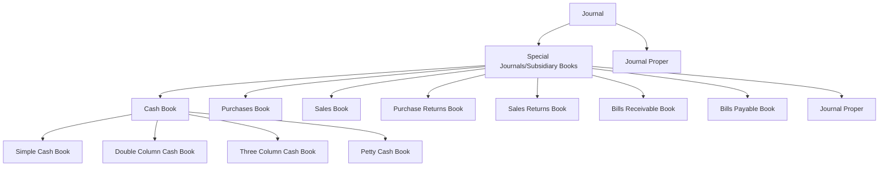

# UNIT 6: SUBSIDIARY BOOKS

**Block 2: Accounting Process** | **PYQ Priority: 🟡 MEDIUM** (3/10 papers - Cash Book, 1/10 - Purchase Book, 2/10 - Why Journal sub-divided)

---

## 6.1 INTRODUCTION

As business grows, recording all transactions in one Journal becomes **cumbersome**. Journal is **sub-divided** into **Special Journals (Subsidiary Books)** for similar transactions. This is called **Sub-division of Journal**.

---

## 6.2 NEED FOR SUB-DIVISION OF JOURNAL

| Reason | Explanation |
|--------|-------------|
| **Volume** | Large number of transactions - single journal unmanageable |
| **Division of Work** | Different clerks handle different books |
| **Specialization** | Expertise in specific transactions |
| **Quick Reference** | Easy to find specific transactions |
| **Internal Check** | Reduces errors and fraud |
| **Efficiency** | Faster recording and posting |

---

## 6.3 SPECIAL JOURNALS (SUBSIDIARY BOOKS)



### **Transactions Recorded in Each:**

| Subsidiary Book | Transactions Recorded |
|-----------------|----------------------|
| **Cash Book** | All cash and bank receipts/payments |
| **Purchases Book** | Credit purchases of goods only |
| **Sales Book** | Credit sales of goods only |
| **Purchase Returns Book** | Goods returned to suppliers |
| **Sales Returns Book** | Goods returned by customers |
| **Bills Receivable Book** | Bills received from debtors |
| **Bills Payable Book** | Bills accepted to creditors |
| **Journal Proper** | Opening/closing entries, rectification, adjustments, rare transactions |

---

## 6.4 PURCHASES BOOK (BOUGHT BOOK)

### **Purpose:** Record **credit purchases of goods** (not assets).

### **Format:**

```
PURCHASES BOOK
Date    Particulars    Invoice No.    L.F.    Details (₹)    Amount (₹)
2024
Jan 5   Ram & Co.      101            10      5,000          5,000
      Less: Trade Discount 10%                  (500)
      Add: CGST 9%                              405
      Add: SGST 9%                              405           5,310
Jan 12  Shyam Ltd.     205            12      10,000         10,000
      Less: Trade Discount 5%                 (500)
      Add: IGST 18%                           1,710          11,210
      ----                                    ----
      Total                                     16,520
```

### **Posting:**
- **Daily:** Individual supplier accounts **Credited** in Purchase Ledger
- **Periodically:** Total **Debited** to Purchases Account in General Ledger
- **Trade Discount** - Not recorded in books (deducted from invoice)
- **Cash Discount** - Recorded when payment made

---

## 6.5 SALES BOOK (SALES DAY BOOK)

### **Purpose:** Record **credit sales of goods** (not assets).

### **Format:** Similar to Purchases Book

### **Posting:**
- **Daily:** Individual customer accounts **Debited** in Sales Ledger
- **Periodically:** Total **Credited** to Sales Account in General Ledger

---

## 6.6 PURCHASE RETURNS BOOK (RETURNS OUTWARD BOOK)

### **Purpose:** Record **goods returned to suppliers**.

### **Document:** **Debit Note** sent to supplier.

### **Format:**

```
PURCHASE RETURNS BOOK
Date    Particulars    Debit Note No.    L.F.    Amount (₹)
2024
Jan 10  Ram & Co.      501               10      500
Jan 15  Shyam Ltd.     502               12      1,000
      ----                                    ----
      Total                                     1,500
```

### **Posting:**
- **Daily:** Supplier accounts **Debited**
- **Periodically:** Total **Credited** to Purchase Returns Account

---

## 6.7 SALES RETURNS BOOK (RETURNS INWARD BOOK)

### **Purpose:** Record **goods returned by customers**.

### **Document:** **Credit Note** sent to customer.

### **Posting:**
- **Daily:** Customer accounts **Credited**
- **Periodically:** Total **Debited** to Sales Returns Account

---

## 6.8 BILLS RECEIVABLE BOOK

### **Purpose:** Record **bills of exchange received** from debtors.

### **Posting:**
- **Daily:** Drawee (debtor) account **Credited**
- **Periodically:** Total **Debited** to Bills Receivable Account

---

## 6.9 BILLS PAYABLE BOOK

### **Purpose:** Record **bills of exchange accepted** to creditors.

### **Posting:**
- **Daily:** Drawer (creditor) account **Debited**
- **Periodically:** Total **Credited** to Bills Payable Account

---

## 6.10 JOURNAL PROPER

### **Transactions Recorded:**
1. **Opening Entry**
2. **Closing Entries**
3. **Rectification Entries**
4. **Adjustment Entries**
5. **Transfer Entries**
6. **Rare/Non-recurring transactions** (e.g., asset purchase on credit, end-of-period adjustments)

---

## 6.11 CASH BOOK 🔴 HIGH PRIORITY (3/10 papers - 20 marks practical)

Cash Book is **both a subsidiary book and a ledger** (Cash A/c and Bank A/c).

### **Types of Cash Book:**

| Type | Columns | Records |
|------|---------|---------|
| **Simple (Single Column)** | Cash only | Cash receipts/payments |
| **Double Column** | Cash + Discount | Cash + Discount allowed/received |
| **Three Column** | Cash + Bank + Discount | Cash, Bank, Discount |
| **Petty Cash Book** | Analytical columns | Small expenses |

---

## 6.12 SIMPLE CASH BOOK

### **Format:**

```
DR.                              SIMPLE CASH BOOK                              CR.
Date    Particulars    L.F.    Cash (₹)      Date    Particulars    L.F.    Cash (₹)
2024                                         2024
Jan 1   To Capital A/c         50,000       Jan 2   By Purchases A/c      10,000
Jan 5   To Sales A/c           5,000        Jan 3   By Rent A/c            2,000
      ----                   ----                       ----              ----
      Total                  55,000         Total                   12,000
      Balance c/d            43,000
      ----                   ----                       ----              ----
      Total                  55,000         Total                   55,000
Feb 1   To Balance b/d       43,000
```

### **Key Points:**
- **Only cash column** on both sides
- **Receipts on Dr. side** (To), **Payments on Cr. side** (By)
- **Balanced like ledger** - Balance c/d on credit side
- **Never shows credit balance** (cash cannot be negative)

---

## 6.13 DOUBLE COLUMN CASH BOOK (CASH + DISCOUNT)

### **Format:**

```
DR.                              DOUBLE COLUMN CASH BOOK                              CR.
Date    Particulars    L.F.    Discount (₹)    Cash (₹)      Date    Particulars    L.F.    Discount (₹)    Cash (₹)
2024                                                                                  2024
Jan 1   To Capital                50,000       Jan 2   By Purchases         200    10,000
Jan 5   To Ram (Sales)   100      4,900        Jan 3   By Rent                     2,000
Jan 10  To Shyam              50      9,950      Jan 7   By Wages                       1,500
      ----                  ----   ----                     ----      ----   ----
      Total                 150    64,850        Total                200    13,500
      Balance c/d                    51,350
      ----                  ----   ----                     ----      ----   ----
      Total                 150    64,850        Total                200    64,850
```

### **Discount Columns:**
- **Dr. Side (Discount Allowed)** - Given to customers for early payment
- **Cr. Side (Discount Received)** - Received from suppliers for early payment
- **Discount columns NOT balanced** - Totals transferred to Discount Allowed/Received Accounts

---

## 6.14 THREE COLUMN CASH BOOK (CASH + BANK + DISCOUNT) 🔴 MOST COMMON IN EXAMS

### **Format:**

```
DR.                              THREE COLUMN CASH BOOK                              CR.
Date    Particulars    L.F.    Discount (₹)    Cash (₹)    Bank (₹)      Date    Particulars    L.F.    Discount (₹)    Cash (₹)    Bank (₹)
2024                                                                                  2024
Jan 1   To Capital                50,000       Jan 2   By Purchases         200    10,000
Jan 5   To Ram (Sales)   100      4,900        Jan 3   By Rent                     2,000
Jan 7   To Bank (C)                     5,000       Jan 4   By Cash (C)                     5,000
Jan 10  To Shyam              50      9,950      Jan 7   By Wages                       1,500
      ----                  ----   ----    ----                     ----      ----   ----   ----
      Total                 150    14,850  55,000       Total                200    13,500   5,000
      Balance c/d                    51,350  50,000
      ----                  ----   ----    ----                     ----      ----   ----   ----
      Total                 150    66,200  55,000       Total                200    66,200  55,000
```

### **Contra Entries (Marked 'C'):**
- **Cash deposited into Bank:** Dr. Bank / Cr. Cash (Contra)
- **Cash withdrawn from Bank:** Dr. Cash / Cr. Bank (Contra)
- **Marked 'C' in L.F. column** - No separate ledger posting needed

### **Cheque Transactions:**
| Transaction | Entry |
|-------------|-------|
| Cheque received & deposited same day | Dr. Bank / Cr. Customer |
| Cheque received, deposited later | Dr. Cash / Cr. Customer (on receipt) → Dr. Bank / Cr. Cash (C) (on deposit) |
| Cheque issued | Dr. Creditor / Cr. Bank |
| Cheque dishonoured | Dr. Customer / Cr. Bank (reverse) |

---

## 6.15 PETTY CASH BOOK

### **Purpose:** Record **small, frequent expenses** (postage, stationery, conveyance, etc.)

### **Systems:**
1. **Ordinary System** - Fixed amount given, reimbursed when spent
2. **Imprest System** - Fixed amount (imprest), reimbursed to restore imprest (preferred)

### **Analytical Petty Cash Book Format:**

```
PETTY CASH BOOK (IMPREST SYSTEM)
Receipt    Date    Particulars    Voucher No.    Total (₹)    Postage    Stationery    Conveyance    Sundries    L.F.
Amt (₹)                                                                      (₹)          (₹)           (₹)           (₹)       
500        2024                                            
          Jan 1   To Cash A/c                500
          Jan 2   By Postage             1     50           50
          Jan 3   By Stationery          2     100                      100
          Jan 4   By Conveyance          3     30                                     30
          Jan 5   By Sundries            4     20                                                     20
          ----                                          200          50           100           30            20
          Jan 6   By Balance c/d                        300
          ----                                          500          50           100           30            20
          Jan 7   To Cash A/c (Reimburse)               200
          ----                                          500
```

### **Posting:**
- **Total of each expense column** → Debited to respective Expense Account
- **Total reimbursement** → Credited to Petty Cash Account

---

## 6.16 BANKING TRANSACTIONS IN CASH BOOK

### **Common Banking Transactions:**

| Transaction | Dr. Side Entry | Cr. Side Entry |
|-------------|----------------|----------------|
| **Cash deposited** | To Bank (C) | By Cash (C) |
| **Cash withdrawn** | To Cash (C) | By Bank (C) |
| **Cheque received & deposited** | To Bank | By Customer |
| **Cheque issued** | To Creditor | By Bank |
| **Bank charges** | -- | By Bank Charges |
| **Interest credited by bank** | To Bank Interest | -- |
| **Direct deposit by customer** | To Bank | By Customer |
| **Direct payment by bank** | -- | By Creditor/Expense |
| **Cheque dishonoured** | To Customer | By Bank |
| **Standing instructions** | -- | By Expense/Creditor |

---

## 6.17 IMPORTANT EXAM QUESTIONS (From PYQ Analysis)

### **2 Marks Questions:**
1. What is a Subsidiary Book?
2. Why is Journal sub-divided?
3. Name the special journals.
4. What is a Cash Book?
5. What is a Contra Entry?
6. What is Imprest System of Petty Cash?
7. What is a Debit Note?
8. What is a Credit Note?
9. Difference between Trade Discount and Cash Discount.

### **5 Marks Questions:**
1. Explain the need for sub-division of Journal.
2. Distinguish between Purchases Book and Sales Book.
3. Explain the Imprest System of Petty Cash Book.
3. What are Contra Entries? Give examples.
4. Explain the three-column Cash Book format.

### **10 Marks Questions:**
1. **Enter the following transactions in a Single/Double/Three Column Cash Book.** (June 2022, June 2024, June 2025 - 20 marks)
2. **Prepare Purchases Book from given transactions.** (Dec 2024 - 20 marks)
3. **Why is Journal sub-divided? Explain different types of journal books.** (June 2022, June 2026 - 5+15 / 5+5)

### **15+5 / 20 Marks Practical:**
- Cash Book problems (Single/Double/Three column) with 15-20 transactions
- Posting to Ledger from Cash Book
- Petty Cash Book (Analytical)
- Purchase/Sales/Returns Books

---

## 6.18 KEY POINTS FOR REVISION

- ✅ **8 Subsidiary Books:** Cash, Purchases, Sales, Purchase Returns, Sales Returns, Bills Receivable, Bills Payable, Journal Proper
- ✅ **Cash Book** = Subsidiary book + Ledger (Cash & Bank A/c)
- ✅ **Three Column Cash Book** = Cash + Bank + Discount columns (most common in exams)
- ✅ **Contra Entries** = Cash↔Bank transactions (marked 'C', no ledger posting)
- ✅ **Trade Discount** = Deducted from invoice, not recorded in books
- ✅ **Cash Discount** = Recorded in Discount columns of Cash Book
- ✅ **Debit Note** = For Purchase Returns (sent to supplier)
- ✅ **Credit Note** = For Sales Returns (sent to customer)
- ✅ **Imprest System** = Fixed float, reimbursed to restore float
- ✅ **Petty Cash Book** = Analytical columns for expense analysis
- ✅ **Cheque received** = Bank column if deposited same day, Cash column if later

---

## 6.19 CASH BOOK - TRANSACTION ANALYSIS QUICK REFERENCE

| Transaction | Dr. Side | Cr. Side | L.F. Mark |
|-------------|----------|----------|-----------|
| Cash Sales | Cash | Sales | -- |
| Credit Sales | -- | -- | -- (Journal Proper/Sales Book) |
| Cash Purchase | Purchases | Cash | -- |
| Credit Purchase | -- | -- | -- (Purchases Book) |
| Cash Received from Debtor | Cash | Debtor | -- |
| Cheque Received & Deposited | Bank | Debtor | -- |
| Cheque Received, Deposited Later | Cash | Debtor | -- (on receipt) |
|  | Bank | Cash | C (on deposit) |
| Cash Paid to Creditor | Creditor | Cash | -- |
| Cheque Issued | Creditor | Bank | -- |
| Cash Deposited in Bank | Bank (C) | Cash (C) | C |
| Cash Withdrawn from Bank | Cash (C) | Bank (C) | C |
| Bank Charges | -- | Bank Charges | -- |
| Bank Interest | Bank Interest | -- | -- |
| Discount Allowed | Discount Allowed | Debtor | -- |
| Discount Received | Creditor | Discount Received | -- |

---

*End of Unit 6 Notes*