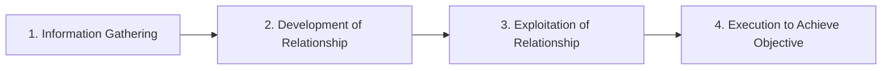
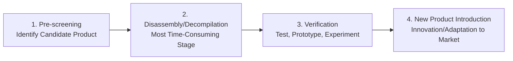

# MSEI-023 CYBER SECURITY - UNIT 1: INFORMATION GATHERING

**Block 1: Information Gathering (Units 1-4)**  
**Subject: MSEI-023 Cyber Security**  
**Programme: PGDIS/MSCIS (IGNOU)**

---

## UNIT OVERVIEW

This unit covers **Block 1** of the MSEI-023 syllabus comprising four textbook units:
1. **Unit 1: Social Engineering** (Highest Priority - 9 PYQ occurrences)
2. **Unit 2: E-mail Crime & Investigation** (High Priority - 5 PYQ occurrences)
3. **Unit 3: Reverse Engineering** (Medium Priority - 4 PYQ occurrences)
4. **Unit 4: Cracking Methodology** (Medium Priority - 2 PYQ occurrences)

**Exam Weightage**: Questions from this block appear consistently across all years. Social Engineering alone appeared in 9 out of 10 papers (1-mark to 10-mark questions).

---

## TOPIC 1: SOCIAL ENGINEERING

### 1.1 Introduction

Social Engineering is the art of manipulating human psychology to obtain confidential information, gain unauthorized access, or induce actions that compromise security. Unlike technical hacking that exploits software vulnerabilities, social engineering exploits **human vulnerabilities**—the "weakest link in the security chain."

> **Key Insight**: "Security is all about trust. The weakest link in the security chain is the natural human willingness to accept someone at his or her word."

### 1.2 Definition (Exam-Ready)

> **Social Engineering**: The act of manipulating a person to accomplish goals that may or may not be in the target's best interest. This includes obtaining information, gaining access, or getting the target to take certain action. It is a hacker's clever manipulation of the natural human tendency to trust. The hacker's goal is to obtain information that will allow him/her to gain unauthorized access to a valued system and the information that resides on that system.

### 1.3 Human Behaviours Vulnerable to Social Engineering (Textbook §1.2)

| Vulnerability | Description |
|--------------|-------------|
| **Desire to be helpful** | Most employees are desirous to be helpful to others and this can lead to giving away too much information which could be very unsafe to the company |
| **Tendency to trust people** | Human nature is to actually trust others until they prove that they are not trustworthy. If someone tells something to a certain person, we usually accept that statement which might be incorrect |
| **Fear of getting into trouble** | Most of us have seen negative situations in our life and want to get rid of such situations. This is a very common entry point for Social Engineers to say something which might take you towards negative and troublesome situation and fetch out details |
| **Careless nature** | Sometimes we get lazy or careless and post passwords on the screen in front of others or leave important material lying out, which ultimately helps the Social Engineer to access the information |

**Additional Psychological Triggers** (from textbook):
- Fear of job loss or personal embarrassment → release proprietary information
- Desire for prestige → induce bragging, resulting in information release
- Overworked and tired employees → make mistakes, predictable susceptibility (end of month/quarter/lunch hour)

### 1.4 Social Engineering Attack Cycle (⭐⭐⭐ HIGH PRIORITY - Asked 4 times as 5-mark question)

**Textbook Figure 1: Four-Phase Cycle**



#### Phase 1: Information Gathering (Reconnaissance)
- **Objective**: Gather required information of target's system
- **Techniques & Tools**: Ping Command, Email Bouncing Techniques, Netstat, Whois, Neo Trace Pro, http://visualroute.visualware.com, Nmap, Port Scan, Shadow Scan, Domain name lookup, NSlookup
- **Process**: Get IP address/DNS → Search location → Search way to enter website/destination
- **Examples**: Dumpster diving, shoulder surfing, memorizing access codes, OSINT

#### Phase 2: Development of Relationship
- **Objective**: Build trust and rapport with target
- **Human tendency**: "It's human nature to be somewhat trusting. Attackers exploit this tendency to develop a rapport with their targets."
- **Duration**: Single phone call to weeks or longer
- **Methods**: Impersonation (new employee, repair person, researcher), ingratiation, conformity, diffusion of responsibility, friendliness

#### Phase 3: Exploitation of Relationship
- **Objective**: Manipulate target into revealing information or performing actions
- **Examples**: Passwords, credit card numbers, vacation schedules, creating an account, reversing telephone charges
- **Outcome**: Can be end objective or used to stage next attack phase

#### Phase 4: Execution to Achieve Objective
- **Objective**: Execute cycle to achieve end-to-end objective
- **Combines**: Multiple attack cycles + traditional cracking methods + physical information gathering
- **Key Insight**: "A series of small, apparently unrelated successes can form the base of a more serious attack"

### 1.5 Adaptive Attacks - Overarching Methods (Textbook §1.3.3)

| Method | Description |
|--------|-------------|
| **Playing the authority** | With some knowledge, attackers impersonate authority figures and pressure or trick human targets |
| **Playing someone in need** | Humans have tendency to help others in need (e.g., users having difficulty accessing accounts). With research, attackers learn enough about real user (employee number, manager) to fool help desk |
| **Identity theft** | Rising problem. Criminals obtain enough information to "steal" identity, creating new bank/credit card accounts, accessing existing accounts |
| **Maintenance and support** | Easiest way to gain access - cleaning staff, temporary workers, phone repairmen, maintenance employees with full premises access |
| **Malicious software** | Viruses like "Melissa" or "ILOVEYOU" are social engineering attacks - users fooled by compelling email content/subject line/trusted origin |
| **Reverse social engineering** | Attacker creates problem, then presents as expert. Encourages employees to ask for solutions, revealing information |
| **Research** | In information age, little about ourselves/organizations that a good researcher can't find (personal driving/credit history, corporate financial reports, network topography) |

### 1.6 Types of Social Engineering (Textbook §1.4)

#### 1.6.1 Human-based Social Engineering (Direct person-to-person interaction)

| Technique | Description | Example |
|-----------|-------------|---------|
| **Posturing as Authentic End User** | Impersonate employee, use unusual methods to gain privileged data | "Hi! This is Anup from HR. I forgot my password. Can I get it please?" |
| **Posing as Important User** | Assume identity of important employee (Director, VP) to add extortion element | "Hi! This is Anup, CFO Secretary. Urgent project, lost system password. Help me out!" |
| **Posing as Technical Support** | Mask as hardware vendor/technician/computer-accessories supplier | Target non-tech-savvy users who won't question |
| **In Person** | Physically survey organization - courier, custodian, visitor, businessperson, client, technician | Look for passwords on terminals, papers on desks, overhear conversations |
| **Third-party Authorization** | Represent as agent authorized by authority figure to obtain information on their behalf | "Mr. Anup, Finance Manager, asked me to pick up audit reports" |
| **Tailgating** | Unauthorized person with fake ID badge follows authorized person through secured door | Authorized person unaware of providing access |
| **Piggybacking** | Authorized person keeps secured door open for unauthorized person | "I forgot my ID badge at home. Please help me..." |
| **Reverse Social Engineering** | Perpetrator assumes authority role; employees ask for information. Creates problem, then offers solution | Employee asks how problem affected files/servers → reveals info to social engineer |
| **Sabotage** | Corrupt workstation; users seek help when facing problems | |
| **Marketing** | Advertise via business cards/error messages to ensure user calls attacker | Contact number on error message |
| **Support** | Continue providing assistance so users remain ignorant of hacker's identity | |
| **Service Desk / Help Desk** | Target for social engineers - staff trained to help, may override security for "customer service" | Dilemma: enforce security vs appear unhelpful |
| **Waste Management Threats** | Business paper waste contains account numbers, user IDs, telephone lists, org charts. Electronic media (hard disks, CDs, DVDs) if not wiped/destroyed | ⭐⭐ PYQ: Jun 2021, Dec 2023 |
| **Personal Approaches** | Intimidation (impersonate authority), Persuasion (flattery/name-dropping), Ingratiation (long-term relationship building), Assistance (offer help to steal identity) | |
| **Virtual Approaches** | Email, pop-up windows, Trojan horse mail engines | |
| **Insider Attack** | 60% of organizational attacks by insiders - employees, contractors, job candidates placed by competitors | |

#### 1.6.2 Computer-based Social Engineering (Software-mediated)

| Technique | Description |
|-----------|-------------|
| **Pop-up Windows** | Window appears claiming lost network connection, needs username/password re-entry. Pre-installed program emails info to remote site. Spyware pretends to be antivirus |
| **Spam & Email Attachments** | Lottery scams, links to phishing sites, attachments with viruses/Trojans (e.g., "Anna Kournikova" worm - .vbs extension hidden by long filename) |
| **Chatting/Instant Messaging** | Informal communication; attacker lies about identity; uses display pictures as bait; elicits information through questions |
| **Malicious Websites** | Trick users to disclose sensitive data; ads for free gifts/holidays asking for email/password; users often reuse work passwords |
| **Private Branch Exchange (PBX)** | Phreaking - pretend to be telephone engineer requesting outside line/password to "analyze problems" on internal telephone system | 

### 1.7 Countermeasures & Defence Strategies (Textbook §1.5, §1.6, §1.7, §1.8)

#### 1.7.1 Designing Defences - Three Steps (Textbook §1.5)
1. **Develop Security Management Framework**: Define SE security goals, allocate named job roles (Security Sponsor, Security Manager, IT Security Officer, Facilities Security Officer, Security Awareness Officer)
2. **Undertake Risk Management Assessments**: Review each SE threat, rationalize danger level for organization
3. **Implement SE Defences in Security Policy**: Written policies/procedures for staff to manage potential SE attack situations

#### 1.7.2 Implementing Defences (Textbook §1.6)
| Defence | Description |
|---------|-------------|
| **Employee Education is the Key** | Awareness programs, real incident examples, training on required behaviour |
| **Defence-in-Depth Layered Model** | Multiple layers: Policies → Physical Security → Network Security → Host Security → Application Security → Data Security → User Education |

#### 1.7.3 Specific Countermeasures (Textbook §1.7)
| Category | Measures |
|----------|----------|
| **Training** | Regular awareness programs, simulated phishing tests, security awareness campaigns |
| **Password Policies** | Complex passwords, unique per account, regular rotation, no sharing, no writing down |
| **Operational Guidelines** | Verify identity before sharing info, escalation procedures, call-back verification |
| **Physical Security Policies** | Access controls, visitor logs, secure document disposal, media management (wiping/destruction) |
| **Classification of Information** | Label sensitive data, need-to-know access, document handling procedures |

#### 1.7.4 Policies and Procedures (Textbook §1.8)
| Component | Details |
|-----------|---------|
| **Security Policies - Checklist** | Acceptable use, password, email, internet, remote access, incident response, physical security |
| **Prevention Techniques for Personal Defence** | Never give info without authorization, report suspicious behavior, verify caller independently, use strong unique passwords, enable MFA |
| **Counter Measures for Organizations** | Background checks, security awareness training, incident reporting, access reviews, audit trails |

### 1.8 Impersonation & Identity Theft (Textbook §1.9) (⭐⭐⭐ HIGH PRIORITY - 5-mark Dec 21, Dec 23)

#### Impersonation on Social Platforms
| Platform | Method |
|----------|--------|
| **Orkut** | Create fake profiles using stolen photos/info; exploit trust in friend networks |
| **Facebook** | Clone profiles; send friend requests to victim's contacts; harvest personal data |
| **MySpace** | Similar profile cloning; exploit blog/messaging features for social engineering |

#### Identity Theft
- **Definition**: Criminals obtain enough personal information to "steal" identity, creating new bank/credit card accounts, accessing existing accounts
- **Information Used**: Social Security number, mother's maiden name, driver's license number, financial data, personal data
- **Countermeasures**: Monitor credit reports, shred documents, limit personal info sharing, use strong unique passwords, enable 2FA

### 1.9 Important Exam Questions

| Marks | Question | Frequency |
|-------|----------|-----------|
| 1-mark | Define Social Engineering | Dec 2021, Jun 2021 |
| 2-mark | Write notes on Phishing / Impersonation / Cracking / Email Spoofing / Social Networking Sites Security | Dec 2021 |
| 2-mark | Waste Management Threats | Jun 2021 |
| 5-mark | **Describe Social Engineering Attack Cycle** (4 phases) | Dec 21, Jun 21, Dec 22, Jun 24 ⭐⭐⭐ |
| 5-mark | Types of Reverse Engineering | Dec 21, Dec 23 |
| 5-mark | Phishing Attack | Jun 2023 |
| 5-mark | Phishing vs Spear Phishing with example | Jun 2026 |
| 5-mark | Impersonation notes | Dec 2023 |
| 5-mark | Waste Management Threats | Jun 2021, Dec 2023 |
| 5-mark | Email Location Tracking Process | Jun 2024 |
| 5-mark | Hybrid Crack notes | Jun 2024 |
| 10-mark | Types of Social Engineering with examples + Mitigation strategies | Dec 2025 ⭐⭐⭐ |

---

## TOPIC 2: E-MAIL CRIME & INVESTIGATION

### 2.1 Introduction

Email crime involves misuse of email systems for fraud, harassment, malware distribution, and unauthorized access. Investigation requires understanding email protocols, header analysis, and tracing tools.

### 2.2 Email System Architecture (Textbook §2.2)

```
Sender (MUA) → MSA (Submission Agent) → MTA (Mail Transfer Agent) → MDA (Mail Delivery Agent) → Recipient (MUA)
                    ↓
              SMTP (Port 25)
              DNS MX Lookup
```

**Protocols & Ports**:
- **SMTP** (Port 25): Sending emails - MUA submits to MSA, MSA delivers to MTA, MTA uses DNS MX lookup to deliver to MDA
- **POP3** (Port 110): Receiving emails (download & delete from server)
- **IMAP** (Port 143): Receiving emails (server-side storage, synchronization)

**Mail Flow** (Textbook):
1. User Mail User Agent (MUA) formats message, uses SMTP to send to local MTA (smtp.a.org, run by ISP)
2. MTA looks at destination address (bob@b.org), resolves domain via DNS to mail exchange server
3. Message delivered to recipient's mailbox

### 2.3 Email Header Analysis (⭐⭐ HIGH PRIORITY - Jun 2024 5-mark)

#### Key Header Fields (Textbook §2.5)
| Field | Purpose | Forensic Value |
|-------|---------|----------------|
| **Received** | Path of email through servers | **Most critical** - trace route, IP addresses |
| **Message-ID** | Unique identifier (server-name + unique string) | Detect forgery - mismatch indicates spoofing |
| **From/To/CC/BCC** | Sender/recipients | Often forged |
| **Subject** | Email topic | Social engineering indicators |
| **X-Originating-IP** (X-IP) | Sender's actual IP | Critical for webmail (Hotmail, Gmail) |
| **X-UIDL** | POP3 unique ID | Optional, spammers often include |
| **X-Mailer** | Client software used | Identify tools |
| **Date** | Timestamp with timezone | Geographical clues |

#### Reading Received Headers (Textbook §2.7)
- **Order**: Top to bottom = closest to receiver → closest to sender
- **Pattern**: `Received: from BBB (dns-name [ip-address]) by AAA`
- **Golden Rule**: **IP address in 'from' token is gold for tracking** — hostnames can be spoofed
- **Critical**: Do NOT trust 'by' token (last mail server could be spammer-controlled)
- **Example Analysis**:
  ```
  1: Received: from tesla623.onEmail.com.sg ([203.127.89.129]) by visualroute.com (8.11.6) id f9CIVSk24480
  3: Received: from drb.com (IIM1608 [203.127.89.138]) by tesla623.onEmail.com.sg with SMTP
  ```
  → Track IP trail: 203.127.89.129 → 203.127.89.138 (source)

#### Spam vs Legitimate Header Differences
| Indicator | Legitimate | Spam/Forged |
|-----------|------------|-------------|
| **X-Originating-IP** | Matches sender location | Different country/ISP |
| **Received chain** | Consistent routing | Gaps, private IPs (127.0.0.1, localhost) |
| **Message-ID domain** | Matches From domain | Mismatch (e.g., yahoo.com vs hotmail.com) |
| **X-IP tag** | Present and accurate | Missing or fake |

#### Leaked Sender Information
- **Windows Computer Name**: Sometimes leaked in `Received: from hostname (dns-name [ip])` - e.g., "hanksdell"
- **Timezone Information**: `+0800` = 8 hours east of GMT (Singapore), confirms location
- **X-Mailer**: Software used (e.g., "QUALCOMM Windows Eudora Pro Version 4.1")

### 2.4 Major Email Crimes (Textbook §2.11)

| Crime | Description |
|-------|-------------|
| **Email Spoofing** | Forging sender address; From field user-settable, may not reflect true sender |
| **Malicious Code** | Viruses, trojans, ransomware via attachments |
| **Email Bombing** | Flooding inbox with massive emails (⭐⭐ PYQ: Dec 2022) |
| **Threatening Emails** | Harassment, extortion |
| **Defamatory Emails** | Reputation damage |
| **Email Fraud** | Advance fee fraud, BEC (Business Email Compromise) |

### 2.5 Email Tracing Tools (⭐⭐ HIGH PRIORITY)

| Tool | Function (from textbook) |
|------|--------------------------|
| **E-MailTrackerPro** | Automatically analyzes email/headers; provides Identification Report (Host, Network Contact, Status, location); traces email address via email server |
| **ReadNotify** | Most powerful email tracking service; tracks when email read/reopened/forwarded; features: Certified email, Silent Tracking, Proof of Opening, Security/Timestamps, Location mapping, IP address, URL clicks, read duration, forward detection. Usage: add `.readnotify.com` to recipient email or use ActiveTracker plugin |
| **CallerIP** | Real-time monitoring of connections; detects spyware; worldwide WHOIS/network provider reports; Advanced Edition runs as server with automated alerts; plots connections on world map; gradient threat table; identifies country of origin |
| **SmartWhois** | Network info utility for IP/hostname/domain; country, state/province, city, network provider, admin/tech contacts; 100+ WHOIS databases; IDN support; IPv6; IE/Outlook integration; batch processing; caching; CommView integration |
| **VisualRoute** | Graphical traceroute; packet loss/latency per hop; IP location reporting on global map; WHOIS lookups; network provider reporting; OmniPath multiple path discovery; NetVu topology graph; application port testing; DNS performance testing; continuous connection testing; reverse traces; IPv6 compatibility |
| **McAfee NeoTrace Pro** | World's most popular Internet tracer; trace by email/IP/URL; map view with node details; IE integration; HackerWatch.org event reporting; mail server tracing; multiple save formats (JPG, PNG, BMP, HTML, RTF, text) |

### 2.6 Email Location Tracking (Textbook §2.8)

**ReadNotify Process**:
1. Add `.readnotify.com` to recipient email OR install ActiveTracker plugin
2. Send tracked email
3. Receive tracking report: Date/time opened, Location (ISP city/town), Map, Recipient IP, Apparent email, Referrer details, URL clicks, Read duration, Open count, Forward detection, Device/browser/OS info
4. SPF/Sender-ID compliant mail servers for safe transmission

**Example Output**:
```
Opened 21-Dec-10 at 20:38:14pm (UTC +05:30) 5mins23secs after sending
Location: Bangalore, Karnataka, India (86% likelihood)
Opened on: ABTS-KK-Dynamic-205.3, 167.122.airtelbroadband.in (122.167.205.6)
Browser: Mozilla/5.0 (Windows NT 6.0) AppleWebKit/534.10 Chrome/8.0.552.224 Safari/534.10
```

### 2.7 IP Address Tracing Tools (Textbook §2.9)

| Tool | Description |
|------|-------------|
| **CallerIP** | Standard: real-time monitoring, WHOIS, network provider reports. Advanced: server mode, automated alerts, world map plotting, gradient threat table, condensed dialog |
| **SmartWhois** | Right database selection from 100+ worldwide; IDN support; IPv6; IE/Outlook integration; archive building; batch processing; caching; CommView integration |
| **VisualRoute** | Graphical traceroute; packet loss/latency; IP location on global map; WHOIS/network provider; OmniPath multi-path; NetVu topology; port testing; continuous testing; reverse traces; IPv6 |
| **McAfee NeoTrace Pro** | Trace by email/IP/URL; map view with node registrant info; IE integration; HackerWatch reporting; mail server tracing; multiple save formats |

### 2.8 Securing Email Accounts (Textbook §2.10)

1. **Creating Strong Passwords** (Textbook §2.10.1):
   - 8+ chars, special chars (@#$%&), mixed case, no common words (123, password, birth date, login name, dictionary words)
   - **Technique**: Base phrase (unique to you, 8+ chars) → Substitution rules (a=@, s=$, space=%, o=0, i=!) → Append site name/URL → Test on Password Meter → Rotate positions periodically
   - Example: "Darnien Oh" → "D@rn!en%Oh" → "D@rn!en%OhGmail" or "GmailD@rn!en%Oh"

2. **Email Protector** (Textbook §2.10.2): Local SMTP server program bypassing ISP mail servers; breaks group emails into individual messages; no temporary files; connects via "localhost" SMTP

3. **SuperSecret** (Textbook §2.10.3): Encrypted password storage; single master password; multiple users; URL storage; random password generation; filtering by login/password/description; minimize to taskbar

4. **Additional Measures**:
   - Verification questions for password recovery
   - Secondary email for password reset instructions
   - Never check "Keep me signed in"

### 2.9 Important Exam Questions

| Marks | Question | Frequency |
|-------|----------|-----------|
| 1-mark | Email spoofing definition | Dec 2021, Jun 2021 |
| 2-mark | Email spoofing / Email bombing notes | Dec 2021, Jun 2021, Dec 2022 |
| 5-mark | **Email header analysis / Received tags function** | Jun 2024 |
| 5-mark | **Email location tracking process (ReadNotify)** | Jun 2024 |
| 5-mark | Major email crimes / Securing email accounts | Various |
| 5-mark | Different ways of tracing IP address (explain any one) | Jun 2024 |

---

## TOPIC 3: REVERSE ENGINEERING

### 3.1 Introduction

Reverse Engineering (RE) is the process of analyzing a technology to understand its design, operation, or functionality by decomposing it.

### 3.2 Definition (Textbook §3.2)

> **Reverse Engineering**: A process where a researcher gathers the technical data necessary for the documentation of the operation of a technology or component of a system. With this research method researchers are able to examine the strength of softwares, applications, systems etc. and identify their weaknesses in terms of performance, security, and interoperability.

**Three Views of RE Process** (Textbook §3.2):
1. Identify the system's components and their interrelationships
2. Create representations of the system in another form or higher level of abstraction
3. Create the physical representation of that system

### 3.3 Types of Reverse Engineering (Textbook §3.2)

| Type | Description | Legality |
|------|-------------|----------|
| **Software Reverse Engineering** | Converting machine code → source code (disassembly/decompilation). Retrieves source code, studies program operations, improves performance, fixes bugs without source, identifies malicious content, adapts for different microprocessors | Legal for interoperability, security research, lost source code; illegal for copying/duplicating (copyright violation); some licenses prohibit RE |
| **Hardware Reverse Engineering** | Physical disassembly of devices (PCBs, ICs). Determines components and interconnections. Requires stripping/peeling chips (chemical etching/grinding, photographing layers, voltage contrast electron microscopy). Often illegal (patent/trade secret violation), expensive, requires expertise | Generally illegal in many countries |

### 3.4 Need for Reverse Engineering (Textbook §3.3) (⭐⭐ PYQ: Importance/Need)

| Reason | Description |
|--------|-------------|
| **Interoperability** | Make technologies work together without standards; lack of standards forces RE for interoperability |
| **Lost Documentation** | Documentation lost/never written; designer unavailable; incorporate functionality into new tech |
| **Product Analysis** | Examine how product works, components, cost estimation, patent infringement identification |
| **Digital Update/Correction** | Update digital version (3D/CAD) to match "as-built" condition |
| **Security Auditing** | Determine vulnerabilities (e.g., Sedulity Solutions & Technologies security audits) |
| **Learning** | Learn from others' mistakes; don't repeat corrected errors |
| **Acquiring Sensitive Data** | Disassembling and analyzing system component design |
| **Military/Commercial Espionage** | Steal/capture prototype, dismantle to learn enemy/competitor research |
| **Copy Protection Removal** | Circumvent access restrictions, create unlicensed/unapproved duplicates |
| **Undocumented Functionality** | Determine if application contains undocumented features |
| **Compress Development Time** | Rapid Product Development (RPD) - capture 3D model, remodel, export for rapid prototyping/tooling/manufacturing |

### 3.5 Stages of Reverse Engineering Process (⭐⭐⭐ HIGH PRIORITY - 4 PYQ occurrences)

**Textbook §3.4: Four-Stage Process**



| Stage | Name | Description |
|-------|------|-------------|
| **1** | **Pre-screening** | Determine candidate product (singular items, parts, components, units, subassemblies, some containing many smaller parts) |
| **2** | **Disassembly/Decompilation** | **Most time-consuming aspect**. Construct system characterization by accumulating all technical data/instructions of how product works |
| **3** | **Verification** | Verify accuracy/validity by testing system, creating prototypes, experimenting with results |
| **4** | **New Product Introduction** | Introduce innovation/adaptation to marketplace; competitive designs/features/capabilities; adaptations for other platforms; different engineer groups per step to prevent copyright violation |

### 3.6 Disassembly vs Decompilation (Textbook §3.5)

| Aspect | Disassembly | Decompilation |
|--------|-------------|---------------|
| **Output** | Assembly language (text form of binary) | High-level language (C-like, compilable) |
| **Readability** | Low (hard to make sense of) | Higher (closer to original source) |
| **Tools** | Disassembler (IDA Pro, PE Explorer) | Decompiler (Boomerang, REC, Andromeda) |
| **Completeness** | Loses comments, variable names, specifications | Attempts to reconstruct logic, data structures, design rationale |
| **Process** | Reads binary code, displays executable instructions in text | Transforms input program repeatedly until high-level source code |

**Source Code vs Object Code** (Textbook):
- **Source Code**: Human-readable, written by programmers, translated by assembler/compiler
- **Object Code**: Numeric codes specifying computer instructions + memory locations; machine-executable
- **Translation**: Source → (Assembler/Compiler) → Object Code. Comments, notations, specifications LOST in translation.

**Black Box RE**: Characterizing software through observation of interactions (no decompilation needed)

### 3.7 Cracking Software Protection (Textbook §3.6)

- **Technique**: Modify application's binary to cause/prevent specific key branch in execution
- **Process**: Reverse engineer compiled code using debugger until reaching protection subroutine; OR disassemble executable
- **Modification**: Replace branching opcode with complement or NOP opcode → key branch always executes or skips
- **Protections**: Code obfuscation, encryption, self-modifying code (developers struggle to combat)
- **Examples**: Remove expiration from trial apps (patch .exe/.dll/.so); bypass hardware dongles; break copy protection for legally purchased software
- **Tools**: CloneCD (scan for SafeDisc, StarForce), Alcohol 120%, CloneDVD, Game Jackal, Daemon Tools

### 3.8 Reverse Engineering Tools (Textbook §3.7) (⭐⭐ MEDIUM PRIORITY)

| Tool | Category | Key Features (from textbook) |
|------|----------|------------------------------|
| **Resource Hacker** | Resource Editor | View/modify/add/rename/delete resources in Win32 exe/dll/cpl/ocx & .res files; extract to .res/binary/decompiled scripts/images; decompile icons, bitmaps, cursors, menus, dialogs, string tables, message tables, accelerators, Borland forms, version info; modify/replace resources; add new resources (multi-language, custom logos); delete unused resources; 32-bit .res support |
| **Hex Workshop** | Hex Editor | Binary editing, data interpretation/visualization; edit/cut/copy/paste/insert/fill/delete binary data; integrated structure viewer, smart bookmarks; jump to file/sector, find/replace, arithmetic/bitwise/logical ops, binary compare, checksums/digests, character distributions, export to RTF/HTML; Sector Editor with disk imaging; Base Converter; Hex Calculator; Expression Calculator; Data Visualizer; Data Inspector (decimal/float/date representations) |
| **IDA Pro** | Disassembler + Debugger | Multi-processor disassembler, local/remote debugger, plug-in programming environment; creates execution maps; assembly language; advanced techniques for readability; genomic virus classification; debugger bypasses obfuscation; local/remote (x86, ARM, Windows CE); virtual environment for malware analysis; macro language for automation; open plugin architecture |
| **PE Explorer** | PE Analyzer | Inspect 32-bit Windows PE files (EXE, DLL, OCX, SCR, CPL, SYS, MSSTYLES, BPL, DPL, Win Mobile); static analysis; PE header, resources; API Function Syntax Lookup, Dependency Scanner, Section Editor, UPX/UPack/NSPack Unpacker, Disassembler; view/edit EXE/DLL properties; correct/repair PE structures; safe mode for damaged/packed files; PE Header Viewer (file headers, data directories, section headers, export tables); Viewers (Headers, Data Directories, Sections, Export/Import/Delay Import, Function Syntax, Digital Signature, Dependency Scanner, Relocation, Debug Info, Resource); Editors (Resource, Manifest Wizard, Characteristics, Section, Syntax Description, Debug/Relocation Removal, Time Date Stamp Adjuster) |
| **Boomerang** | Decompiler | Open source, retargetable (x86-windows, sparc-solaris), modular, interactive; transforms input until high-level source; doesn't recreate original source; example: converts assembly to compilable C with stack→local variables, array detection, string handling |
| **REC Decompiler** | Decompiler | Command line: `rec [+option] exec_file`; Batch/Interactive/HTML modes; Interactive menu: regions, labels, branches, jump tables, strings, symbols, procedures, options, hex dump; Region/Label/Branch/Jump Table/String/Symbol/Procedure lists; Hex dump viewer |
| **Andromeda Decompiler** | Decompiler | Universal interactive RE environment; research/investigate binary modules at source level; partial/full restoration to recompilable forms; 32-bit Intel x86 frontend, C/C++ backend; interactive (user participates, hints for suspicious situations) |
| **Remotesoft .NET Explorer** | .NET Disassembler | Generic object browser + MSIL disassembler; ILDASM functionality + low-level metadata/PE viewing; decompiler/obfuscator console; source code editor with syntax coloring (IL, C#, C++, VB, ASP, Java, HTML, Fortran, PHP); .NET 2.0 support; VS.NET Addin; managed resources view; MSIL Linker; dependency walker; accurate disassembly (re-assemblable via ILASM) |
| **Spices .NET Decompiler** | .NET Decompiler | Decompile .NET assemblies to C#/VB.NET |

### 3.9 Important Exam Questions

| Marks | Question | Frequency |
|-------|----------|-----------|
| 5-mark | **Types of Reverse Engineering** (Software + Hardware) | Dec 2021, Dec 2023 ⭐⭐ |
| 5-mark | Stages of RE Process (4 stages, identify most time-consuming) | Dec 2023 |
| 5-mark | Tools & techniques | Various |
| 5-mark | Reverse Engineering + Social Engineering combined notes | Dec 2023 |
| 5-mark | Need/Importance of Reverse Engineering | Check Your Progress 1 |
| 5-mark | Cracking Software Protection / How developers struggle | Check Your Progress 3 |

---

## TOPIC 4: CRACKING METHODOLOGY

### 4.1 Introduction

Cracking methodology covers password security, cracking techniques, and password recovery mechanisms. Unit focuses on understanding passwords in Windows OS, addressing password myths, password theft techniques, and OS/application password recovery.

### 4.2 Password Cracking Techniques (Textbook §4.2)

| Technique | Description |
|-----------|-------------|
| **Dictionary Attack** | Uses wordlist of common passwords |
| **Brute Force** | Tries all possible combinations systematically |
| **Hybrid Crack** (⭐⭐ PYQ: Jun 2024) | Dictionary + variations (numbers, symbols, case changes) |
| **Rainbow Tables** | Precomputed hash tables for fast lookup |
| **Rule-based Attack** | Applies transformation rules to wordlist |

### 4.3 Password Theft Techniques (Textbook §4.3)

| Technique | Description |
|-----------|-------------|
| **Keyloggers** | Record keystrokes (hardware devices or software) |
| **Trojans** | Steal stored passwords from system |
| **Phishing** | Fake login pages to capture credentials |
| **Shoulder Surfing** | Physical observation of password entry |
| **Social Engineering** | Trick user into revealing password directly |
| **Dumpster Diving** | Find written passwords in trash |
| **Network Sniffing** | Capture unencrypted passwords on network |

### 4.4 Windows Password Storage & Recovery (⭐⭐ HIGH PRIORITY - Jun 2025 10-mark)

#### Password Storage in Windows (Textbook)
- **SAM File Location**: `%SystemRoot%\system32\config\SAM` (encrypted with SYSKEY)
- **Hash Types**:
  - **LM Hash** (Legacy, weak): Used in Windows NT/2000/XP; case-insensitive; 7-char chunks; easily cracked
  - **NTLM Hash** (Current): Used in Windows Vista/7/8/10/11; case-sensitive; stronger algorithm
- **Cached Credentials**: Stored for domain logins when offline (registry)
- **SYSKEY**: Additional encryption layer for SAM (Windows 2000+)

#### OS Password Recovery Methods (Textbook)
| Method | Description |
|--------|-------------|
| **Offline Tools** | Ophcrack (rainbow tables), Kon-Boot (bypass auth), PCUnlocker (reset SAM), Offline NT Password & Registry Editor |
| **Live CD/USB** | Boot alternate OS (Linux/WinPE) to access/reset SAM file |
| **Built-in Administrator** | Hidden admin account (if enabled) for password reset |
| **Sticky Keys / Utilman Exploit** | Replace sethc.exe/utilman.exe with cmd.exe at login screen |
| **Password Reset Disk** | Pre-created USB/floppy for local account recovery |

### 4.5 Password Myths (Textbook §4.5)

| Myth | Reality |
|------|---------|
| **"Complex passwords are uncrackable"** | False - **length matters more than complexity**; long passphrases > short complex passwords |
| **"Changing passwords frequently improves security"** | Often leads to weaker patterns (Password1, Password2...) or writing down |
| **"Writing passwords down is always bad"** | Better than reuse; use **password manager** (SuperSecret, KeePass, Bitwarden) |
| **"My password is strong enough"** | Many users reuse same simple password across Yahoo, Gmail, Facebook, corporate IDs |
| **"Only admins need strong passwords"** | All accounts are entry points; compromised low-privilege account → privilege escalation |

### 4.6 Important Exam Questions

| Marks | Question | Frequency |
|-------|----------|-----------|
| 2-mark | Cracking definition | Dec 2021 |
| 5-mark | **Hybrid Crack notes** | Jun 2024 ⭐⭐ |
| 5-mark | OS Password Recovery mechanism | Dec 2022 |
| 5-mark | Password theft techniques / Keyloggers | Various |
| 5-mark | Password myths | Textbook Check Your Progress |

---

## COMPARISON TABLES FOR QUICK REVISION

### Social Engineering vs Technical Hacking

| Aspect | Social Engineering | Technical Hacking |
|--------|-------------------|-------------------|
| **Target** | Human psychology | Software/hardware vulnerabilities |
| **Skill Required** | Psychological manipulation | Programming, networking, coding |
| **Time** | 24/7, patient (no time limits) | Limited by vulnerability window |
| **Detection** | Hard (no logs) | Easier (IDS, logs, SIEM) |
| **Countermeasure** | Education, policies, awareness | Patches, firewalls, secure code |
| **Success Rate** | High (exploits trust) | Variable (depends on vuln) |

### Phishing vs Spear Phishing

| Aspect | Phishing | Spear Phishing |
|--------|----------|----------------|
| **Target** | Mass, random | Specific individual/org |
| **Personalization** | Generic ("Dear Customer") | Highly customized ("Dear John, Project X") |
| **Success Rate** | Low | High |
| **Research Required** | Minimal | Extensive (OSINT, social media) |
| **Example** | "Your account will be closed" | "Hi John, attached is Q3 budget for Project Alpha" |

### Human-based vs Computer-based Social Engineering

| Aspect | Human-based | Computer-based |
|--------|-------------|----------------|
| **Medium** | Direct person-to-person | Software/Internet systems |
| **Examples** | Impersonation, tailgating, dumpster diving, service desk | Pop-ups, spam email, chat, malicious websites |
| **Skill** | Social skills, acting | Technical, programming |
| **Detection** | Very hard | Moderate (AV, spam filters) |

### Email Header Forensic Indicators

| Indicator | Legitimate | Suspicious |
|-----------|------------|------------|
| **Received IPs** | Consistent geographic path | Jumps across countries |
| **X-Originating-IP** | Present, matches sender | Missing or mismatched |
| **Message-ID Domain** | Matches From domain | Different domain |
| **Authentication** | SPF/DKIM/DMARC pass | Fail or absent |
| **Received chain** | No gaps, no private IPs | 127.0.0.1, localhost gaps |

### Disassembly vs Decompilation

| Aspect | Disassembly | Decompilation |
|--------|-------------|---------------|
| **Output** | Assembly language | High-level (C-like) |
| **Tools** | IDA Pro, PE Explorer | Boomerang, REC, Andromeda |
| **Readability** | Low | Higher |
| **Variable Names** | Lost | Reconstructed (generic) |
| **Comments** | Lost | Not recovered |
| **Control Flow** | Explicit jumps/branches | Structured (if/while/for) |

### Windows Password Hashes

| Hash Type | Algorithm | Used In | Strength | Vulnerability |
|-----------|-----------|---------|----------|---------------|
| **LM** | DES-based, 7-char chunks | NT/2000/XP | Very Weak | Case-insensitive, no salt, rainbow tables |
| **NTLM** | MD4 (Unicode) | Vista/7/8/10/11 | Moderate | No salt, fast GPU cracking |
| **NTLMv2** | HMAC-MD5 | Domain auth | Stronger | Challenge-response, but relay attacks |

---

## SUMMARY OF HIGH-YIELD TOPICS FOR UNIT 1

| Priority | Topic | Must-Know For Exam |
|----------|-------|-------------------|
| 🔴 **Critical** | **Social Engineering Attack Cycle** | **4 phases** (not 5!), diagram, each phase detail, tools for Info Gathering |
| 🔴 **Critical** | **Adaptive Attack Methods** | 7 methods: Authority, Need, Identity Theft, Maintenance, Malware, Reverse SE, Research |
| 🔴 **Critical** | **Types of Social Engineering** | **Human-based** (17 techniques) & **Computer-based** (5 techniques) with examples |
| 🔴 **Critical** | **Phishing & Variants** | Definitions, examples, spear vs regular vs whaling vs vishing vs smishing |
| 🔴 **Critical** | **Email Header Analysis** | Received tags (IP trail), Message-ID, X-Originating-IP, Spam vs Legitimate |
| 🔴 **Critical** | **Email Tracing Tools** | 6 tools (E-MailTrackerPro, ReadNotify, CallerIP, SmartWhois, VisualRoute, NeoTrace) |
| 🟠 **High** | **Impersonation & Identity Theft** | Platforms (Orkut, Facebook, MySpace), countermeasures |
| 🟠 **High** | **Countermeasures Framework** | 3-step design, Defence-in-Depth, 5 countermeasure categories, Policies checklist |
| 🟠 **High** | **Reverse Engineering Stages** | **4 stages**, Stage 2 (Disassembly) = most time-consuming |
| 🟠 **High** | **RE Tools** | IDA Pro, PE Explorer, Boomerang, REC, Andromeda, Remotesoft, Spices, Resource Hacker, Hex Workshop |
| 🟠 **High** | **Waste Management Threats** | Paper waste (account numbers, org charts), Electronic media (disks, CDs, DVDs) - ⭐ PYQ |
| 🟡 **Medium** | **Password Cracking Types** | Dictionary, Brute, Hybrid, Rainbow, Rule-based |
| 🟡 **Medium** | **Windows Password Storage** | SAM file, SYSKEY, LM vs NTLM, Cached Credentials |
| 🟡 **Medium** | **OS Password Recovery** | Offline tools, Live CD, Built-in Admin, Sticky Keys exploit |
| 🟢 **Overview** | **Email Protocols** | SMTP/POP3/IMAP ports, MUA/MTA/MDA/ MSAs roles |
| 🟢 **Overview** | **Cracking Software Protection** | Binary modification, NOP/JMP, debugger, hex editor, protections |

---

## PRACTICE QUESTIONS

### 2-Mark Questions
1. Define Social Engineering. What is its primary goal?
2. Differentiate between phishing and spear phishing.
3. What is the function of Received tags in email headers?
4. List four tools used for email tracing.
5. What is a hybrid password crack?
6. Define Reverse Engineering. Name its two types.
7. What are Waste Management Threats in Social Engineering?
8. Explain the concept of Reverse Social Engineering.

### 5-Mark Questions
1. **Describe the Social Engineering Attack Cycle with diagram (4 phases).**
2. Explain the seven Adaptive Attack methods used in Social Engineering.
3. Describe types of Human-based Social Engineering with examples.
4. Explain email header analysis for tracking sender IP address (Received tags, X-Originating-IP).
5. Describe the process of email location tracking using ReadNotify.
6. **Describe types of Reverse Engineering (Software + Hardware) with examples.**
7. Explain the four stages of Reverse Engineering process. Which is most time-consuming?
8. Discuss countermeasures against social engineering at organizational level (3-step framework).
9. Explain Hybrid Crack technique for password cracking.
10. Describe Windows password storage (SAM, LM/NTLM, SYSKEY) and recovery methods.

### 10-Mark Questions
1. **Explain types of Social Engineering attacks (Human-based & Computer-based) with examples. Discuss mitigation strategies for individuals and organizations.** (Dec 2025)
2. Describe major email crimes and investigation techniques. Include header analysis, tracing tools, and IP tracing methods.
3. Explain the Reverse Engineering process stages. Detail the tools used for software and hardware RE. Include disassembly vs decompilation comparison.
4. **Explain Social Engineering Attack Cycle, Adaptive Attacks, and Countermeasures in detail.**
5. Describe Email Crime Investigation process: Header analysis → Tracing tools → IP tracing → Securing accounts.

---

*End of Unit 1 Notes*  
*Next: Unit 2 - Database Security (Block 2)*