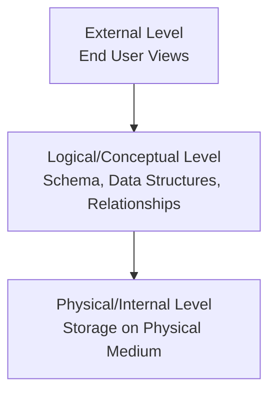
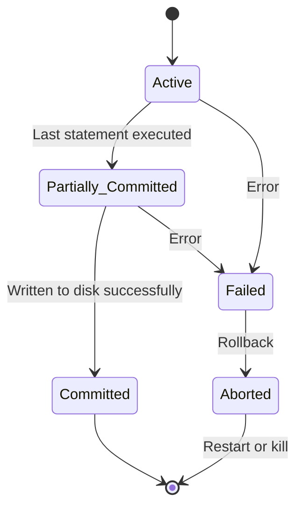
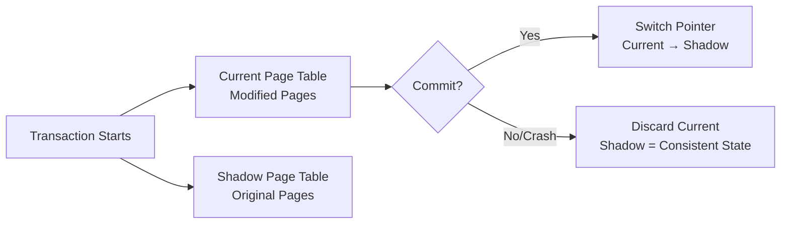

# MSEI-023 CYBER SECURITY - UNIT 2: DATABASE SECURITY

**Block 2: Database Security (Units 1-4)**  
**Subject: MSEI-023 Cyber Security**  
**Programme: PGDIS/MSCIS (IGNOU)**

---

## UNIT OVERVIEW

This unit covers **Block 2** of the MSEI-023 syllabus comprising four textbook units:
1. **Unit 1: Introduction to Database Concepts** (High Priority - ER Model 5 occurrences)
2. **Unit 2: Hands-on Database Usage & Hacking Attempt** (High Priority - SQL Injection 6 occurrences)
3. **Unit 3: Database Security - I (Distributed Databases)** (Medium Priority - 2-3 occurrences)
4. **Unit 4: Database Security - II (Concurrency, ACID, Recovery)** (High Priority - 6 occurrences)

**Exam Weightage**: Database topics are consistently tested. SQL Injection (4 exact repeats), ER Model (4 exact repeats), Concurrency Control (2 exact 10-mark repeats), Shadow Paging (2 exact 10-mark repeats).

---

## TOPIC 1: DATABASE CONCEPTS & ER MODEL

### 1.1 Introduction (Textbook §1.0)

A **Database** is a structured collection of related data. It contains information about an enterprise useful for decision-making. Examples: telephone directories, catalogues, forms. A computerized database is a repository of data stored electronically, available to many users for different purposes.

A **Database Management System (DBMS)** is a software suite responsible for organization of database on the computer. One of the most powerful types is the 'relational' model - programs using this are Relational Database Management Systems (RDBMS).

### 1.2 Advantages of Database Systems (Textbook §1.2)

| Advantage | Description (from textbook) |
|-----------|----------------------------|
| **Reduces Data Redundancy** | Centralized/distributed storage eliminates duplication; latest copy accessed by multiple users (e.g., Institute Management System - admission, library, teachers all see same student data) |
| **Controls Data Inconsistency** | Since all departments have latest copy, no inconsistency exists |
| **Data Sharing** | Facilitates sharing among several users |
| **Data Security** | Protection from accidental loss, unauthorized access, access only through username/password |
| **Data Integrity** | Maintains correct data and associations; constraints ensure data values conform to specified rules |
| **Enforces Standards** | Ensures data follows organizational standards; helps data migration/interchange between platforms |

### 1.3 Traditional File-Oriented Approach vs DBMS (Textbook §1.3)

| Aspect | File-Oriented | DBMS |
|--------|--------------|------|
| **Data Redundancy** | High - data stored in multiple copies per module | Low - centralized/distributed storage |
| **Program-Data Coupling** | Tight - programs and files dependent on each other | Loose - Data Independence |
| **Flexibility** | Poor - change in master file requires program changes | High |
| **Concurrent Access** | Problematic | Managed |
| **Integrity Enforcement** | Through programming code only | Database constraints (CHECK, etc.) |
| **Transactions** | Not supported (Insert/Update/Delete not direct) | ACID compliant |

**Disadvantages of Traditional Approach** (Textbook):
- High data redundancy
- Any field change in master file requires program changes
- Lack of flexibility (tight coupling)
- Concurrent users cause problems
- Data integrity only through programming code
- No direct Insert/Update/Delete transactions

### 1.4 Database Abstraction / Three-Level Architecture (Textbook §1.4)



| Level | Description (Textbook) | Audience |
|-------|------------------------|----------|
| **External** | Way data is viewed by end users | End Users |
| **Logical/Conceptual** | What data is stored; data structures, relations, associations | System Analysts |
| **Physical** | Lowest level; storage on physical medium | System Analysts (storage factors) |

### 1.5 Relational Database Management System (RDBMS) (Textbook §1.5)

**RDBMS**: Data represented as tables (relations) with rows (tuples) and columns (attributes). Based on E.F. Codd's relational model (IBM). Most databases (Oracle, SQL) use this model.

#### Key Terminologies (Textbook §1.5.1)

| Term | Definition (Textbook) |
|------|----------------------|
| **Relation** | Table with rows and columns; values in each column similar and atomic (indivisible); each row distinct |
| **Domain** | Set of values from which column values are drawn (e.g., salary=numerical, name=alphabetic, employee number=odd values 1-100) |
| **Tuple** | Row of table; horizontal collection of all data values of the relation |
| **Attribute** | Column of table; also called field |
| **Degree** | Total number of attributes (columns) of the table |
| **Cardinality** | Total number of tuples (rows) in the table |

**Example from Textbook (STUDENT Table)**:
| STUDENT NO. | NAME | PHYSICS | CHEMISTRY | BIOLOGY | MATHS | ENGLISH |
|-------------|------|---------|-----------|---------|-------|---------|
| IAM-1112-0001 | TANYA SINHA | 50 | 67 | 76 | 80 | 67 |
| IAM-1112-0002 | GAUTAM SHARMA | 30 | 45 | 72 | 86 | 78 |
| ... | ... | ... | ... | ... | ... | ... |

- Degree = 7 attributes, Cardinality = 10 tuples (rows)

### 1.6 Keys in RDBMS (Textbook §1.5.2) (⭐⭐⭐ HIGH PRIORITY)

| Key Type | Definition (Textbook) | Example |
|----------|----------------------|---------|
| **Primary Key** | Attribute(s) that uniquely distinguishes each row; no two values same; each relation must have one | `Supplier#` in Supplier table, `Buyer#` in Buyer table |
| **Foreign Key** | Non-key attribute whose value derived from PK of another table; relates two+ tables | `Supplier#` is FK in Buyer table, PK in Supplier table |
| **Candidate Key** | Attribute(s) that can serve as primary key | Alternate key = candidate key not serving as PK |
| **Alternate Key** | Candidate key not chosen as Primary Key | |

**Referential Integrity** (Textbook §1.5.3):
Rules to ensure relationships between records of related tables; prevents accidental manipulation/deletion:
1. No FK value in primary table if corresponding value doesn't exist in PK of foreign table (NULL allowed for no relation)
2. No record deletion from primary table if related record exists in related table
3. No change in PK field in primary table if related records exist

### 1.7 Relational Algebra Operations (Textbook §1.6) (⭐⭐ MEDIUM PRIORITY)

Operations performed on relations (operands). Each requires operand(s).

| Operation | Symbol | Description (Textbook) | Example |
|-----------|--------|------------------------|---------|
| **Select (σ)** | σ | Selects rows/tuples/records based on condition | σ_sal>3000(EMP) → selects only King (sal=5000) |
| **Project (π)** | π | Selects columns/attributes from relation | π_empno,ename,sal(EMP) → outputs 3 columns for all rows |
| **Cartesian Product (×)** | × | Binary op; combines all rows of two relations | Supplier × Buyer → each supplier row paired with each buyer row |
| **Union (∪)** | ∪ | Binary; combines records from both relations (union-compatible: same degree, same domains) | Travel_Europe ∪ Travel_Asia |
| **Set Difference (−)** | − | Tuples in first but not second | Travel_Europe − Travel_Asia |
| **Intersection (∩)** | ∩ | Tuples common to both relations | Travel_Europe ∩ Travel_Asia |
| **Join (⋈)** | ⋈ | Joins two+ relations on common column; equijoin = equality condition; natural join = remove duplicate column | EMP ⋈ DEPT on DEPTNO |

### 1.8 Entity-Relationship (ER) Model (Textbook §1.7) (⭐⭐⭐ HIGHEST PRIORITY - 5 PYQ, 4 exact 5-mark repeats)

**Definition**: High-level conceptual model based on real-world entities and relationships. By P.P. Chen. Circulates around entities, properties, relationships.

#### ER Model Components (Textbook)

| Component | Symbol | Description |
|-----------|--------|-------------|
| **Entity** | Rectangle | Real-world object with name and properties (e.g., STUDENT, BOOK) |
| **Entity Set/Type** | — | Set of similar entities with common properties |
| **Entity Instance** | — | An instance of the entity type |
| **Weak/Dependent Entity** | Double Rectangle | Depends on another entity for existence |
| **Strong/Independent Entity** | Rectangle | Doesn't depend on any entity |
| **Relationship** | Diamond | Association between entities (e.g., Student—Enrolls—Book) |
| **Attribute** | Oval | Property of entity (Roll No, Name, Address, Marks) |
| **Key Attribute** | Underlined Oval | Primary key field |

#### Relationship Types (Textbook)

| Type | Notation | Description |
|------|----------|-------------|
| **One-to-One (1:1)** | `1——1` | One entity X with one entity Y (Student ↔ Programme) |
| **One-to-Many (1:N)** | `1——<` | Entity X with min 1, max many entity Y (Student ——< Book) |
| **Many-to-Many (M:N)** | `>——<` | Many-to-many between X and Y (Student >——< Hobby_Classes) |

#### Example ER Diagram (Student-Course)
```
STUDENT (Entity)
├── Roll_No (Key Attribute)
├── Name (Attribute)
├── Address (Attribute)
└── Marks (Attribute)

COURSE (Entity)
├── Course_ID (Key Attribute)
├── Title (Attribute)
└── Credits (Attribute)

STUDENT ——< ENROLLS >—— COURSE (1:N from Student, 1:N from Course = M:N resolved via ENROLLS)
```

### 1.9 Important Exam Questions

| Marks | Question | Frequency |
|-------|----------|-----------|
| 1-mark | Primary Key / Rows=Tuples definition | Dec 2021, Jun 2021 |
| 2-mark | Clustering vs Mirroring / Data Fragmentation | Jun 2021 |
| 5-mark | **Explain ER Model with example** | Jun 21, Dec 22, Jun 23, Jun 24 ⭐⭐⭐⭐⭐ |
| 5-mark | Advantages of Database Approach (6 advantages) | Dec 2023 |
| 5-mark | Data Dictionary notes | Jun 2021, Dec 2023 |
| 5-mark | Relational Algebra operations (any 4) | Various |
| 5-mark | Cluster Table notes | Jun 2023 |
| 5-mark | Define: Primary Key, Foreign Key, Alternate Key, Candidate Key, Referential Integrity | Check Your Progress |

---

## TOPIC 2: ORACLE ARCHITECTURE & SQL (⭐⭐⭐ HIGH PRIORITY - SQL Injection)

### 2.1 Oracle Architecture (Textbook §2.2)

```
Oracle Server = Oracle Database (Physical Storage) + Oracle Instance (Memory + Processes)
```

**Oracle Instance Components** (Textbook Fig. 1):
- **SGA (System Global Area)**: Shared memory
- **Background Processes**: DBWR (Database Writer), LGWR (Log Writer), SMON (System Monitor), PMON (Process Monitor), CKPT (Checkpoint), RECO (Recoverer)

**Database Files**: Data files, Control files, Redo log files

### 2.2 SQL*Plus - Command Line Interface (Textbook §2.2.1)
- Start: `Start → Programs → Oracle → SQL*Plus`
- Login: `username/password@database`
- Commands end with `;`
- `DESC tablename` or `DESCRIBE tablename` to view structure

### 2.3 SQL Command Categories (Textbook §2.2.3)

| Category | Commands | Purpose |
|----------|----------|---------|
| **DDL** (Data Definition) | CREATE, ALTER, DROP, TRUNCATE, GRANT, REVOKE | Schema objects, privileges |
| **DML** (Data Manipulation) | INSERT, UPDATE, DELETE, SELECT | Data operations |
| **TCL** (Transaction Control) | COMMIT, ROLLBACK, SAVEPOINT | Transactions |

### 2.4 Important SQL Concepts (Textbook §2.2-2.5)

#### Data Dictionary (Textbook §2.2.2)
- **Definition**: Repository of data about data (metadata)
- **Upon object creation**: Details stored in Data Dictionary
- **Views**: USER_*, ALL_*, DBA_* (e.g., USER_TABLES, ALL_TAB_COLUMNS)
- **Purpose**: Inside view of Oracle DB; objects, logical structure, relationships

#### Database Objects (Textbook §2.2.2)
| Object | Description |
|--------|-------------|
| **Relation** | Table storing data in rows/columns |
| **Views** | Virtual table selecting from base tables |
| **Stored Procedures/Functions** | Compiled procedures/functions in DB |
| **Synonyms** | Alternate names for DB objects |
| **Indexes** | Track rows/columns for faster access |

#### Constraints for Data Integrity (Textbook §2.5.1)
| Constraint | Syntax Example |
|------------|----------------|
| **PRIMARY KEY** | `ROLL_NO NUMBER(3) PRIMARY KEY` |
| **DEFAULT** | `GRADE CHAR(2) DEFAULT 'E'` |
| **CHECK** | Validates values entered |
| **FOREIGN KEY** | Checks relationships between tables |

#### DDL Commands (Textbook §2.5.2)
```sql
-- Create Table
CREATE TABLE STUDENT (
    ROLL_NO NUMBER(3),
    NAME VARCHAR2(20),
    MARKS NUMBER(5,2),
    GRADE CHAR(1)
);

-- Alter Table
ALTER TABLE TABLENAME ADD/MODIFY (COLUMNNAME DATATYPE(SIZE) CONSTRAINT);

-- Delete Table
DROP TABLE TABLENAME;
```

#### DML Commands (Textbook §2.6)
```sql
-- Insert
INSERT INTO TABLENAME VALUES (VALUE1, VALUE2, ...);
INSERT INTO TABLENAME VALUES (&VALUE1, VALUE2, ...);  -- runtime input
INSERT INTO TABLENAME1 SELECT * FROM TABLENAME2 WHERE CONDITION;

-- Update
UPDATE TABLE TABLENAME SET COLUMNNAME = VALUE WHERE CONDITION;

-- Delete
DELETE FROM TABLENAME WHERE CONDITION;
```

#### SQL Functions (Textbook §2.4)
| Category | Functions |
|----------|-----------|
| **Character** | LOWER, UPPER, CONCAT, INITCAP, LPAD, RPAD, SUBSTR, INSTR, LTRIM, RTRIM, LENGTH |
| **Numeric** | MOD, SIGN, POWER, SQRT, ROUND |
| **Aggregate** | AVG, COUNT, MAX, MIN, SUM |
| **Date** | SYSDATE, MONTHS_BETWEEN, ADD_MONTHS, NEXT_DAY, LAST_DAY |

#### Oracle Datatypes (Textbook §2.2.5)
| Datatype | Description |
|----------|-------------|
| CHAR(SIZE) | Fixed length character string |
| VARCHAR2(SIZE) | Variable length character string (max size) |
| NUMBER(P,S) | Numeric, precision 1-38, scale -84 to 127 |
| DATE | Valid date in DD-MON-YYYY |
| LONG | Variable length character data up to few GB |
| RAW(SIZE) | Binary data of length SIZE bytes |
| LONG RAW | Variable length binary data up to few GB |

### 2.5 Database Hacking & Vulnerabilities (Textbook §2.7)

**Security Risks** (Textbook):
- 80% breaches involve insiders/employees
- DBA has unrestricted access - risk of misuse
- Role-based security doesn't meet "need-to-know" principle

**Multi-Factored Prevention Model** (Defense-in-Depth):
1. **Realms**: Protection zones for database objects/applications
2. **Rules**: Context-based restrictions (auth models, time-of-day, IP address)
3. **Policies**: Separation of data management & security admin
4. **Roles**: Least privilege access

**Common Vulnerabilities** (Textbook §2.7):
- SQL Injection (input validation error)
- Buffer Overflow (stack smashing)
- Symlink Races
- Directory Traversal
- Session Hijacking
- Remote Code Execution

**Vulnerability Disclosure**:
- **Full Disclosure**: Public release after discovery
- **Responsible Disclosure**: Vendor notified first, patch then public
- **Tools**: Scanners (Nessus, OpenVAS) + human analysis

### 2.6 SQL Injection (⭐⭐⭐ HIGHEST PRIORITY - 6 PYQ, 4 exact 5-mark repeats)

#### Definition
> **SQL Injection**: Attack where malicious SQL code is inserted into input fields to manipulate database queries, bypass authentication, extract/modify/delete data.

#### Classic Example (LOGIN BYPASS) - From PYQ Analysis

**Vulnerable Code**:
```java
String query = "SELECT * FROM users WHERE username = '" + input + "' AND password = '" + pass + "'";
```

**Attack Input**: `' OR '1'='1' --`

**Resulting Query**:
```sql
SELECT * FROM users WHERE username = '' OR '1'='1' --' AND password = 'pass'
```
→ Always true, logs in as first user!

**Second Example (Data Deletion)**:
```sql
Input: name'; DELETE FROM items; --
Query: SELECT * FROM items WHERE owner = 'wiley' AND itemname = 'name'; DELETE FROM items; --'
```

#### SQL Injection Types

| Type | Description | Example |
|------|-------------|---------|
| **In-band (Classic)** | Results visible in same channel | Error-based, UNION-based |
| **Blind (Inferential)** | No direct output; infer from behavior | Boolean-based, Time-based |
| **Out-of-band** | Data exfiltrated via different channel | DNS, HTTP requests |

#### Prevention Techniques (⭐⭐⭐ CRITICAL FOR EXAM)

| Technique | Effectiveness | Why |
|-----------|---------------|-----|
| **Parameterized Queries / Prepared Statements** | ✅ Best | Separates code from data; query plan fixed before input bound |
| **Stored Procedures** | ✅ Good | If parameterized (not dynamic SQL) |
| **ORM (Object-Relational Mapping)** | ✅ Good | Auto-parameterizes |
| **Input Validation (Whitelist)** | ⚠️ Supplementary | Only allow known good patterns |
| **Least Privilege DB Accounts** | ✅ Defense in depth | Limits damage |
| **Web Application Firewall (WAF)** | ⚠️ Partial | Signature-based, bypassable |
| **Escaping (Blacklist)** | ❌ Ineffective | Loopholes (unquoted fields, stored procedures, meta-characters) |

**Why Parameterized Queries Work**: Input treated as literal data, never as executable code. The query plan is fixed before input is bound.

### 2.7 Important Exam Questions

| Marks | Question | Frequency |
|-------|----------|-----------|
| 1-mark | Data Dictionary definition | Jun 2021 |
| 5-mark | **SQL Injection with example** | Dec 21, Jun 23, Dec 23, Jun 24 ⭐⭐⭐⭐⭐ |
| 5-mark | Oracle Architecture | Various |
| 5-mark | DDL vs DML | Various |
| 5-mark | Data Fragmentation / Clustering vs Mirroring | Jun 21, Dec 22, Dec 23 |
| 5-mark | SQL*PLUS Shell steps | Various |
| 10-mark | Hacking attempts on databases / Multi-factored prevention | Various |

---

## TOPIC 3: DISTRIBUTED DATABASES (Textbook Unit 3) (⭐⭐ MEDIUM PRIORITY)

### 3.1 Definition (Textbook §3.0)

> **Distributed Database**: Databases located at different machines at same/different locations that looks like one centralized database to end user. Set of server machines working in synchronization. No shared memory or clock. Processors vary from microcomputers to mainframes.

### 3.2 Why Distributed Databases? (Textbook §3.0)
- Geographically separated branches
- Centralized DB causes: slow accessibility, session timeout, inefficiency, no load sharing

### 3.3 Distributed Database Design (Textbook §3.2)
Sites connected via topologies: Bus, Star, Tree, Ring, Mesh
**Design Factors**: Low installation cost, low communication cost, high reliability, high availability, high fault tolerance

### 3.4 Advantages of Distributed Databases (Textbook §3.3)

| Advantage | Description |
|-----------|-------------|
| **Performance** | Load distributed; local queries resolved locally; reduced query processing time |
| **Sharing** | Data at multiple sites shared by users at different sites |
| **Robustness** | Multiple servers; failure of one ≠ system failure |
| **Availability** | Data replicated at multiple sites; alternate server access |
| **Multiple Query Evaluation** | Simultaneous evaluation → high performance |
| **Ease of Growth** | Add clients easily; no overloading |
| **Transparency** | Management with different levels |
| **Independence** | Hardware, OS, Network, Location |
| **Continuous Operation** | No reliance on central site |

### 3.5 Data Allocation Methodologies (Textbook §3.4)

#### 3.4.1 Data Fragmentation (Textbook §3.4.1)
| Type | Description |
|------|-------------|
| **Horizontal** | Tuples/records satisfying condition → horizontal subset; stored at one location; other subsets at other locations |
| **Vertical** | Commonly used attributes at one location; less common at another |
| **Mixed** | Combination of horizontal + vertical |

#### 3.4.2 Data Replication (Textbook §3.4.2)
| Type | Description |
|------|-------------|
| **Partial Replication** | Some fragments at multiple locations; critical data available to all users |
| **Full Replication** | Entire DB at multiple sites; full backup; may slow processing |
| **No Replication** | Each fragment at one site only; not stored elsewhere |

### 3.6 Disadvantages (Textbook §3.5)
- Complex system
- High manufacturing cost
- More security standards needed
- Sites may not adhere to standards
- Integrity enforcement over network requires too many resources

### 3.7 Centralized Database (Textbook §3.6)

**Concept**: One large system at one site; several CPUs + device controllers via common bus → shared memory. Single/multi-user systems.

**Benefits**:
- **Data Integrity** - Single greatest benefit; no redundancy; one primary record per member
- **Broad Marketing Info/History** - Easier reports; less duplicate records
- **Ease of Training** - One system for all processes
- **Support** - Focused on one product

**Disadvantages**:
- Lack of cooperation from managers
- Resistance to mechanization
- Difficult equitable services
- Data security questioned

### 3.8 Centralized vs Distributed Database Security (Textbook §3.7) (⭐⭐ HIGH PRIORITY - Jun 2023 10-mark)

#### Centralized DB Security (Textbook):
Three technologies: **Authentication, Access Control, Audit**
- Authentication: Identifies parties (bidirectional); true identity
- Access Control: Set by security admin; who accesses what with what privileges
- Audit: Records activities in logs; real-time = intrusion detection; protects via: detecting violations, discovering attempted attacks (abnormal patterns), detecting system flaws

#### Distributed DB Security (Textbook):
| Aspect | Centralized | Distributed |
|--------|-------------|-------------|
| **System Access** | Single point | Home site vs remote site (overhead) |
| **Clearance Tables** | Single copy | Replicated (expensive, error-prone) |
| **Passwords** | Single store | Replicated (increased theft risk) |
| **Access Control** | Views on local relations | Global views on global relations (more complex) |
| **Multilevel Security** | Simpler | Heterogeneous = prohibitive overhead (inference engines at each site) |
| **Global Views** | Not needed | Computationally expensive (unique query per view) |

### 3.9 Important Exam Questions

| Marks | Question | Frequency |
|-------|----------|-----------|
| 5-mark | Data Fragmentation types (Horizontal/Vertical/Mixed) | Jun 2021, Dec 2022 |
| 5-mark | Remote Data Management | Dec 2023 |
| 5-mark | Distributed DB advantages | Various |
| 5-mark | Define Distributed Database / Why needed / Centralized DB system | Check Your Progress |
| 10-mark | **Centralized vs Distributed DB Security - which more insecure & why** | Jun 2023 ⭐⭐⭐ |

---

## TOPIC 4: DATABASE CONCURRENCY, ACID & RECOVERY (Textbook Unit 4) (⭐⭐⭐ HIGH PRIORITY - 6 PYQ)

### 4.1 Database Transaction (Textbook §4.0, §4.6)

> **Transaction**: Logical unit of work that must complete or fail in its entirety (atomicity). Should make change in DB or rollback all together.

**Transaction Operations** (Textbook §4.6):
| Operation | Notation | Description |
|-----------|----------|-------------|
| **READ** | READ(X) | Retrieve value of item X |
| **WRITE** | WRITE(X) | Store program variable X into DB item X |

**Transaction States** (Textbook §4.6):


| State | Description (Textbook) |
|-------|------------------------|
| **Active** | Initial Phase (execution started) → Partially Committed Phase (final statement executed, not yet committed; output in main memory) |
| **Failed** | Cannot execute due to error/failure |
| **Aborted** | Rolled back; no effect on DB; DB returns to consistent state (state before transaction began) |
| **Committed** | Enough info written to disk after successful execution |

### 4.2 ACID Properties (Textbook §4.0) (⭐⭐⭐ HIGH PRIORITY - Jun 2021, Dec 2022)

| Property | Definition (Textbook) |
|----------|----------------------|
| **Atomicity** | All-or-nothing: effects of all or none of operations when transaction completes (committed/aborted). Result: done or never started. |
| **Consistency** | Every transaction leaves DB in consistent (correct) state; maintains predetermined integrity rules. Transforms DB from one consistent state to another. Aborted transaction doesn't change state. |
| **Isolation** | All transactions independent; cannot interfere; each unaware of concurrent transactions. |
| **Durability** | Effects of successful transactions persist through crashes. Changes persist even with DB failure. |

**ACID Breach Example**: In a breach, which property is attacked? Typically **Integrity (Consistency)** or **Confidentiality (Isolation)**.

### 4.3 Concurrency Control (Textbook §4.2, §4.3) (⭐⭐⭐ HIGH PRIORITY - Dec 2021, Jun 2024 - 10-mark exact repeats)

#### Problems Without Control (Textbook §4.2)
| Problem | Description |
|---------|-------------|
| **Lost Update** | T2 writes second value on top of T1's first value; first value lost to concurrent transactions needing it |
| **Dirty Read** | Transaction reads value written by later-aborted transaction; value disappears on abort |
| **Incorrect Summary** | T1 takes summary over all instances; T2 updates some instances; summary reflects random result depending on timing |

#### Concurrency Control Mechanisms (Textbook §4.2.1)
| Category | Approach |
|----------|----------|
| **Optimistic** | Delay checking until end; no blocking; abort if rules violated on commit; restart |
| **Pessimistic** | Block operation if may cause violation; blocking = performance reduction |
| **Semi-optimistic** | Block in some situations; delay checking in others |

#### Methods of Concurrency Control (Textbook §4.3.1)
| Method | Description |
|--------|-------------|
| **1. Locking** | Restrict access via locks (Shared for read, Exclusive for write) |
| **2. Serializability** | Check cycles in schedule graph; break by aborts |
| **3. Timestamp Ordering** | Assign timestamps; control access by timestamp order |
| **4. Commitment Ordering** | Control commit events chronological order compatible with precedence |

**Most Common**: **Strong Strict Two-Phase Locking (SS2PL / Rigorous 2PL)** - Special case of 2PL and Commitment Ordering. Pessimistic. Rule: "Release all locks applied by a transaction only after the transaction has ended."

#### Goals of Concurrency Control (Textbook §4.3.2)

| Goal | Description |
|------|-------------|
| **Serializability** | Equivalence to some serial execution; highest isolation level; major correctness criterion. Achieved via Conflict Serializability (broad special case, efficiently implemented). |
| **Recoverability** | No committed transaction reads data written by aborted transaction. Cannot be compromised. **Strictness** = commonly used special case allowing efficient recovery. |
| **Cascadeless** | No cascading rollbacks. |
| **Deadlock Freedom** | Prevention (ordering), Detection (wait-for graph), Timeout. |
| **Performance** | Maximize throughput, minimize latency. |

### 4.4 Shadow Paging Recovery (Textbook - implied, detailed in PYQ analysis) (⭐⭐⭐ HIGH PRIORITY - Jun 2023, Dec 2023 - 10-mark exact repeats)

#### Mechanism
- **Two Page Tables**: Current (modified) and Shadow (original, consistent)
- **On Commit**: Switch pointer from Shadow → Current
- **On Crash**: Shadow table has consistent state (no log needed)



#### Advantages
- No log required
- Fast recovery (pointer switch)

#### Disadvantages
- Fragmentation
- Overhead of page table copying
- Single writer at a time (no concurrent writes)

### 4.5 Failure Recovery (Textbook §4.4)

#### Failure Types (Textbook §4.4.1)
| Type | Cause | Recovery |
|------|-------|----------|
| **Human Error** | Accidental delete/update; app modifying data | Point-in-time restore |
| **Media Failure** | Disk crash (mechanical failure) | Restore from backup + redo logs |
| **Catastrophic** | Fire, flood, storm, electrical outage, virus, hacking | Off-site backup + disaster recovery plan |

**Key**: Without backup → recovery impossible; without recovery plan → no guarantee backup survives

#### Recovery Measures (Textbook §4.4.2)
- **Backup**: Data files + **transaction logs** (both essential! Without logs, data files useless)
- **Database Security Controls**: Access control, Auditing, Authentication, Encryption, Integrity controls, Backups, Application security (antivirus)

### 4.6 Fault Tolerance (Textbook §4.5)

| Level | Implementation |
|-------|----------------|
| **Hardware** | Mirroring (RAID), redundant power, clustering |
| **Software** | OS mechanisms, database replication (master-slave) |
| **Database Replication** | Master logs updates → ripple to slaves → slave acknowledges receipt |

### 4.7 Important Exam Questions

| Marks | Question | Frequency |
|-------|----------|-----------|
| 1-mark | Rows=Tuples, Columns=Attributes | Dec 2021, Jun 2021 |
| 5-mark | ACID Properties / Which attacked in breach | Jun 2021, Dec 2022 |
| 5-mark | Concurrency Control Methods & Goals | Dec 2021, Jun 2024 |
| 5-mark | Database Failure causes (3 types) | Various |
| 5-mark | Transaction states (5 states) | Various |
| 10-mark | **Concurrency Control - Methods & Goals** | Dec 2021, Jun 2024 ⭐⭐⭐ |
| 10-mark | **Shadow Paging Recovery Technique** | Jun 2023, Dec 2023 ⭐⭐⭐ |

---

## COMPARISON TABLES FOR QUICK REVISION

### Concurrency Control Methods Comparison

| Method | Type | Blocking | Best For | Deadlock Risk |
|--------|------|----------|----------|---------------|
| **2PL (Locking)** | Pessimistic | Yes | High conflict | High (needs detection) |
| **Strict 2PL** | Pessimistic | Yes (hold X-locks till commit) | High conflict, recoverability | High |
| **Timestamp** | Pessimistic | No (abort) | Low conflict | None |
| **Optimistic** | Optimistic | No (validate at commit) | Very low conflict | None |
| **MVCC** | Multi-version | Readers never block | High read, mixed write | Low |

### Centralized vs Distributed DB Security

| Security Aspect | Centralized | Distributed |
|-----------------|-------------|-------------|
| **Authentication** | Single authority | Home/remote site complexity |
| **Access Control** | Local views | Global views (expensive) |
| **Audit** | Single log | Distributed logs |
| **Clearance Tables** | One copy | Replicated (overhead) |
| **Inference Control** | Easier | Harder (global queries) |
| **Multilevel Security** | Simpler | Heterogeneous = prohibitive overhead |

### Recovery Techniques

| Technique | Log Required | Recovery Time | Concurrency |
|-----------|--------------|---------------|-------------|
| **Deferred Update** | Yes (redo only) | Slow | Single user |
| **Immediate Update** | Yes (undo+redo) | Medium | Multi-user |
| **Shadow Paging** | No | Fast (pointer switch) | Limited |

---

## SUMMARY OF HIGH-YIELD TOPICS FOR UNIT 2

| Priority | Topic | Must-Know For Exam |
|----------|-------|-------------------|
| 🔴 **Critical** | **ER Model with Diagram** | Entities, attributes, relationships, cardinalities (1:1, 1:N, M:N), Student-Course example |
| 🔴 **Critical** | **SQL Injection** | Example payload (`' OR '1'='1' --`), types (In-band, Blind, Out-of-band), prevention (parameterized queries) |
| 🔴 **Critical** | **ACID Properties** | Definitions with examples, which attacked in breach (Consistency/Isolation) |
| 🔴 **Critical** | **Concurrency Control** | 4 methods (Locking/2PL, Serializability, Timestamp, Commitment Ordering), SS2PL, 5 goals (Serializability, Recoverability, Cascadeless, Deadlock Freedom, Performance) |
| 🔴 **Critical** | **Shadow Paging** | Two page tables, commit/crash behavior, pros (no log, fast) / cons (fragmentation, single writer) |
| 🟠 **High** | Database Advantages | 6 advantages with Institute Management System example |
| 🟠 **High** | Keys & Referential Integrity | PK, FK, Candidate, Alternate; 3 referential integrity rules |
| 🟠 **High** | Relational Algebra | 7 operations, symbols (σ, π, ×, ∪, −, ∩, ⋈), examples |
| 🟠 **High** | Distributed DB | Fragmentation (H/V/M), Replication (Partial/Full/None), Security comparison table |
| 🟡 **Medium** | Oracle Architecture | Database vs Instance, SGA, Background processes (DBWR, LGWR, SMON, PMON, CKPT, RECO) |
| 🟡 **Medium** | Transaction States | 5 states (Active→Partially Committed→Committed/Failed→Aborted) with diagram |
| 🟢 **Overview** | SQL Functions | Categories, common functions (LOWER, SUBSTR, NVL, SYSDATE, etc.) |
| 🟢 **Overview** | Vulnerability Disclosure | Full vs Responsible disclosure |

---

## PRACTICE QUESTIONS

### 2-Mark Questions
1. Define Primary Key and Foreign Key with example.
2. What is the difference between Tuple and Attribute?
3. Define Data Fragmentation. Name its types.
4. What are ACID properties?
5. Difference between 2PL and Strict 2PL.
6. What is Shadow Paging?
7. Difference between Degree and Cardinality.

### 5-Mark Questions
1. **Explain ER Model with a suitable example (Student-Course with attributes and relationships).**
2. Describe SQL Injection attack with a practical example (login bypass + data deletion).
3. Explain the four methods of Concurrency Control (Locking, Serializability, Timestamp, Commitment Ordering).
4. Describe Shadow Paging Recovery Technique with diagram.
5. Differentiate between Horizontal, Vertical, and Mixed Fragmentation.
6. What are the advantages of Distributed Databases over Centralized?
7. Explain ACID properties with examples. Which is most attacked in security breach?
8. List and explain the three types of database failure.

### 10-Mark Questions
1. **What is Concurrency Control in DBMS? Explain methods and goals.** (Dec 2021, Jun 2024)
2. **Explain Shadow Paging Recovery Technique in detail.** (Jun 2023, Dec 2023)
3. **Centralized vs Distributed Database Security - Which is more insecure and why?** (Jun 2023)
4. Explain ACID properties. Which property is most attacked in a security breach?
5. Describe database failure types and recovery measures. Include transaction log role.
6. Explain the Multi-Factored Prevention Model for database hacking.
7. Describe Distributed Database Design factors and Data Allocation Methodologies.

---

*End of Unit 2 Notes*  
*Next: Unit 3 - Web Security (Block 3)*