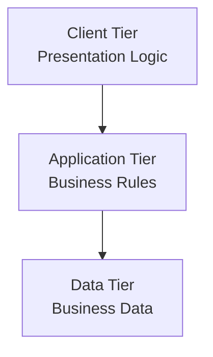
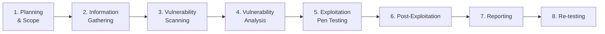
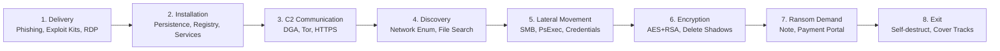
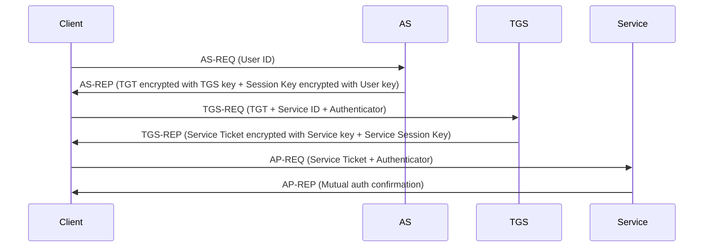
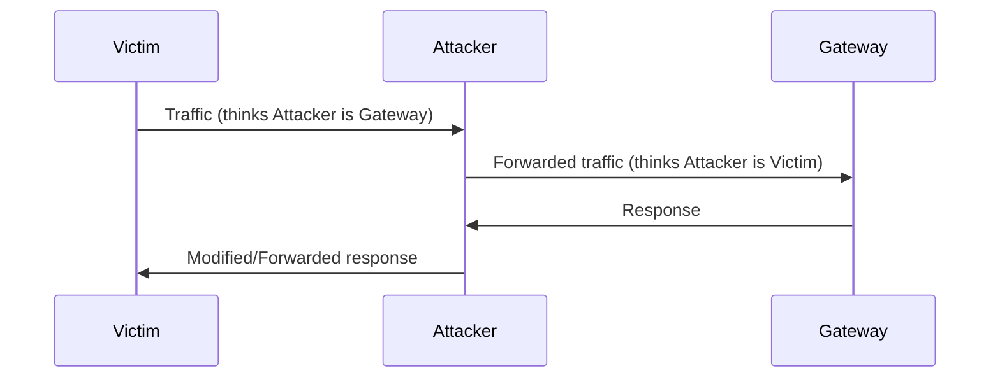
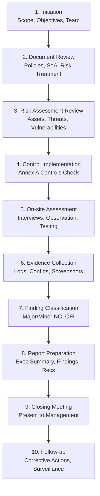

# MSEI-023 CYBER SECURITY - UNIT 4: INTERNET SECURITY

**Block 4: Internet Technology (Units 1-4)**  
**Subject: MSEI-023 Cyber Security**  
**Programme: PGDIS/MSCIS (IGNOU)**

---

## ⚠️ IMPORTANT NOTE ON TEXTBOOK vs PYQ ALIGNMENT

**The Block-4 textbook (2011) is outdated for modern exam topics.** The textbook covers:
- Unit 1: Internet Architecture (TCP/IP, DNS, ISP, NAP, routing)
- Unit 2: Social Networking (Facebook, YouTube, Flickr, Twitter, MySpace, LinkedIn, Orkut, Tagged, Classmates, BharatStudent)
- Unit 3: Advanced Searching (Google operators, Boolean, search strategies)
- Unit 4: Web 2.0 (Blogs, user-generated content, collaboration tools, ease of use, AJAX, SOAP, REST, RSS, Mashups, Podcasts, Social Bookmarking, Tags, Folksonomies, Wikis, XSS, XSRF)

**However, recent papers (2024-2026) heavily test modern topics NOT in the textbook:**
- VAPT, Ransomware, Zero-Day, Cloud Security, Kerberos, MITM, Cyber Audit, Zero Trust, OWASP Top 10, PKI, Domain Cache Poisoning

**This unit includes BOTH:**
1. **Textbook content** (Units 1-4) - for completeness and 5-mark questions
2. **PYQ-based modern topics** (Unit 4 Latest Trends) - marked with 📋 **PYQ-SOURCE** tag

> **Study Strategy**: Master textbook Units 1-3 for 5-mark questions. For 10-mark questions on modern topics, use the PYQ-sourced content below (these are the actual exam questions from 2024-2026). **Also master Extended & Base Services of Server Programs** - asked 3 times in 10-mark questions (Dec 21, Jun 21, Dec 23) - this is from Block 3 Unit 3 but critical for Block 4 exams.

---

## UNIT OVERVIEW

| Textbook Unit | Title | PYQ Priority | Notes |
|--------------|-------|--------------|-------|
| **Unit 1** | Internet Architecture | High (DNS, Firewall, PKI, Cache Poisoning) | Textbook content |
| **Unit 2** | Social Networking | Medium (4 occurrences) | Textbook content |
| **Unit 3** | Advanced Searching | Low | Textbook content |
| **Unit 4** | Latest Trends in Internet Security | 🔴 **CRITICAL** (Modern topics) | **📋 PYQ-SOURCE** - Not in textbook |

---

## TOPIC 1: INTERNET ARCHITECTURE (Textbook Unit 1)

### 1.1 Client-Server Architecture (Textbook §1.2)

**Client Process**: Makes request for information (e.g., Browser)  
**Server Process**: Takes request, processes, gathers info, sends response (e.g., Web Server)

#### Two-Tier Architecture (Textbook §1.2.1)
- Client directly interacts with server
- Client tier: presentation logic + business rules
- Server tier: processing management + database management
- Example: Browser → Web Server

#### Three-Tier Architecture (Textbook §1.2.2)

- Client tier: User interface (browser)
- Application tier (Middle tier): Business logic, calls data tier
- Data tier: Provides data to application tier

#### Web Architecture (Textbook §1.2.3)
Three key standards:
1. **HTML** - Encoding document content (SGML-based, hierarchical tags)
2. **URI/URL** - Addressing protocol (URN = identity, URL = location with protocol, machine, path, file)
3. **HTTP** - Application-level protocol for WWW (commands: establish TCP/IP, send request, return response, close connection)

### 1.2 Internet Architecture & Key Technologies (Textbook §1.3)

#### How Internet Works (Textbook §1.3.1)
1. Type URL or click hyperlink
2. Browser sends request to ISP server
3. ISP server looks up host server in address database
4. Host server sends page to ISP server
5. ISP sends page to browser

#### DNS (Textbook §1.3.2)
- Translates domain names (www.ignou.ac.in) to IP addresses
- Hierarchy: Root servers → TLD (.in) → Second-level (.ac.in) → Host (www.ignou.ac.in)
- Resolvers cache information for faster resolution

#### ISP (Textbook §1.3.3)
- Provides Internet access (dial-up, DSL, cable, wireless)
- Examples in India: BSNL, Sify, Siti Cable, VSNL, Reliance, ERNET India

#### NAP (Textbook §1.3.4)
- Network Access Point: Major interconnection points for ISPs
- NSP (Network Service Provider): Backbone services to ISPs
- IX/IXP: Internet Exchange Point for peering

#### TCP/IP Protocol Suite (Textbook §1.4)

| Layer | Protocols | Function |
|-------|-----------|----------|
| **Application** | HTTP, FTP, SMTP, DNS, Telnet, SNMP | User applications |
| **Transport** | TCP, UDP | End-to-end delivery (TCP=reliable, UDP=fast) |
| **Internet** | IP, ICMP, IGMP | Routing, addressing, error reporting, multicast |
| **Network Interface** | Ethernet, Wi-Fi, PPP, ARP, RARP | Physical transmission, address resolution |

> **Note**: Textbook places ARP/RARP at Network Interface Layer, not Internet Layer.

#### IP Addressing (Textbook §1.5)
- **IPv4**: 32-bit, dotted decimal (124.98.78.234), ~4.3 billion addresses
- **IPv6**: 128-bit, hexadecimal (3FFE:F200:0234:AB00:0123:4567:8901:ABCD), ~3.4×10³⁸ addresses
- **Subnetting**: Dividing network into subnetworks
- **CIDR**: Classless Inter-Domain Routing (e.g., 192.168.1.0/24)
- **NAT**: Network Address Translation (private ↔ public IP)
- **Packet Switching**: Data sent in packets via routers (vs circuit switching)

**IP Address Classes (Textbook §1.5.1):**
| Class | First Octet Range | Network Bits | Host Bits | Networks | Hosts/Network |
|-------|-------------------|--------------|-----------|----------|---------------|
| A | 1-126 | 8 | 24 | 126 | ~16.7M |
| B | 128-191 | 16 | 16 | 16,384 | ~65,534 |
| C | 192-223 | 24 | 8 | ~2M | 254 |
| D | 224-239 | Multicast | - | - | - |
| E | 240-254 | Reserved | - | - | - |

**Subnet Mask Examples (Textbook §1.5.2):**
- Class A default: 255.0.0.0 (/8)
- Class B default: 255.255.0.0 (/16)
- Class C default: 255.255.255.0 (/24)
- CIDR notation: 255.255.255.224 = /27

**NAT Process (Textbook §1.5.4):**
1. Internal client sends packet (src: 192.168.10.2:1074, dst: 131.110.30.4:80)
2. NAT changes header (src: 131.110.5.1:1563, dst: unchanged)
3. External server replies to NAT external IP:port
4. NAT maps back to internal client using mapping table

**Routing Protocols (Textbook §1.5.5):**
- **IGP (Interior Gateway Protocol)**: RIP, OSPF - within autonomous network
- **EGP (Exterior Gateway Protocol)**: BGP, EGP - between autonomous systems

### 1.3 Security Issues (Textbook §1.6)

#### Anti-Virus Software (Textbook §1.6)
- **Purpose**: Detect, protect, clean viruses
- **Methods**: Remove virus code, remove infected file, quarantine infected file
- **Free Products**: AntiVir, avast!, AVG, BitDefender, Comodo
- **Commercial**: Norton, F-Secure, Kaspersky

#### Firewall (Textbook §1.6)
**Definition**: System limiting network access between networks. Sits at gateway between private and public network. Filters inbound/outbound traffic based on criteria.

**Types of Firewalls (Textbook §1.6):**
| Type | Layer | Description |
|------|-------|-------------|
| **Packet Filtering** | Network (IP) | Part of router; compares each packet to rules (src/dst IP, port, protocol); low cost, low performance impact; no sophisticated rules |
| **Circuit Level Gateway** | Session (TCP) | Monitors TCP handshaking; hides private network info; doesn't filter individual packets |
| **Application Level Gateway (Proxy)** | Application | Application-specific; filters at app layer (HTTP POST/GET); logs user activity; high security but performance impact; not transparent |

**NAT + Firewall**: NAT routers offer packet filtering + hide internal IPs + circuit-based filtering.

#### Pop-up Blocker (Textbook §1.6)
- Prevents pop-ups in browser
- Methods: Close window, disable command, alter HTML
- Limitation: Can't always distinguish wanted vs unwanted pop-ups

### 1.4 Important Exam Questions (Textbook-based)

| Marks | Question | Frequency |
|-------|----------|-----------|
| 1-mark | Network firewall / SMTP / Broadcast address / ICMP / IPv6 bits (128) / Subnetting / Primary Key / Rows=Tuples | Dec 2021, Jun 2021 |
| 2-mark | Phishing, Social-networking sites, Impersonation, Cracking, E-mail spoofing | Dec 2021 |
| 5-mark | Categories of cyber attacks - explain 2 + countermeasures | Dec 2021, Jun 2024 |
| 5-mark | Domain Cache Poisoning prevention steps | Dec 2024, Jun 2026 |
| 5-mark | DNS/Cache Poisoning notes | Dec 2024, Dec 2025, Jun 2026 |
| 5-mark | Network Security (Firewall/IDS/IPS) | Jun 2026 |
| 5-mark | Firewall types and working | Textbook Check Your Progress |
| 5-mark | Packet filtering firewall working | Textbook Check Your Progress |
| 5-mark | Application level gateway | Textbook Check Your Progress |
| 10-mark | Internet Security Issues in detail | Dec 21, Jun 21, Dec 22 ⭐⭐⭐ |
| 10-mark | PKI Architecture & Working | Dec 2024 ⭐⭐⭐ |
| 10-mark | Firewalls & IDS in Network Security + real-world examples | Jun 2026 |
| 10-mark | Intruder & Intrusion Techniques | Dec 2022 |

---

## TOPIC 2: SOCIAL NETWORKING SECURITY (Textbook Unit 2)

### 2.1 Types of Social Networks (Textbook §2.4-2.5)

| Type | Description | Examples (Textbook) |
|------|-------------|---------------------|
| **Profile-based** | Services organized around profile pages | Facebook, MySpace, Bebo |
| **Content-based** | Main goal: share content, photos, videos | Flickr, YouTube, Shelfari |
| **White-label** | Create own mini-social networks | WetPaint (social wikis) |
| **Multi-User Virtual Environments** | Avatar-based interaction | Runescape, Second Life |
| **Mobile Social Networks** | Mobile access to services | Facebook Mobile, Bebo Mobile, Wadja |
| **Microblogging/Presence** | Short status updates | Twitter, Wayn |
| **Social Search** | Search across public profiles | Wink, Spokeo |
| **Thematic Websites** | Common interest + local dimension | Netmums, deafgateway.info |
| **Professional** | Business-oriented networking | LinkedIn |

### 2.2 Key Platforms (Textbook §2.5)

| Platform | Key Features (Textbook) |
|----------|-------------------------|
| **Facebook** | Profiles, friends, messages, chat, groups, pages, low-cost business advertising, networks, events, photo/video sharing, applications |
| **YouTube** | Video sharing, comments, tutorials, marketing, education, categories, upload up to 20GB/15min, HD support, embed videos, personalize profile |
| **Flickr** | Photo upload via email, sharing, tags, groups, comments, favorites, search, explore community, API for mashups |
| **Twitter** | Tweets (140 chars), follow, SMS/IM/web, real-time, microblogging, hashtags, third-party apps (Tweetie, Twitterrific) |
| **LinkedIn** | Professional profiles (Title, Summary, Experience, Education), connections, jobs, recommendations, company following, research |
| **MySpace** | Profile, interests, friends, comments, bulletins, blogs, forums, music, banner advertising |
| **Orkut** | Google's social network; Gmail/GTalk integration; scrapbook (offline messages); communities; ratings (coolness/trustworthiness/sexiness); fans/testimonials; crush/hot/ignore lists; photos/videos/blogs linked to Blogger/Picasa |
| **Tagged** | Custom profile, friends, comments, tags, groups, chat, games, photos |
| **Classmates** | Find school friends, graduation year search, email, reconnect |
| **BharatStudent** | Indian students/professionals, GenX Zone, Cafe Bharat, Study Zone, Classifieds |

### 2.3 Security Issues (Textbook §2.6)

| Threat | Description (Textbook) |
|--------|------------------------|
| **Malware** | Fake Twitter invitations → malicious attachment → gathers emails → spreads via removable drives/shared folders |
| **Spam** | Hijacked account sends messages to connections → malware loads on navigation |
| **Targeted Attacks** | Employees with bad intentions collect personal info → sophisticated social engineering |
| **Phishing** | Fake login pages → steal credentials → banking/enterprise account compromise |
| **Identity Hijacking** | Impersonate reputable person → access business contracts/acquaintances → spam to friends |

### 2.4 Advantages (Textbook §2.3.1, §2.7, Check Your Progress)
- Job opportunities through contacts
- Learning new technologies/strategies
- Word-of-mouth marketing (best form, no investment)
- Alliances and referrals
- Low-cost business advertising (Facebook)
- Easy connection with friends/family
- Support for learning and informal learning
- Engaging with others for business intelligence
- Ease of access to information and applications
- Common interface across work/social boundaries
- Builds credibility with customers
- Connections leverage (friends of friends)

### 2.5 Disadvantages (Textbook §2.3.2)
- Security concerns (personal info display)
- Fake identity/illegal activities
- Lack of anonymity (name, location, age, gender exposed)
- Scams and harassment (cyber-stalking, identity theft)
- Time consuming

### 2.6 Important Exam Questions

| Marks | Question | Frequency |
|-------|----------|-----------|
| 2-mark | Social networking sites security | Dec 2021 |
| 5-mark | Social networking security issues | Jun 2023, Dec 2023, Jun 2024 |
| 5-mark | White-label social networks notes | Dec 2022 |
| 5-mark | Social bookmarking notes | Jun 2024 |
| 5-mark | Advantages of Facebook / Features of YouTube / Benefits of Flickr / Tweet features / LinkedIn functionality | Textbook Check Your Progress |
| 5-mark | Differentiate profile-based vs content-based social networks | Textbook Check Your Progress |
| 5-mark | Mobile social networks | Textbook Check Your Progress |
| 5-mark | Functionality of thematic websites | Textbook Check Your Progress |
| 5-mark | Micro-blogging | Textbook Check Your Progress |

---

## TOPIC 3: ADVANCED SEARCHING (Textbook Unit 3) - LOW PRIORITY

### 3.1 Search Tools (Textbook §3.2.1)

| Tool | Description |
|------|-------------|
| **Search Engines** | Keyword-searchable DB (Google, AlltheWeb, AltaVista) - scour web, index, store |
| **Subject Directories** | Human-edited, hierarchically organized (Open Directory Project, Yahoo) |
| **Virtual Libraries** | Highly selective links by librarians (WWW Virtual Library) |
| **Meta Search Engines** | Query multiple engines simultaneously (Dogpile, HotBot, IBoogie) |
| **Invisible/Deep Web** | Databases not indexed by standard engines (Complete Planet, Resource Discovery Network) |

### 3.2 How Search Engines Work (Textbook §3.2.2)
1. **Spider/Crawler** - Scours web, follows links
2. **Indexer** - Processes, stores in database
3. **Query Processor** - Searches index, returns results
4. **Ranking** - Relevance algorithms

> Search engines search their cached database, not live web. Pages must be linked from other pages to be found.

### 3.3 Search Operators (Textbook §3.3)

| Operator | Function | Example |
|----------|----------|---------|
| **Boolean AND** | All keywords must appear | `fly AND fishing` |
| **Boolean OR** | Either keyword | `web OR designer` |
| **Boolean NOT** | Exclude keyword | `web NOT spider` |
| **Phrase Search** | Exact phrase in quotes | `"cyber security"` |
| **+ (Force)** | Include specific word | `Ramayan Episode +1` |
| **- (Exclude)** | Exclude word | `virus -computer` |
| **~ (Tilde)** | Include synonyms | `~primer` → basics, introduction |
| **\* (Wildcard)** | Replace unknown word | `"little * riding hood"` |
| **? (Single char)** | Single character wildcard | `Kir?land` |
| **Advanced** | `site:`, `filetype:`, `intitle:`, `inurl:`, `allintext:`, `allintitle:`, `allinurl:`, `define:`, `info:`, `cache:`, `link:`, `movie:`, `music:`, `site:`, `weather:`, `daterange:`, `numrange:` |

### 3.4 Google Advanced Operators (Textbook §3.5.1)

| Operator | Function | Example |
|----------|----------|---------|
| **allintext:** | All terms in page text | `allintext: travel packing list` |
| **allintitle:** | All terms in title | `allintitle: detect virus` |
| **allinurl:** | All terms in URL | `allinurl: cyber security` |
| **cache:** | Google's cached version | `cache:www.ignou.ac.in` |
| **define:** | Definitions from web | `define: blog` |
| **filetype:** | Specific file extension | `cyber security filetype:pdf` |
| **info:** | Page information | `info:www.ignou.ac.in` |
| **link:** | Pages linking to URL | `link:www.ignou.ac.in` |
| **movie:** | Movie information | `movie:3 idiots` |
| **music:** | Music information | `music:A.R. Rahman` |
| **site:** | Restrict to domain | `admissions site:www.ignou.ac.in` |
| **weather:** | Weather forecast | `weather New Delhi` |
| **numrange:** | Number range | `numrange:1200-1230` |
| **.. (periods)** | Shorthand for numrange | `laptops $700..$1200` |

### 3.5 Google Advanced Search Page Options (Textbook §3.5.2)
- All words / Exact phrase / At least one word / Without words
- Language, File Format (PDF, PS, DOC, XLS, PPT, RTF), Date (3/6/12 months)
- Domain (include/exclude), Usage Rights, SafeSearch
- Page-Specific: Similar pages, Pages linking to URL
- Topic-Specific: Microsoft, Apple, Linux, BSD, University, Government

### 3.6 Google Advanced Image Search (Textbook §3.6)
**Find Options:** All words / Exact phrase / Any words / Without words
**Image Options:** Size (Small/Medium/Large/Extra Large), Aspect Ratio (Tall/Square/Wide/Panoramic), Colors (Full color/Black & White/Transparent), Content Type (Any/News/Faces/Photos/Clip Art/Line Drawings), File Type (Any/JPEG/GIF/PNG/BMP/SVG), Site/Domain, SafeSearch

### 3.7 Search Tips (Textbook §3.8)
1. **Choose Right Tool**: Search engines + subject directories
2. **Use Boolean Operators**: Narrow results
3. **Use Advanced Operators**: Zero in on target
4. **Don't Stick to One Engine**: Use AllTheWeb, AltaVista, HotBot, Yahoo!
5. **Use Meta Search Engines**: Dogpile, Metacrawler, Vivisimo
6. **Use Subject Directories**: Birds-eye view, drill down (Digital Librarian, Google Directory, Open Directory Project)
7. **Use Deep Web**: Invisible web databases (Complete Planet)
8. **Use Social Search**: Blogs, microblogs, social networks, Q&A sites

### 3.8 Important Exam Questions

| Marks | Question | Frequency |
|-------|----------|-----------|
| 1-mark | Search engine functions / Data Dictionary | Jun 2021, Dec 2023 |
| 2-mark | Data fragmentation / Clustering vs Mirroring | Jun 2021 |
| 5-mark | Search engine functions | Textbook Check Your Progress |
| 5-mark | Meta search engine vs Subject directory | Textbook Check Your Progress |
| 5-mark | Google "I'm Feeling Lucky" | Textbook Check Your Progress |
| 5-mark | Page-specific options in Google advanced search | Textbook Check Your Progress |
| 5-mark | Google Cache operator | Textbook Check Your Progress |
| 5-mark | allinURL vs allintitle | Textbook Check Your Progress |
| 5-mark | Google image search content types | Textbook Check Your Progress |
| 5-mark | filetype: operator | Textbook Check Your Progress |
| 5-mark | NEAR operator | Textbook Check Your Progress |

---

## TOPIC 4: LATEST TRENDS IN INTERNET SECURITY (Textbook Unit 4 + 📋 PYQ-SOURCE)

### ⚠️ TEXTBOOK CONTENT (Unit 4 - Web 2.0) - LOW EXAM PRIORITY BUT IN TEXTBOOK

**Textbook §4.0 (Block Introduction)**: "Web 2.0 is about revolutionary new ways of creating, collaborating, editing and sharing user-generated content online... ease of use... people who consume media should be active contributors..."

**Textbook Unit 4 covers**: Web 2.0 Applications, Domains, Principles, Characteristics, Concepts (AJAX, RIA, SOAP, REST), Technologies (RSS, Blog, Mashups, Podcast, Social Bookmarking, Social Networking, Tags, Folksonomies, Wiki), Web Security Threats (XSS, XSRF).

> **Exam Reality**: These topics rarely appear in recent papers. Modern security topics (below) dominate. **However, XSS and XSRF from §4.5 ARE tested** (6 occurrences in PYQ).

---

### 📖 TEXTBOOK UNIT 4 DETAILED CONTENT (For Completeness)

#### 4.1 Web 2.0 Applications (Textbook §4.2)
- **Blogs**: Online journals, personal emphasis, RSS distribution
- **Microblogging**: Condensed posts (Twitter - 160 chars, SMS posting)
- **Collective Intelligence**: Group expertise > individual (collaborative publishing, common databases)
- **Mash-ups**: Aggregate content/functionality from multiple sources (WikiMapia = Wiki + Google Maps)
- **Peer-to-Peer (P2P)**: Distributed file sharing (BitTorrent, Skype)
- **Podcasts**: Audio/video recordings, distributed via aggregators (iTunes)
- **RSS**: Really Simple Syndication - subscribe to news, blogs, podcasts
- **Aggregators/Social Bookmarking**: Gather data from multiple sources, organize
- **Social Networking**: Member skills/talents/preferences (Facebook, LinkedIn)
- **Social Media**: Blogs (WordPress, Blogger), photo-sharing (Flickr, Picasa), video (YouTube, Blip.tv)
- **Web Applications**: Online programs (Zoho, Google Docs)
- **Web Services**: Machine-to-machine communication (retailer-supplier inventory)
- **Wikis**: Collaborative publishing (Wikipedia)

#### 4.2 Web 2.0 Domains (Textbook §4.2.1)
| Domain | Description |
|--------|-------------|
| **Sci-Mate** | Open collaboration of scientists using Web 2.0 for academic publishing |
| **Science 2.0** | Conversations between researchers, data discussion, blogs/wikis |
| **Health 2.0** | Web tools (blogs, podcasts, tagging, wikis) for healthcare personalization |
| **BI 2.0** | Dynamic querying of real-time corporate data, browser-based |
| **Open Web** | Entire WWW open to anyone - initial Web 2.0 domain |
| **Enterprise 2.0** | Inside firewalls, Web 2.0 for business performance |

#### 4.3 Web 2.0 Principles (Textbook §4.2.2)
- **Data Freedom**: Services pull from multiple sources, data exposed/alterable
- **Virtual Applications**: Construct apps from varied sources, deploy quickly
- **Participation**: Viewers become involved, not mere spectators
- **User-Centric Content**: Content generated for individual needs
- **Modularity**: Pick components to construct custom solutions
- **Sharing**: Ideas, content, code - businesses add value beyond infrastructure
- **Communication**: Core to success on Web 2.0

#### 4.4 Web 2.0 Characteristics (Textbook §4.2.3)
| Characteristic | Description |
|----------------|-------------|
| **Participation** | Easy content creation/sharing via blogging, social networks, free uploads |
| **Standards** | Common interfaces for integration |
| **Decentralization** | Distributed apps/content over many systems |
| **Openness** | Transparent access to applications/content |
| **Modularity** | Components link/integrate, whole > sum of parts |
| **User Control** | Users control content, data, identity |
| **Identity** | Choose representation across interactions |
| **Network as Platform** | Apps hosted on network, no local install |
| **Culture of Openness** | Creative Commons licenses enable reuse |
| **Tagging** | User-created tags vs formal classification |
| **Embedding** | Content embeddable in third-party sites |

#### 4.5 Web 2.0 Concepts (Textbook §4.3)

**AJAX (Asynchronous JavaScript and XML) - §4.3.1**
- **Key Components**: XHTML, CSS, JavaScript DOM, XMLHttpRequest
- **Working**: Async data exchange, partial page updates without reload
- **Examples**: GMail, Flickr
- **Advantages**: State maintenance, reduced bandwidth/load time, perceived speed, fewer server connections
- **Disadvantages**: Back button issues, bookmarking difficulties, JS dependency, potential attack vector

**Rich Internet Applications (RIA) - §4.3.2**
- Process data on both server and client
- Asynchronous data exchange, client stays responsive
- No page reload, drag & drop, short response time, multimedia animations
- Features: Live validation, auto-completion, periodic refresh, rich text editors

**SOAP (Simple Object Access Protocol) - §4.3.3**
- XML-based messaging for machine-to-machine communication over HTTP
- **Message Structure**: Envelope (identifies SOAP), Header (header info), Body (call/response), Fault (errors/status)
- **Advantage**: Passes through firewalls (HTTP allowed)

**REST (Representational State Transfer) - §4.3.4**
- Architectural style for distributed hypermedia (WWW)
- **Key Abstraction**: Resource (any named concept)
- **Elements**: Resource Identifier (URL/URN), Representation (data + metadata), Control Data (cache-control, if-modified-since)
- **Connectors**: Client (initiates), Server (listens/responds)
- **HTTP Methods**: POST, GET, PUT, DELETE → maps to CRUD
- **Principles**: Resources uniquely addressable, uniform interface, constrained operations/content types, client-server, stateless, cacheable, layered

#### 4.6 Web 2.0 Technologies (Textbook §4.4)

**RSS (Really Simple Syndication) - §4.4.1**
- **Problem Solved**: Multiple sites with unpredictable updates → tedious checking, email notifications disorganized/spam-like
- **How Works**: Site maintains RSS Feed (XML list of items: title, description, link). RSS aggregators auto-check feeds, organize results.
- **RSS vs Atom**: Both lightweight standards for alerts/syndication in Web 2.0
- **Uses**: New product notifications, newsletter issues, weather alerts, database additions, new group members
- **Aggregators**: Browser-based (Bloglines, Pluck, Newsgator) or desktop

**Blog - §4.4.2**
- **Components**: Advertising, Title, Date, Post Title, Text, Posting Info, Comments, Previous Posts, Archives
- **Blogroll**: Recommended sites in sidebar
- **Moblogging**: Mobile blogging from phone/camera/PDA
- **Types**: Political, Personal, Business, Topical, Health, Literary, Travel, Research, Legal (blawgs), Educational

**Mashups - §4.4.3**
- **Components**: Content providers, mashup site, client browser
- **Technical**: APIs from web services (Google Maps, Yahoo, Flickr)
- **Examples**: Yahoo Pipes (visual drag-drop RSS remixing), Flickr API (tags, photos, contacts), YouTube (embed videos via HTML/FLV)

**Podcast - §4.4.4**
- **Technical**: RSS 2.0 + audio files (MP3), auto-download to device
- **Educational Uses**: Lecture recordings, student podcasts, text-to-MP3, wider audience for seminars, meeting recordings, accessibility
- **Problems**: Copyright, context issues, quality, user adoption
- **Creation**: MP3 file (Audacity) + RSS feed for subscription

**Social Bookmarking - §4.4.5**
- Store favorites online (not browser), tag with keywords, share with others
- Browse by popular/recent/category
- **Getting Started**: Pick site, install browser button, tag websites
- **Meeting People**: Find interesting bookmarks → view user profile → add as friend

**Social Networking - §4.4.6**
- **Structure**: Profile (info/personality), Friends (trusted members), Groups (shared interests), Discussions (boards + media), Blogs, Widgets
- **Unique features**: Poke (Facebook), High-five (Hi5)

**Tags - §4.4.7**
- Non-hierarchical keywords for resources
- **Features**: Creator/viewer chosen, informal, multiple per item, no "wrong" tag
- **Tag Clouds**: Visual display, font size = frequency
- **Hash Tags (#)**: Twitter topic tagging (#goji #superfood)
- **Official Tags**: Events/conferences for consistent resource tagging

**Folksonomies - §4.4.8**
- Decentralized, social metadata creation via collaborative tagging
- **Broad**: Many users tag one object
- **Narrow**: Few users tag individual items
- **vs Taxonomy**: Not hierarchical; flat/faceted approach

**Wiki - §4.4.9**
- Collaboratively edited web pages, simplified markup/WYSIWYG
- **Characteristics**: No special software, simple markup, easy editing, no special privileges
- **Uses**: Public contribution (Science Museum), communities of practice, local resident archives
- **Types**: Public (Wikipedia), Protected (view public, edit authorized), Private (hidden, designated users)
- **Advantages**: Quick ideas, instant collaboration, accessible anywhere, version archive, empowering, no email/spam issues, all drafts saved, password protection

#### 4.7 Web Security Threats (Textbook §4.5) - **IMPORTANT: TESTED IN PYQ**

**Cross Site Scripting (XSS) - §4.5**
- **Definition**: Common application-layer web attack targeting client-side scripts (HTML, JavaScript, VBScript, ActiveX, Flash)
- **Mechanism**: Manipulate client-side scripts to execute attacker's desired manner
- **Example**: Inject script in shopping site URL → redirects to fake page → captures cookie → session hijack
- **Obfuscation**: XSS part encoded in HEX to look harmless
- **Malicious Results**: Identity theft, sensitive info access, free paid content, spying, browser alteration, defamation, defacement, DoS
- **Prevention (Developer)**: Filter/validate input, encode/filter output
- **Prevention (User)**: Disable scripting (loses functionality), only follow main site links

**Cross Site Reference Forgery (XSRF/CSRF) - §4.5**
- **Definition**: Attack on web apps with predictable action structure using cookies/browser auth/client certs
- **Mechanism**: Attacker tricks user into performing action via directed link/content
- **Common Vectors**: ``, `<script src="...">`, `<iframe src="...">`
- **Prevention**: Unpredictable challenge tokens per request tied to user session (HMAC_SHA1(Action+Secret, SessionID)), time-limited, unique action names, use SSL

---

### 📋 PYQ-SOURCE: MODERN TOPICS (2024-2026 Papers) - 🔴 CRITICAL PRIORITY

> **Source**: These topics are NOT in the 2011 textbook but appear repeatedly in Jun 2024 - Jun 2026 papers. Content is based on PYQ analysis and standard industry knowledge for exam preparation.

---

#### 4.1 VAPT (Vulnerability Assessment & Penetration Testing) 📋 PYQ-SOURCE (⭐⭐⭐ - 3 exact 10-mark repeats: Dec 24, Jun 25, Dec 25)

**Definition**: Systematic process of identifying, evaluating, and exploiting vulnerabilities in systems/networks to assess security posture.

**VAPT Methodology (8 Steps)**:


| Phase | Activities | Tools |
|-------|------------|-------|
| **1. Planning & Scope** | Rules of engagement, targets, timeline, legal | Contract, scope document |
| **2. Information Gathering** | Passive (OSINT, Whois, DNS) + Active (port scan, banner grab) | Nmap, Recon-ng, Maltego, theHarvester |
| **3. Vulnerability Scanning** | Automated scans | Nessus, OpenVAS, Qualys, Nexpose |
| **4. Vulnerability Analysis** | Verify findings, remove false positives, CVSS scoring | Manual verification, CVSS calculator |
| **5. Exploitation** | Controlled exploitation, proof-of-concept | Metasploit, Core Impact, custom exploits |
| **6. Post-Exploitation** | Privilege escalation, lateral movement, persistence | Meterpreter, BloodHound, Mimikatz |
| **7. Reporting** | Executive summary, technical findings, risk rating, remediation | Custom templates, Dradis, Faraday |
| **8. Re-testing** | Verify fixes after remediation | Repeat scanning |

**VAPT Types**:
| Type | Knowledge | Access |
|------|-----------|--------|
| **Black Box** | Zero knowledge | External only |
| **White Box** | Full knowledge (code, config) | Internal + External |
| **Gray Box** | Partial knowledge | Limited internal access |

---

#### 4.2 Ransomware Lifecycle 📋 PYQ-SOURCE (⭐⭐⭐ - 3 exact 10-mark repeats: Dec 24, Jun 25, Dec 25)

**8-Stage Ransomware Kill Chain**:


**Encryption Process**:
1. Generate random AES-256 key per file
2. Encrypt file with AES key
3. Encrypt AES key with attacker's RSA public key
4. Store encrypted AES key with file
5. Delete volume shadow copies (`vssadmin delete shadows /all`)
6. Disable recovery options

**Prevention Measures**:
| Layer | Measures |
|-------|----------|
| **Backup** | 3-2-1 rule: 3 copies, 2 media, 1 offsite/offline; Immutable backups |
| **Patch Management** | Timely OS/app patches; disable SMBv1 |
| **Email Security** | Advanced filtering, sandboxing, DMARC/DKIM/SPF |
| **Endpoint** | EDR/XDR, application control, behavior monitoring |
| **Network** | Segmentation, zero trust, disable RDP from Internet |
| **Identity** | MFA everywhere, least privilege, PAM |
| **User Training** | Phishing simulation, reporting culture |

**Ransomware Evolution**:
| Generation | Characteristics |
|------------|-----------------|
| **1.0** | Single machine, simple encryption |
| **2.0** | Network propagation (WannaCry, NotPetya) |
| **3.0** | Double extortion (encrypt + threaten leak) |
| **4.0** | Triple extortion (add DDoS, notify customers/regulators) |
| **RaaS** | Ransomware-as-a-Service (LockBit, Conti, BlackCat) |

---

#### 4.3 Zero-Day Vulnerabilities 📋 PYQ-SOURCE (⭐⭐⭐ - 3 occurrences: Dec 24, Dec 25, Jun 26)

**Definition**: Vulnerability unknown to vendor, no patch exists, actively exploited in wild. "Zero days" since discovery = no defense time.

**Significance**:
- Bypasses signature-based defenses (AV, IDS/IPS)
- High value on exploit markets ($100K-$2M+)
- Used in APT campaigns, targeted attacks
- Example: Stuxnet used 4 zero-days

**Recent High-Profile Zero-Days**:
| Vulnerability | CVE | Year | Impact |
|---------------|-----|------|--------|
| **Log4Shell** | CVE-2021-44228 | 2021 | RCE in Log4j; ubiquitous Java library |
| **PrintNightmare** | CVE-2021-34527 | 2021 | Windows Print Spooler RCE |
| **ProxyLogon** | CVE-2021-26855 | 2021 | Exchange Server SSRF → RCE chain |
| **Follina** | CVE-2022-30190 | 2022 | MSDT RCE via Office documents |
| **CitrixBleed** | CVE-2023-4966 | 2023 | NetScaler session hijack |

**Defense Strategies**:
| Strategy | Implementation |
|----------|----------------|
| **Behavior-based Detection** | EDR/XDR, sandboxing, ML anomaly detection |
| **Threat Intelligence** | IOC feeds, TIP integration, early warning |
| **Patch Management** | Rapid deployment, virtual patching (WAF/IPS) |
| **Network Segmentation** | Limit blast radius, micro-segmentation |
| **Application Whitelisting** | Only approved executables run |
| **Zero Trust** | Never trust, always verify, least privilege |

---

#### 4.4 Authentication & Access Control 📋 PYQ-SOURCE (⭐⭐⭐ - 5 occurrences: Dec 24, Jun 25, Dec 25, Jun 26)

**MFA (Multi-Factor Authentication)**:
| Factor Type | Examples |
|-------------|----------|
| **Something You Know** | Password, PIN, security questions |
| **Something You Have** | TOTP app (Google Auth, Authy), hardware token (YubiKey), SMS/Email OTP, smart card |
| **Something You Are** | Fingerprint, FaceID, iris, voice, behavioral biometrics |

**MFA Best Practices**:
- Enforce for all admin/remote access
- Prefer authenticator apps/hardware tokens over SMS
- Implement number matching (prevents MFA fatigue)
- Conditional access policies (risk-based)

**Least Privilege Principle** 📋 PYQ-SOURCE (⭐⭐⭐ - 10-mark Dec 2025):
> **Definition**: Users/processes should have only minimum permissions necessary to perform their function.

**Implementation**:
| Level | Measures |
|-------|----------|
| **User** | Role-based access (RBAC), attribute-based (ABAC), just-in-time (JIT) |
| **Service Accounts** | Managed identities, no interactive login, scoped permissions |
| **Admin** | Tiered administration (Tier 0/1/2), PAM, privileged session recording |
| **Cloud** | IAM conditions, SCPs, permission boundaries, resource policies |

---

#### 4.5 Kerberos Authentication Protocol 📋 PYQ-SOURCE (⭐⭐⭐ - Jun 2025 10-mark question)

**Components**:
- **KDC (Key Distribution Center)**: AS (Authentication Server) + TGS (Ticket Granting Server)
- **Realm**: Kerberos administrative domain
- **Principal**: Unique identity (user/service@REALM)
- **Ticket**: Encrypted credential (TGT, Service Ticket)
- **Authenticator**: Timestamp + client info encrypted with session key

**6-Step Flow**:


**Key Features**: Mutual authentication, single sign-on, delegation, cross-realm trust

---

#### 4.6 MITM Attack 📋 PYQ-SOURCE (⭐⭐⭐ - Jun 2025 10-mark question)

**Process**:


**Techniques**:
| Technique | Layer | Description |
|-----------|-------|-------------|
| **ARP Spoofing** | L2 | Poison ARP cache; map attacker MAC to gateway IP |
| **DNS Spoofing** | L7 | Forge DNS responses; redirect to malicious server |
| **SSL Stripping** | L7 | Downgrade HTTPS→HTTP; proxy secure traffic |
| **Wi-Fi Eavesdropping** | L1/L2 | Rogue AP, Karma attack, packet sniffing |
| **BGP Hijacking** | L3 | Announce victim's prefixes; redirect Internet traffic |
| **Session Hijacking** | L7 | Steal session cookies; replay authenticated requests |

**Prevention**:
| Measure | Effectiveness |
|---------|---------------|
| **TLS 1.3 + HSTS** | Prevents SSL stripping, enforces encryption |
| **Certificate Pinning** | Detects fraudulent certs |
| **DNSSEC** | Prevents DNS spoofing |
| **Static ARP / DAI** | Prevents ARP spoofing (Dynamic ARP Inspection) |
| **RPKI / ROA** | Prevents BGP hijacking |
| **Secure Cookies** | HttpOnly, Secure, SameSite |
| **VPN / Zero Trust** | Encrypted tunnels, verify every request |

---

#### 4.7 Cloud Security 📋 PYQ-SOURCE (⭐⭐⭐ - 4 occurrences: Jun 25, Dec 25, Jun 26)

**Shared Responsibility Model**:
| Provider Responsibility | Customer Responsibility |
|------------------------|------------------------|
| Physical security | Data classification |
| Hypervisor/Host OS | Guest OS patching |
| Network infrastructure | Application security |
| Managed services (RDS, S3) | Identity & Access (IAM) |
| | Encryption keys (if CMK) |
| | Client-side data |

**IAM (Identity & Access Management)**:
| Component | Best Practice |
|-----------|---------------|
| **Root Account** | MFA enabled, no access keys, use for billing only |
| **Users/Groups** | Least privilege, group-based policies |
| **Roles** | Cross-account access, service roles, federated access |
| **Policies** | Managed > Inline; Conditions (IP, time, MFA, tags) |
| **SCPs** | Organizational guardrails (AWS Organizations) |
| **Permission Boundaries** | Max permissions for delegated admins |
| **Access Analyzer** | Identify unintended resource access |

**Encryption**:
| State | Implementation |
|-------|----------------|
| **At Rest** | AES-256; SSE-S3, SSE-KMS, SSE-C; Customer Managed Keys (CMK) in KMS/HSM |
| **In Transit** | TLS 1.2+ everywhere; mTLS for service-to-service; Certificate Manager |
| **Key Management** | Envelope encryption; automatic rotation; key policies; CloudHSM for FIPS 140-2 |

**Network Security**:
| Control | Implementation |
|---------|----------------|
| **VPC/VNet** | Isolated network; public/private subnets; NAT Gateway |
| **Security Groups** | Stateful; instance-level; default deny; allow specific |
| **NACLs** | Stateless; subnet-level; ordered rules; ephemeral ports |
| **Private Endpoints** | Access services without Internet (Interface/Gateway) |
| **WAF** | OWASP Top 10 managed rules; rate limiting; geo-blocking |
| **DDoS Protection** | Standard (free) + Advanced (paid, Shield) |
| **Segmentation** | Micro-segmentation (Calico, Cilium, cloud-native) |

---

#### 4.8 Cyber Security Audit 📋 PYQ-SOURCE (⭐⭐⭐ - Jun 2026 10-mark question)

**International Standard**: **ISO/IEC 27001:2022** (Information Security Management Systems - ISMS)

**Annex A Controls (93 controls in 4 Themes)**:
| Theme | Controls | Focus |
|-------|----------|-------|
| **Organizational (A.5-A.8)** | 37 | Policies, roles, assets, HR security |
| **People (A.6)** | 8 | Screening, training, disciplinary |
| **Physical (A.7)** | 13 | Perimeter, equipment, clear desk |
| **Technological (A.8)** | 35 | Access, crypto, ops, network, dev |

**Audit Process (10 Steps)**:


**Finding Classification**:
| Classification | Definition |
|----------------|------------|
| **Major Nonconformity** | Systemic failure; absent/ineffective control; significant risk |
| **Minor Nonconformity** | Isolated lapse; single instance; limited risk |
| **Opportunity for Improvement (OFI)** | Not a nonconformity; enhancement suggestion |

---

#### 4.9 APT & Botnets 📋 PYQ-SOURCE (⭐⭐ MEDIUM - 3 occurrences)

**APT Characteristics**:
| Attribute | Description |
|-----------|-------------|
| **Advanced** | Custom malware, zero-days, sophisticated TTPs |
| **Persistent** | Long-term access (months/years); low-and-slow |
| **Threat** | Nation-state or organized crime; specific targets |
| **Lifecycle** | Reconnaissance → Weaponization → Delivery → Exploitation → Installation → C2 → Actions on Objectives |

**Botnet Architecture**:
```
C2 Server (Command & Control)
    │
    ├── HTTP/HTTPS (domain flux, fast flux)
    ├── P2P (decentralized, resilient)
    ├── DNS (covert channel)
    └── Tor/I2P (anonymity)
    │
Bots (Compromised Devices)
    ├── DDoS (volumetric, application)
    ├── Spam/Phishing
    ├── Credential Stuffing
    ├── Crypto Mining
    └── Proxy/Relay
```

**Notable APT Groups**:
| Group | Attribution | Notable Campaigns |
|-------|-------------|-------------------|
| **APT28 (Fancy Bear)** | Russia GRU | DNC hack, Olympics, NotPetya |
| **APT29 (Cozy Bear)** | Russia SVR | SolarWinds, COVID research |
| **Lazarus Group** | North Korea | WannaCry, Sony, Bangladesh Bank |
| **APT10 (Stone Panda)** | China MSS | Cloud Hopper, MSP compromise |
| **Charming Kitten** | Iran IRGC | Credential harvesting, academia |

---

#### 4.10 Malware Types 📋 PYQ-SOURCE

| Type | Propagation | Payload |
|------|-------------|---------|
| **Virus** | Requires host file/user action | Corrupt, delete, steal |
| **Worm** | Self-propagating (network) | Bandwidth consumption, backdoor |
| **Trojan** | Disguised as legitimate | Remote access, data theft |
| **Ransomware** | Various | Encryption + extortion |
| **Spyware** | Bundled, drive-by | Keylogging, screen capture |
| **Rootkit** | Kernel/user mode | Hide presence, persist |
| **RAT** | Phishing, exploits | Full remote control |
| **Fileless Malware** | Memory-only (PowerShell, WMI) | No disk footprint, evades AV |

---

#### 4.11 OWASP Top 10 (2021) 📋 PYQ-SOURCE (⭐⭐ - Jun 2025 5-mark)

| Rank | Category | Description |
|------|----------|-------------|
| **A01** | Broken Access Control | IDOR, privilege escalation, missing authZ |
| **A02** | Cryptographic Failures | Weak crypto, plaintext transmission, hard-coded keys |
| **A03** | Injection | SQLi, NoSQLi, Command Injection, LDAPi |
| **A04** | Insecure Design | Missing threat modeling, secure design patterns |
| **A05** | Security Misconfiguration | Default creds, unnecessary features, verbose errors |
| **A06** | Vulnerable Components | Outdated libraries, unpatched frameworks |
| **A07** | Identification & Auth Failures | Weak passwords, session fixation, MFA bypass |
| **A08** | Software & Data Integrity Failures | Unsigned updates, CI/CD tampering, deserialization |
| **A09** | Security Logging & Monitoring Failures | Insufficient logs, no alerting, blind spots |
| **A10** | Server-Side Request Forgery (SSRF) | Internal service access via forged requests |

---

#### 4.12 VPN & Emerging Topics 📋 PYQ-SOURCE

**VPN** (⭐ - Dec 2025 5-mark):
| Type | Protocol | Use Case |
|------|----------|----------|
| **Remote Access** | IPsec, SSL/TLS, WireGuard | User-to-network |
| **Site-to-Site** | IPsec, DMVPN | Network-to-network |
| **Clientless** | SSL Portal | Browser-based access |

**WireGuard**: Modern, lightweight, kernel-space, ChaCha20-Poly1305, faster than IPsec/OpenVPN

**Supply Chain Security** (Emerging):
- **SBOM**: Software Bill of Materials (SPDX, CycloneDX)
- **SLSA**: Supply Chain Levels for Software Artifacts (integrity levels 1-4)
- **Dependency Confusion**: Private package names claimed on public registries
- **Sigstore/Cosign**: Keyless signing, transparency logs

---

#### 4.13 Extended & Base Services of Server Programs 📋 PYQ-SOURCE (⭐⭐⭐ - 3 exact 10-mark repeats: Dec 21, Jun 21, Dec 23)

> **Note**: This topic is from **Block 3 Unit 3 (Server-side Scripts)** but appears in Block 4 exam papers as a 10-mark question. **Must prepare for Block 4 exams.**

**Base Services** (Core OS services provided to server programs):
- **Process Management**: Creation, scheduling, termination, inter-process communication
- **Memory Management**: Allocation, virtual memory, protection, shared memory
- **File System**: Read/write, permissions, locking, directory services
- **I/O Management**: Device drivers, buffering, spooling
- **Network Communication**: Socket API, protocol stack (TCP/IP), name resolution
- **Security**: Authentication, authorization, auditing, encryption libraries

**Extended Services** (Middleware/application server services):
- **Transaction Management**: ACID properties, distributed transactions (2PC)
- **Connection Pooling**: Reuse DB connections, reduce overhead
- **Load Balancing**: Distribute requests across server cluster
- **Failover/High Availability**: Automatic redirect on failure
- **Clustering**: Multiple servers act as single system
- **Session Management**: Stateful sessions in stateless HTTP
- **Caching**: Frequently accessed data in memory (Redis, Memcached)
- **Message Queuing**: Asynchronous communication (JMS, MQ)
- **Directory/Naming Services**: JNDI, LDAP for resource lookup
- **Security Extensions**: SSO, delegation, fine-grained access control

---

#### 4.14 Password Storage at Server + Theft Methods 📋 PYQ-SOURCE (Jun 2025 10-mark)

**Password Storage at Server**:
- **Hashing**: One-way function (bcrypt, scrypt, Argon2, PBKDF2) - never store plaintext
- **Salting**: Unique random salt per password before hashing (prevents rainbow tables)
- **Pepper**: Secret value added to all hashes (stored separately, e.g., HSM)
- **Key Derivation Functions**: Slow, computationally expensive (bcrypt cost factor, Argon2 memory hardness)
- **Password Verification**: Hash(input + salt) == stored hash

**How Hackers Steal Passwords**:
| Method | Description |
|--------|-------------|
| **Database Breach** | SQLi, misconfig, backup theft → dump password hashes |
| **Offline Cracking** | Hashcat, John the Ripper → dictionary, brute-force, rule-based, rainbow tables |
| **Credential Stuffing** | Reuse leaked credentials across sites |
| **Phishing** | Fake login pages → capture plaintext |
| **Keyloggers/Malware** | Capture keystrokes, clipboard, memory |
| **MITM** | Intercept unencrypted traffic (HTTP, FTP, Telnet) |
| **Pass-the-Hash** | Use NTLM hash directly without cracking |
| **Kerberoasting** | Request service tickets, crack offline |
| **Social Engineering** | Trick users into revealing passwords |
| **Side-Channel** | Timing, power analysis, cache attacks |

---

#### 4.15 Social Engineering Types + Mitigation 📋 PYQ-SOURCE (Dec 2025 10-mark)

**Types of Social Engineering**:
| Type | Description | Example |
|------|-------------|---------|
| **Phishing** | Mass emails with malicious links/attachments | "Your account will be closed" |
| **Spear Phishing** | Targeted phishing with personal info | "Hi John, here's the invoice for Project X" |
| **Whaling** | Spear phishing targeting executives | CEO fraud, wire transfer requests |
| **Vishing** | Voice/phone-based social engineering | Fake IT support call |
| **Smishing** | SMS-based phishing | "Your package delivery failed" link |
| **Pretexting** | Fabricated scenario to gain trust | "I'm from HR, need your SSN" |
| **Baiting** | Malicious media left for victims | Infected USB drive in parking lot |
| **Tailgating/Piggybacking** | Physical access via authorized person | "Hold the door, badge not working" |
| **Impersonation** | Pretend to be someone else | Fake IT admin, vendor, executive |
| **Quid Pro Quo** | Service for information | "Free IT help" for credentials |

**Individual Mitigation**:
- Verify sender through independent channel
- Don't click suspicious links/attachments
- Use MFA everywhere
- Report suspicious communications
- Regular security awareness training
- Limit personal info on social media

**Organizational Mitigation**:
- Security awareness program (phishing simulations)
- Email filtering (DMARC, DKIM, SPF, sandboxing)
- MFA enforcement (especially admin/remote)
- Least privilege access
- Incident response plan for SE incidents
- Physical security (badge readers, visitor management)
- Vendor/third-party verification procedures

---

#### 4.16 PKI Architecture & Working 📋 PYQ-SOURCE (Dec 2024 10-mark)

**Components**:
- **CA (Certificate Authority)**: Issues, signs, revokes certificates
- **RA (Registration Authority)**: Verifies identity before CA issues cert
- **Certificate Repository**: Stores certificates (LDAP/Database)
- **CRL/OCSP**: Certificate Revocation List / Online Certificate Status Protocol
- **Key Pair**: Public (in cert) + Private (kept secret)

**Certificate Fields**: Version, Serial Number, Signature Algorithm, Issuer, Validity Period, Subject, Subject Public Key Info, Extensions (Key Usage, SAN, Basic Constraints)

**Working**:
1. User generates key pair, sends CSR to RA
2. RA verifies identity, forwards to CA
3. CA signs certificate with its private key
4. Certificate distributed to repository
5. Parties verify cert chain to trusted root CA
6. Check revocation via CRL/OCSP
7. Use public key for encryption/signature verification

---

#### 4.17 Domain Cache Poisoning Attack & Prevention 📋 PYQ-SOURCE (Dec 2024 10-mark, Jun 2026 5-mark)

**Attack Mechanism**:
1. Attacker sends forged DNS response to resolver
2. Resolver caches malicious IP for domain
3. Users directed to attacker's server
4. Enables phishing, malware distribution, credential theft

**Prevention**:
- **DNSSEC**: Cryptographically signed DNS records
- **Source Port Randomization**: Prevents prediction of query port
- **Transaction ID Randomization**: 16-bit ID randomization
- **0x20 Encoding**: Random case in domain queries
- **Disable Open Recursion**: Restrict recursive queries to authorized clients
- **Cache Validation**: TTL limits, cache locking

---

### 4.18 Important Exam Questions

| Marks | Question | Frequency |
|-------|----------|-----------|
| 5-mark | **Zero-Day Vulnerabilities notes/concept** | Dec 24, Dec 25, Jun 26 ⭐⭐⭐ |
| 5-mark | **MFA / Least Privilege notes** | Dec 24, Dec 25, Jun 26 ⭐⭐⭐ |
| 5-mark | **OWASP Top 10 notes** | Jun 2025 |
| 5-mark | **VPN Importance** | Dec 2025 |
| 5-mark | **Zero Trust Concept** | Dec 2025 |
| 5-mark | **Cloud Security Challenges** | Jun 25, Jun 26 |
| 5-mark | **APT/Botnets notes** | Jun 25, Dec 25 |
| 5-mark | **Malware Types** | Various |
| 5-mark | **DNS Cache Poisoning prevention** | Dec 2024, Jun 2026 |
| 5-mark | **Network Security (Firewall/IDS/IPS)** | Jun 2026 |
| 10-mark | **VAPT Steps on a Network** | Dec 24, Jun 25, Dec 25 ⭐⭐⭐⭐⭐ |
| 10-mark | **Ransomware Lifecycle + Prevention** | Dec 24, Jun 25, Dec 25 ⭐⭐⭐⭐⭐ |
| 10-mark | **Password Storage at Server + Theft Methods** | Jun 2025 |
| 10-mark | **Kerberos Authentication Protocol** | Jun 2025 ⭐⭐⭐ |
| 10-mark | **MITM Attack Process & Techniques** | Jun 2025 ⭐⭐⭐ |
| 10-mark | **Securing Cloud Environment (IAM, Encryption, Network)** | Jun 25, Jun 26 ⭐⭐⭐ |
| 10-mark | **Least Privilege Principle in Access Control** | Dec 2025 |
| 10-mark | **Social Engineering Types + Mitigation** | Dec 2025 |
| 10-mark | **Information Security in Cloud Infrastructure** | Jun 2026 |
| 10-mark | **Firewalls & IDS in Network Security** | Jun 2026 |
| 10-mark | **Zero-Day Vulnerabilities + Recent Incidents** | Jun 2026 |
| 10-mark | **Cyber Security Audit + International Standard** | Jun 2026 ⭐⭐⭐ |
| 10-mark | **PKI Architecture and Working** | Dec 2024 |
| 10-mark | **Domain Cache Poisoning Attack & Prevention** | Dec 2024 |
| 10-mark | **Extended & Base Services of Server Programs** | Dec 21, Jun 21, Dec 23 ⭐⭐⭐ |
| 10-mark | **Internet Security Issues in detail** | Dec 21, Jun 21, Dec 22 ⭐⭐⭐ |

---

## COMPARISON TABLES FOR QUICK REVISION

### VAPT vs Traditional Security Testing

| Aspect | VAPT | Vulnerability Scan Only |
|--------|------|------------------------|
| **Depth** | Manual + Automated | Automated only |
| **Exploitation** | Controlled exploitation | No exploitation |
| **False Positives** | Verified, removed | High |
| **Business Impact** | Demonstrated | Theoretical |
| **Compliance** | PCI DSS, ISO 27001, SOC2 | Basic compliance |

### Ransomware vs Other Malware

| Aspect | Ransomware | Virus/Worm | Trojan/RAT |
|--------|-----------|------------|------------|
| **Goal** | Extortion | Destruction/Spread | Persistent Access |
| **Visibility** | High (ransom note) | Variable | Low (stealth) |
| **Recovery** | Backup/Decrypt | Clean/Reimage | Forensics/Remediate |
| **Time Sensitivity** | Critical (timer) | Variable | Long-term |

### Zero Trust vs Traditional Perimeter

| Aspect | Traditional (Castle-and-Moat) | Zero Trust |
|--------|------------------------------|------------|
| **Trust Model** | Trust inside, verify outside | Never trust, always verify |
| **Network Access** | VPN → Full network | ZTNA → Per-app access |
| **Segmentation** | VLANs, Firewalls | Micro-segmentation |
| **Authentication** | Single factor, perimeter | Continuous, MFA, risk-based |
| **Visibility** | Limited (North-South) | Full (East-West + North-South) |

### Cloud Shared Responsibility

| Service Model | Provider | Customer |
|---------------|----------|----------|
| **IaaS** (EC2, VPC) | Physical, Hypervisor, Network | OS, Apps, Data, Identity, Firewall |
| **PaaS** (RDS, App Service) | + OS, Runtime | Apps, Data, Identity |
| **SaaS** (Office 365, Salesforce) | + Apps | Data, Identity, Config |

### Firewall Types Comparison (Textbook §1.6)

| Type | Layer | Filtering | Performance | Use Case |
|------|-------|-----------|-------------|----------|
| **Packet Filtering** | Network (IP) | IP, Port, Protocol | High (low overhead) | Router-level, initial defense |
| **Circuit Level** | Session (TCP) | TCP handshake | Medium | Hide internal topology |
| **Application Level (Proxy)** | Application | App commands (HTTP GET/POST) | Low (context switches) | High security, content filtering |
| **Next-Gen (NGFW)** | All | App-ID, User-ID, IPS, SSL decrypt | Medium-High | Modern enterprise |

### IDS vs IPS

| Aspect | IDS (Intrusion Detection) | IPS (Intrusion Prevention) |
|--------|---------------------------|----------------------------|
| **Action** | Detect & Alert | Detect, Alert & Block |
| **Placement** | Out-of-band (tap/span) | Inline (traffic flows through) |
| **Latency** | None added | Adds latency |
| **False Positive Impact** | Alert fatigue | Legitimate traffic blocked |
| **Mode** | Passive | Active |

---

## SUMMARY OF HIGH-YIELD TOPICS FOR UNIT 4

| Priority | Topic | Must-Know For Exam |
|----------|-------|-------------------|
| 🔴 **Critical** | **VAPT 8-Step Methodology** | Planning → Info Gathering → Scanning → Analysis → Exploitation → Post-Exploit → Reporting → Re-test |
| 🔴 **Critical** | **Ransomware 8-Stage Lifecycle** | Delivery → Install → C2 → Discovery → Lateral → Encryption → Ransom → Exit |
| 🔴 **Critical** | **Zero-Day Vulnerabilities** | Definition, significance, Log4Shell/PrintNightmare/ProxyLogon, defenses |
| 🔴 **Critical** | **MFA + Least Privilege** | 3 factors, implementation, JIT, PAM, tiered admin |
| 🔴 **Critical** | **Kerberos 6-Step Flow** | AS-REQ/REP → TGS-REQ/REP → AP-REQ/REP, mutual auth |
| 🔴 **Critical** | **MITM Techniques** | ARP/DNS spoofing, SSL stripping, Wi-Fi, BGP, session hijack |
| 🔴 **Critical** | **Cloud Security (IAM/Encryption/Network)** | Shared responsibility, IAM best practices, encryption states, SG/NACL |
| 🔴 **Critical** | **Cyber Security Audit (ISO 27001)** | 10-step process, Annex A 4 themes, finding classification |
| 🔴 **Critical** | **Extended & Base Services** | 6 base services, 10 extended services (3 exact 10-mark repeats!) |
| 🟠 **High** | DNS Cache Poisoning | Mechanism, DNSSEC prevention, randomization |
| 🟠 **High** | PKI Architecture | Components, certificate fields, validation chain, CRL/OCSP |
| 🟠 **High** | Firewall/IDS/IPS Types | Packet filter, stateful, proxy, NGFW; IDS vs IPS comparison |
| 🟠 **High** | Cyber Attack Categories | 10 categories, defense in depth layers |
| 🟠 **High** | Internet Security Issues | 7 categories, key vulnerabilities, countermeasures |
| 🟠 **High** | XSS & XSRF | Mechanism, types, prevention (textbook + PYQ) |
| 🟡 **Medium** | APT/Botnet/Malware Types | Characteristics, lifecycle, notable groups |
| 🟡 **Medium** | OWASP Top 10 (2021) | All 10 categories, top 3 focus |
| 🟡 **Medium** | Zero Trust Principles | 5 principles, ZTNA, micro-segmentation |
| 🟡 **Medium** | Social Engineering | Types, individual/org mitigation |
| 🟡 **Medium** | Password Storage/Theft | Hashing, salting, pepper, theft methods |
| 🟢 **Overview** | Social Networking Security | Issues, types, best practices (textbook) |
| 🟢 **Overview** | VPN Types | Remote access, site-to-site, WireGuard |
| 🟢 **Overview** | Advanced Searching | Google operators, Boolean, search strategies (textbook) |
| 🟢 **Overview** | Web 2.0 / Blogs / RSS / Wiki | Textbook Unit 4 content (low priority) |

---

## PRACTICE QUESTIONS

### 2-Mark Questions
1. Define Zero-Day Vulnerability. Give two recent examples.
2. Differentiate between IDS and IPS.
3. What is DNS Cache Poisoning? How is it prevented?
4. List the 3 factors of MFA with examples.
5. What is the Least Privilege Principle?
6. Name the 4 themes of ISO 27001:2022 Annex A controls.
7. Differentiate packet filtering vs application level firewall.
8. What is NAT? How does it enhance security?
9. Define XSS and XSRF.
10. What is the purpose of DNSSEC?

### 5-Mark Questions
1. Explain the concept of Zero-Day vulnerabilities with recent examples.
2. Describe DNS Cache Poisoning attack and prevention measures.
3. Write notes on Multi-Factor Authentication and its best practices.
4. Explain the Zero Trust security model principles.
5. Describe OWASP Top 10 (2021) - list all 10 with brief description.
6. What are the components of PKI? Explain certificate validation process.
7. Differentiate between APT, Botnet, and Ransomware.
8. Explain the Shared Responsibility Model in Cloud Security.
9. Describe Extended vs Base Services of Server Programs.
10. Explain Social Engineering Attack Cycle (5 steps).
11. Describe SQL Injection with example.
12. Explain XSS vs XSRF with prevention.
13. Describe ER Model with example.
14. Explain Database Concurrency Control methods and goals.
15. Explain Shadow Paging Recovery technique.
16. Describe Three-tier vs Two-tier Client-Server Architecture.
17. Write notes on VAPT methodology.
18. Explain Ransomware lifecycle.
19. Describe Kerberos authentication steps.
20. Explain MITM attack techniques.
21. Describe Cloud Security (IAM, Encryption, Network).
22. Explain Least Privilege Principle.
23. Write notes on Cyber Security Audit (ISO 27001).
24. Describe PKI Architecture and Working.
25. Explain Domain Cache Poisoning attack and prevention.
26. Write notes on Internet Security Issues categories.
27. Describe Firewall types and working.
28. Explain Social Networking security issues.
29. Write notes on White-label social networks.
30. Explain Social Bookmarking.
31. Describe Google advanced search operators.
32. Explain RSS and how it works.

### 10-Mark Questions
1. **Explain VAPT steps on a network with examples.** (Dec 24, Jun 25, Dec 25)
2. **Describe Ransomware lifecycle and prevention measures.** (Dec 24, Jun 25, Dec 25)
3. **Explain Kerberos Authentication Protocol with principles, components, and step-by-step flow.** (Jun 2025)
4. **Describe MITM Attack process and techniques.** (Jun 2025)
5. **Explain securing Cloud Environment covering IAM, Encryption, and Network Security.** (Jun 25, Jun 26)
6. **Describe Least Privilege Principle in Access Control and how it enhances security.** (Dec 2025)
7. **Explain Social Engineering Types with examples and Individual/Organizational Mitigation.** (Dec 2025)
8. **Describe Cyber Security Audit importance, International Standard, and Steps.** (Jun 2026)
9. **Explain Firewalls and IDS in Network Security with real-world examples.** (Jun 2026)
10. **Describe Zero-Day Vulnerabilities significance with recent incidents.** (Jun 2026)
11. **Explain PKI Architecture and Working.** (Dec 2024)
12. **Domain Cache Poisoning Attack & Prevention.** (Dec 2024)
13. **Explain Extended & Base Services of Server Programs.** (Dec 21, Jun 21, Dec 23)
14. **Describe Internet Security Issues in detail.** (Dec 21, Jun 21, Dec 22)
15. **Explain Password Storage at Server and Theft Methods.** (Jun 2025)
16. **Describe Information Security in Cloud Infrastructure.** (Jun 2026)
17. **Explain Categories of Cyber Attacks with 2 examples and countermeasures.** (Dec 21, Jun 24)
18. **Describe Intruder and Intrusion Techniques.** (Dec 2022)
19. **Explain Centralized vs Distributed Database Security.** (Jun 2023)
20. **Describe XSS & XSRF attacks and steps to avoid.** (Jun 23, Dec 23)
21. **Explain Three-tier vs Two-tier Client-Server Architecture with diagram.** (Jun 2024)
22. **Explain Shadow Paging Recovery technique.** (Jun 23, Dec 23)

---

*End of Unit 4 Notes*  
*Comprehensive coverage of Block 4 Textbook (Units 1-4) + PYQ-based Modern Topics (2024-2026)*