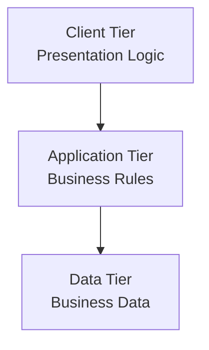
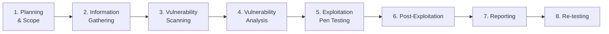
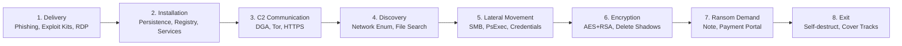
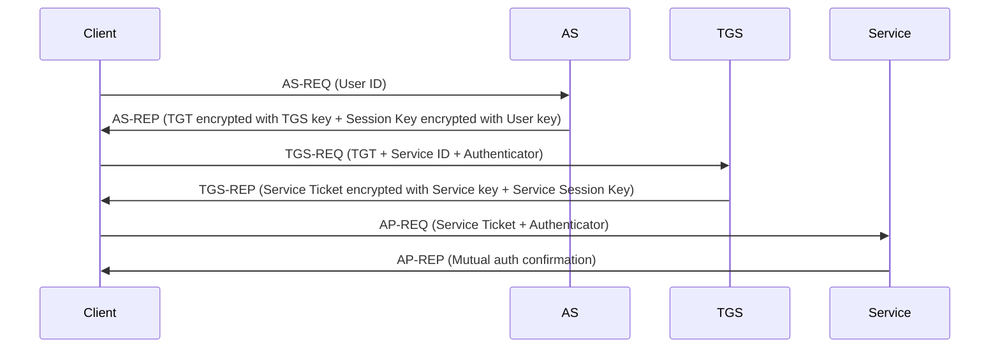
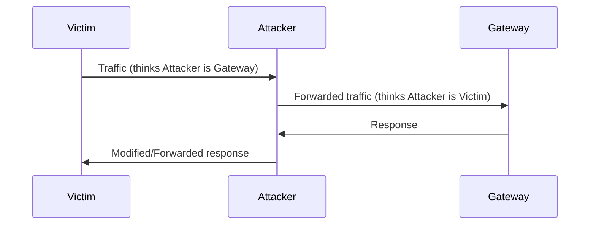
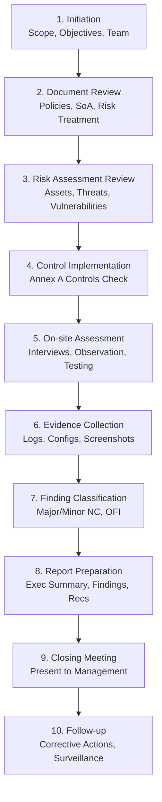

# MSEI-023 CYBER SECURITY - UNIT 4: INTERNET SECURITY

**Block 4: Internet Technology (Units 1-4)**  
**Subject: MSEI-023 Cyber Security**  
**Programme: PGDIS/MSCIS (IGNOU)**

---

## ⚠️ IMPORTANT NOTE ON TEXTBOOK vs PYQ ALIGNMENT

**The Block-4 textbook (2011) is outdated for modern exam topics.** The textbook covers:
- Unit 1: Internet Architecture (TCP/IP, DNS, ISP, NAP, routing)
- Unit 2: Social Networking (Facebook, YouTube, Flickr, Twitter, MySpace, LinkedIn)
- Unit 3: Advanced Searching (Google operators, Boolean, search strategies)
- Unit 4: Web 2.0 (Blogs, user-generated content, collaboration tools, ease of use)

**However, recent papers (2024-2026) heavily test modern topics NOT in the textbook:**
- VAPT, Ransomware, Zero-Day, Cloud Security, Kerberos, MITM, Cyber Audit, Zero Trust, OWASP Top 10

**This unit includes BOTH:**
1. **Textbook content** (Units 1-3) - for completeness
2. **PYQ-based modern topics** (Unit 4 Latest Trends) - marked with 📋 **PYQ-SOURCE** tag

> **Study Strategy**: Master textbook Units 1-3 for 5-mark questions. For 10-mark questions on modern topics, use the PYQ-sourced content below (these are the actual exam questions from 2024-2026).

---

## UNIT OVERVIEW

| Textbook Unit | Title | PYQ Priority | Notes |
|--------------|-------|--------------|-------|
| **Unit 1** | Internet Architecture | High (DNS, Firewall, PKI) | Textbook content |
| **Unit 2** | Social Networking | Medium (4 occurrences) | Textbook content |
| **Unit 3** | Advanced Searching | Low | Textbook content |
| **Unit 4** | Latest Trends in Internet Security | 🔴 **CRITICAL** (Modern topics) | **📋 PYQ-SOURCE** - Not in textbook |

---

## TOPIC 1: INTERNET ARCHITECTURE (Textbook Unit 1)

### 1.1 Client-Server Architecture (Textbook §1.2)

**Client Process**: Makes request for information (e.g., Browser)
**Server Process**: Takes request, processes, gathers info, sends response (e.g., Web Server)

#### Two-Tier Architecture (Textbook §1.2.1)
- Client directly interacts with server
- Client tier: presentation logic + business rules
- Server tier: processing management + database management
- Example: Browser → Web Server

#### Three-Tier Architecture (Textbook §1.2.2)

- Client tier: User interface (browser)
- Application tier (Middle tier): Business logic, calls data tier
- Data tier: Provides data to application tier

#### Web Architecture (Textbook §1.2.3)
Three key standards:
1. **HTML** - Encoding document content (SGML-based, hierarchical tags)
2. **URI/URL** - Addressing protocol (URN = identity, URL = location with protocol, machine, path, file)
3. **HTTP** - Application-level protocol for WWW (commands: establish TCP/IP, send request, return response, close connection)

### 1.2 Internet Architecture & Key Technologies (Textbook §1.3)

#### How Internet Works (Textbook §1.3.1)
1. Type URL or click hyperlink
2. Browser sends request to ISP server
3. ISP server looks up host server in address database
4. Host server sends page to ISP server
5. ISP sends page to browser

#### DNS (Textbook §1.3.2)
- Translates domain names (www.ignou.ac.in) to IP addresses
- Hierarchy: Root servers → TLD (.in) → Second-level (.ac.in) → Host (www.ignou.ac.in)
- Resolvers cache information for faster resolution

#### ISP (Textbook §1.3.3)
- Provides Internet access (dial-up, DSL, cable, wireless)
- Examples in India: BSNL, Sify, Siti Cable, VSNL, Reliance, ERNET India

#### NAP (Textbook §1.3.4)
- Network Access Point: Major interconnection points for ISPs
- NSP (Network Service Provider): Backbone services to ISPs
- IX/IXP: Internet Exchange Point for peering

#### TCP/IP Protocol Suite (Textbook §1.4)

| Layer | Protocols | Function |
|-------|-----------|----------|
| **Application** | HTTP, FTP, SMTP, DNS, Telnet | User applications |
| **Transport** | TCP, UDP | End-to-end delivery (TCP=reliable, UDP=fast) |
| **Internet** | IP, ICMP, ARP, RARP | Routing, addressing, error reporting |
| **Network Interface** | Ethernet, Wi-Fi, PPP | Physical transmission |

#### IP Addressing (Textbook §1.5)
- **IPv4**: 32-bit, dotted decimal (124.98.78.234)
- **Subnetting**: Dividing network into subnetworks
- **CIDR**: Classless Inter-Domain Routing (e.g., 192.168.1.0/24)
- **NAT**: Network Address Translation (private ↔ public IP)
- **Packet Switching**: Data sent in packets via routers (vs circuit switching)

### 1.3 Security Issues (Textbook §1.6)
- Openness of design enables global scale but creates security/privacy issues
- Need for firewalls, encryption, authentication

### 1.4 Important Exam Questions (Textbook-based)

| Marks | Question | Frequency |
|-------|----------|-----------|
| 1-mark | Network firewall / SMTP / Broadcast address | Dec 2021, Jun 2021 |
| 5-mark | Categories of cyber attacks - explain 2 + countermeasures | Dec 2021, Jun 2024 |
| 5-mark | Domain Cache Poisoning prevention steps | Dec 2024, Jun 2026 |
| 5-mark | DNS/Cache Poisoning notes | Dec 2024, Dec 2025, Jun 2026 |
| 5-mark | Network Security (Firewall/IDS/IPS) | Jun 2026 |
| 10-mark | Internet Security Issues in detail | Dec 21, Jun 21, Dec 22 ⭐⭐⭐ |
| 10-mark | PKI Architecture & Working | Dec 2024 ⭐⭐⭐ |
| 10-mark | Firewalls & IDS in Network Security + real-world examples | Jun 2026 |
| 10-mark | Intruder & Intrusion Techniques | Dec 2022 |

---

## TOPIC 2: SOCIAL NETWORKING SECURITY (Textbook Unit 2)

### 2.1 Types of Social Networks (Textbook §2.5)

| Type | Description | Examples (Textbook) |
|------|-------------|---------------------|
| **Profile-based** | Services organized around profile pages | Facebook, MySpace |
| **Content-based** | Main goal: share content, photos, videos | Flickr, YouTube |
| **Microblogging** | Short messages (140 chars), real-time | Twitter |
| **Professional** | Business-oriented, job search, networking | LinkedIn |
| **Specialized** | Regional, student-focused, tagging | Tagged, Classmates, BharatStudent |

### 2.2 Key Platforms (Textbook §2.5)

| Platform | Key Features (Textbook) |
|----------|-------------------------|
| **Facebook** | Profiles, friends, messages, chat, groups, pages, low-cost business advertising |
| **YouTube** | Video sharing, comments, tutorials, marketing, education |
| **Flickr** | Photo upload via email, sharing, tags, groups, comments, favorites, search |
| **Twitter** | Tweets (140 chars), follow, SMS/IM/web, real-time, microblogging |
| **LinkedIn** | Professional profiles (Title, Summary, Experience, Education), connections, jobs, recommendations |
| **MySpace** | Profile, interests, friends, comments, bulletins, blogs, forums, music |
| **Tagged** | Custom profile, friends, comments, tags, groups, chat, games, photos |
| **Classmates** | Find school friends, graduation year search, email, reconnect |
| **BharatStudent** | Indian students/professionals, GenX Zone, Cafe Bharat, Study Zone, Classifieds |

### 2.3 Security Issues (Textbook §2.6)

| Threat | Description (Textbook) |
|--------|------------------------|
| **Malware** | Fake Twitter invitations → malicious attachment → gathers emails → spreads via removable drives/shared folders |
| **Spam** | Hijacked account sends messages to connections → malware loads on navigation |
| **Targeted Attacks** | Employees with bad intentions collect personal info → sophisticated social engineering |
| **Phishing** | Fake login pages → steal credentials → banking/enterprise account compromise |
| **Identity Hijacking** | Impersonate reputable person → access business contracts/acquaintances → spam to friends |

### 2.4 Advantages (Textbook §2.7, Check Your Progress)
- Job opportunities through contacts
- Learning new technologies/strategies
- Word-of-mouth marketing (best form, no investment)
- Alliances and referrals
- Low-cost business advertising (Facebook)
- Easy connection with friends/family

### 2.5 Important Exam Questions

| Marks | Question | Frequency |
|-------|----------|-----------|
| 2-mark | Social networking sites security | Dec 2021 |
| 5-mark | Social networking security issues | Jun 2023, Dec 2023, Jun 2024 |
| 5-mark | White-label social networks notes | Dec 2022 |
| 5-mark | Social bookmarking notes | Jun 2024 |
| 5-mark | Advantages of Facebook / Features of YouTube / Benefits of Flickr / Tweet features / LinkedIn functionality | Check Your Progress |

---

## TOPIC 3: ADVANCED SEARCHING (Textbook Unit 3) - LOW PRIORITY

### 3.1 Search Tools (Textbook §3.2.1)

| Tool | Description |
|------|-------------|
| **Search Engines** | Keyword-searchable DB (Google, AlltheWeb, AltaVista) - scour web, index, store |
| **Subject Directories** | Human-edited, hierarchically organized (Open Directory Project, Yahoo) |
| **Virtual Libraries** | Highly selective links by librarians (WWW Virtual Library) |
| **Meta Search Engines** | Query multiple engines simultaneously |
| **Invisible/Deep Web** | Databases not indexed by standard engines |

### 3.2 How Search Engines Work (Textbook §3.2.2)
1. **Spider/Crawler** - Scours web, follows links
2. **Indexer** - Processes, stores in database
3. **Query Processor** - Searches index, returns results

### 3.3 Search Operators (Textbook §3.3)

| Operator | Function | Example |
|----------|----------|---------|
| **Boolean** | AND, OR, NOT (implied AND in Google) | `cyber security` = cyber AND security |
| **Phrase Search** | Exact phrase in quotes | `"cyber security"` |
| **+ (Force)** | Include specific word | `Ramayan Episode +1` |
| **- (Exclude)** | Exclude word | `virus -computer` |
| **~ (Tilde/Synonyms)** | Include synonyms | `~primer` → basics, introduction |
| **\* (Wildcard)** | Replace unknown word | `"little * riding hood"` |
| **Advanced** | `site:`, `filetype:`, `intitle:`, `inurl:`, `allintext:`, `allintitle:`, `allinurl:`, `define:`, `info:`, `daterange:`, `numrange:` |

### 3.4 Google Search Strategies (Textbook §3.4-3.5)
- Start simple, add operators to refine
- Use specific terms, avoid stop words
- Use advanced search page for complex queries
- Image search: size, color, type, usage rights

---

## TOPIC 4: LATEST TRENDS IN INTERNET SECURITY (Textbook Unit 4 + 📋 PYQ-SOURCE)

### ⚠️ TEXTBOOK CONTENT (Unit 4 - Web 2.0) - LOW EXAM PRIORITY

**Textbook §4.0 (Block Introduction)**: "Web 2.0 is about revolutionary new ways of creating, collaborating, editing and sharing user-generated content online... ease of use... people who consume media should be active contributors..."

**Textbook Unit 4 covers**: Blogs, user-generated content, collaboration tools, ease of use, customization, community purposes.

**Exam Reality**: These topics rarely appear in recent papers. Modern security topics (below) dominate.

---

### 📋 PYQ-SOURCE: MODERN TOPICS (2024-2026 Papers) - 🔴 CRITICAL PRIORITY

> **Source**: These topics are NOT in the 2011 textbook but appear repeatedly in Jun 2024 - Jun 2026 papers. Content is based on PYQ analysis and standard industry knowledge for exam preparation.

---

#### 4.1 VAPT (Vulnerability Assessment & Penetration Testing) 📋 PYQ-SOURCE (⭐⭐⭐ - 3 exact 10-mark repeats: Dec 24, Jun 25, Dec 25)

**Definition**: Systematic process of identifying, evaluating, and exploiting vulnerabilities in systems/networks to assess security posture.

**VAPT Methodology (8 Steps)**:


| Phase | Activities | Tools |
|-------|------------|-------|
| **1. Planning & Scope** | Rules of engagement, targets, timeline, legal | Contract, scope document |
| **2. Information Gathering** | Passive (OSINT, Whois, DNS) + Active (port scan, banner grab) | Nmap, Recon-ng, Maltego, theHarvester |
| **3. Vulnerability Scanning** | Automated scans | Nessus, OpenVAS, Qualys, Nexpose |
| **4. Vulnerability Analysis** | Verify findings, remove false positives, CVSS scoring | Manual verification, CVSS calculator |
| **5. Exploitation** | Controlled exploitation, proof-of-concept | Metasploit, Core Impact, custom exploits |
| **6. Post-Exploitation** | Privilege escalation, lateral movement, persistence | Meterpreter, BloodHound, Mimikatz |
| **7. Reporting** | Executive summary, technical findings, risk rating, remediation | Custom templates, Dradis, Faraday |
| **8. Re-testing** | Verify fixes after remediation | Repeat scanning |

**VAPT Types**:
| Type | Knowledge | Access |
|------|-----------|--------|
| **Black Box** | Zero knowledge | External only |
| **White Box** | Full knowledge (code, config) | Internal + External |
| **Gray Box** | Partial knowledge | Limited internal access |

---

#### 4.2 Ransomware Lifecycle 📋 PYQ-SOURCE (⭐⭐⭐ - 3 exact 10-mark repeats: Dec 24, Jun 25, Dec 25)

**8-Stage Ransomware Kill Chain**:


**Encryption Process**:
1. Generate random AES-256 key per file
2. Encrypt file with AES key
3. Encrypt AES key with attacker's RSA public key
4. Store encrypted AES key with file
5. Delete volume shadow copies (`vssadmin delete shadows /all`)
6. Disable recovery options

**Prevention Measures**:
| Layer | Measures |
|-------|----------|
| **Backup** | 3-2-1 rule: 3 copies, 2 media, 1 offsite/offline; Immutable backups |
| **Patch Management** | Timely OS/app patches; disable SMBv1 |
| **Email Security** | Advanced filtering, sandboxing, DMARC/DKIM/SPF |
| **Endpoint** | EDR/XDR, application control, behavior monitoring |
| **Network** | Segmentation, zero trust, disable RDP from Internet |
| **Identity** | MFA everywhere, least privilege, PAM |
| **User Training** | Phishing simulation, reporting culture |

**Ransomware Evolution**:
| Generation | Characteristics |
|------------|-----------------|
| **1.0** | Single machine, simple encryption |
| **2.0** | Network propagation (WannaCry, NotPetya) |
| **3.0** | Double extortion (encrypt + threaten leak) |
| **4.0** | Triple extortion (add DDoS, notify customers/regulators) |
| **RaaS** | Ransomware-as-a-Service (LockBit, Conti, BlackCat) |

---

#### 4.3 Zero-Day Vulnerabilities 📋 PYQ-SOURCE (⭐⭐⭐ - 3 occurrences: Dec 24, Dec 25, Jun 26)

**Definition**: Vulnerability unknown to vendor, no patch exists, actively exploited in wild. "Zero days" since discovery = no defense time.

**Significance**:
- Bypasses signature-based defenses (AV, IDS/IPS)
- High value on exploit markets ($100K-$2M+)
- Used in APT campaigns, targeted attacks
- Example: Stuxnet used 4 zero-days

**Recent High-Profile Zero-Days**:
| Vulnerability | CVE | Year | Impact |
|---------------|-----|------|--------|
| **Log4Shell** | CVE-2021-44228 | 2021 | RCE in Log4j; ubiquitous Java library |
| **PrintNightmare** | CVE-2021-34527 | 2021 | Windows Print Spooler RCE |
| **ProxyLogon** | CVE-2021-26855 | 2021 | Exchange Server SSRF → RCE chain |
| **Follina** | CVE-2022-30190 | 2022 | MSDT RCE via Office documents |
| **CitrixBleed** | CVE-2023-4966 | 2023 | NetScaler session hijack |

**Defense Strategies**:
| Strategy | Implementation |
|----------|----------------|
| **Behavior-based Detection** | EDR/XDR, sandboxing, ML anomaly detection |
| **Threat Intelligence** | IOC feeds, TIP integration, early warning |
| **Patch Management** | Rapid deployment, virtual patching (WAF/IPS) |
| **Network Segmentation** | Limit blast radius, micro-segmentation |
| **Application Whitelisting** | Only approved executables run |
| **Zero Trust** | Never trust, always verify, least privilege |

---

#### 4.4 Authentication & Access Control 📋 PYQ-SOURCE (⭐⭐⭐ - 5 occurrences: Dec 24, Jun 25, Dec 25, Jun 26)

**MFA (Multi-Factor Authentication)**:
| Factor Type | Examples |
|-------------|----------|
| **Something You Know** | Password, PIN, security questions |
| **Something You Have** | TOTP app (Google Auth, Authy), hardware token (YubiKey), SMS/Email OTP, smart card |
| **Something You Are** | Fingerprint, FaceID, iris, voice, behavioral biometrics |

**MFA Best Practices**:
- Enforce for all admin/remote access
- Prefer authenticator apps/hardware tokens over SMS
- Implement number matching (prevents MFA fatigue)
- Conditional access policies (risk-based)

**Least Privilege Principle** 📋 PYQ-SOURCE (⭐⭐⭐ - 10-mark Dec 2025):
> **Definition**: Users/processes should have only minimum permissions necessary to perform their function.

**Implementation**:
| Level | Measures |
|-------|----------|
| **User** | Role-based access (RBAC), attribute-based (ABAC), just-in-time (JIT) |
| **Service Accounts** | Managed identities, no interactive login, scoped permissions |
| **Admin** | Tiered administration (Tier 0/1/2), PAM, privileged session recording |
| **Cloud** | IAM conditions, SCPs, permission boundaries, resource policies |

---

#### 4.5 Kerberos Authentication Protocol 📋 PYQ-SOURCE (⭐⭐⭐ - Jun 2025 10-mark question)

**Components**:
- **KDC (Key Distribution Center)**: AS (Authentication Server) + TGS (Ticket Granting Server)
- **Realm**: Kerberos administrative domain
- **Principal**: Unique identity (user/service@REALM)
- **Ticket**: Encrypted credential (TGT, Service Ticket)
- **Authenticator**: Timestamp + client info encrypted with session key

**6-Step Flow**:


**Key Features**: Mutual authentication, single sign-on, delegation, cross-realm trust

---

#### 4.6 MITM Attack 📋 PYQ-SOURCE (⭐⭐⭐ - Jun 2025 10-mark question)

**Process**:


**Techniques**:
| Technique | Layer | Description |
|-----------|-------|-------------|
| **ARP Spoofing** | L2 | Poison ARP cache; map attacker MAC to gateway IP |
| **DNS Spoofing** | L7 | Forge DNS responses; redirect to malicious server |
| **SSL Stripping** | L7 | Downgrade HTTPS→HTTP; proxy secure traffic |
| **Wi-Fi Eavesdropping** | L1/L2 | Rogue AP, Karma attack, packet sniffing |
| **BGP Hijacking** | L3 | Announce victim's prefixes; redirect Internet traffic |
| **Session Hijacking** | L7 | Steal session cookies; replay authenticated requests |

**Prevention**:
| Measure | Effectiveness |
|---------|---------------|
| **TLS 1.3 + HSTS** | Prevents SSL stripping, enforces encryption |
| **Certificate Pinning** | Detects fraudulent certs |
| **DNSSEC** | Prevents DNS spoofing |
| **Static ARP / DAI** | Prevents ARP spoofing (Dynamic ARP Inspection) |
| **RPKI / ROA** | Prevents BGP hijacking |
| **Secure Cookies** | HttpOnly, Secure, SameSite |
| **VPN / Zero Trust** | Encrypted tunnels, verify every request |

---

#### 4.7 Cloud Security 📋 PYQ-SOURCE (⭐⭐⭐ - 4 occurrences: Jun 25, Dec 25, Jun 26)

**Shared Responsibility Model**:
| Provider Responsibility | Customer Responsibility |
|------------------------|------------------------|
| Physical security | Data classification |
| Hypervisor/Host OS | Guest OS patching |
| Network infrastructure | Application security |
| Managed services (RDS, S3) | Identity & Access (IAM) |
| | Encryption keys (if CMK) |
| | Client-side data |

**IAM (Identity & Access Management)**:
| Component | Best Practice |
|-----------|---------------|
| **Root Account** | MFA enabled, no access keys, use for billing only |
| **Users/Groups** | Least privilege, group-based policies |
| **Roles** | Cross-account access, service roles, federated access |
| **Policies** | Managed > Inline; Conditions (IP, time, MFA, tags) |
| **SCPs** | Organizational guardrails (AWS Organizations) |
| **Permission Boundaries** | Max permissions for delegated admins |
| **Access Analyzer** | Identify unintended resource access |

**Encryption**:
| State | Implementation |
|-------|----------------|
| **At Rest** | AES-256; SSE-S3, SSE-KMS, SSE-C; Customer Managed Keys (CMK) in KMS/HSM |
| **In Transit** | TLS 1.2+ everywhere; mTLS for service-to-service; Certificate Manager |
| **Key Management** | Envelope encryption; automatic rotation; key policies; CloudHSM for FIPS 140-2 |

**Network Security**:
| Control | Implementation |
|---------|----------------|
| **VPC/VNet** | Isolated network; public/private subnets; NAT Gateway |
| **Security Groups** | Stateful; instance-level; default deny; allow specific |
| **NACLs** | Stateless; subnet-level; ordered rules; ephemeral ports |
| **Private Endpoints** | Access services without Internet (Interface/Gateway) |
| **WAF** | OWASP Top 10 managed rules; rate limiting; geo-blocking |
| **DDoS Protection** | Standard (free) + Advanced (paid, Shield) |
| **Segmentation** | Micro-segmentation (Calico, Cilium, cloud-native) |

---

#### 4.8 Cyber Security Audit 📋 PYQ-SOURCE (⭐⭐⭐ - Jun 2026 10-mark question)

**International Standard**: **ISO/IEC 27001:2022** (Information Security Management Systems - ISMS)

**Annex A Controls (93 controls in 4 Themes)**:
| Theme | Controls | Focus |
|-------|----------|-------|
| **Organizational (A.5-A.8)** | 37 | Policies, roles, assets, HR security |
| **People (A.6)** | 8 | Screening, training, disciplinary |
| **Physical (A.7)** | 13 | Perimeter, equipment, clear desk |
| **Technological (A.8)** | 35 | Access, crypto, ops, network, dev |

**Audit Process (10 Steps)**:


**Finding Classification**:
| Classification | Definition |
|----------------|------------|
| **Major Nonconformity** | Systemic failure; absent/ineffective control; significant risk |
| **Minor Nonconformity** | Isolated lapse; single instance; limited risk |
| **Opportunity for Improvement (OFI)** | Not a nonconformity; enhancement suggestion |

---

#### 4.9 APT & Botnets 📋 PYQ-SOURCE (⭐⭐ MEDIUM - 3 occurrences)

**APT Characteristics**:
| Attribute | Description |
|-----------|-------------|
| **Advanced** | Custom malware, zero-days, sophisticated TTPs |
| **Persistent** | Long-term access (months/years); low-and-slow |
| **Threat** | Nation-state or organized crime; specific targets |
| **Lifecycle** | Reconnaissance → Weaponization → Delivery → Exploitation → Installation → C2 → Actions on Objectives |

**Botnet Architecture**:
```
C2 Server (Command & Control)
    │
    ├── HTTP/HTTPS (domain flux, fast flux)
    ├── P2P (decentralized, resilient)
    ├── DNS (covert channel)
    └── Tor/I2P (anonymity)
    │
Bots (Compromised Devices)
    ├── DDoS (volumetric, application)
    ├── Spam/Phishing
    ├── Credential Stuffing
    ├── Crypto Mining
    └── Proxy/Relay
```

**Notable APT Groups**:
| Group | Attribution | Notable Campaigns |
|-------|-------------|-------------------|
| **APT28 (Fancy Bear)** | Russia GRU | DNC hack, Olympics, NotPetya |
| **APT29 (Cozy Bear)** | Russia SVR | SolarWinds, COVID research |
| **Lazarus Group** | North Korea | WannaCry, Sony, Bangladesh Bank |
| **APT10 (Stone Panda)** | China MSS | Cloud Hopper, MSP compromise |
| **Charming Kitten** | Iran IRGC | Credential harvesting, academia |

---

#### 4.10 Malware Types 📋 PYQ-SOURCE

| Type | Propagation | Payload |
|------|-------------|---------|
| **Virus** | Requires host file/user action | Corrupt, delete, steal |
| **Worm** | Self-propagating (network) | Bandwidth consumption, backdoor |
| **Trojan** | Disguised as legitimate | Remote access, data theft |
| **Ransomware** | Various | Encryption + extortion |
| **Spyware** | Bundled, drive-by | Keylogging, screen capture |
| **Rootkit** | Kernel/user mode | Hide presence, persist |
| **RAT** | Phishing, exploits | Full remote control |
| **Fileless Malware** | Memory-only (PowerShell, WMI) | No disk footprint, evades AV |

---

#### 4.11 OWASP Top 10 (2021) 📋 PYQ-SOURCE (⭐⭐ - Jun 2025 5-mark)

| Rank | Category | Description |
|------|----------|-------------|
| **A01** | Broken Access Control | IDOR, privilege escalation, missing authZ |
| **A02** | Cryptographic Failures | Weak crypto, plaintext transmission, hard-coded keys |
| **A03** | Injection | SQLi, NoSQLi, Command Injection, LDAPi |
| **A04** | Insecure Design | Missing threat modeling, secure design patterns |
| **A05** | Security Misconfiguration | Default creds, unnecessary features, verbose errors |
| **A06** | Vulnerable Components | Outdated libraries, unpatched frameworks |
| **A07** | Identification & Auth Failures | Weak passwords, session fixation, MFA bypass |
| **A08** | Software & Data Integrity Failures | Unsigned updates, CI/CD tampering, deserialization |
| **A09** | Security Logging & Monitoring Failures | Insufficient logs, no alerting, blind spots |
| **A10** | Server-Side Request Forgery (SSRF) | Internal service access via forged requests |

---

#### 4.12 VPN & Emerging Topics 📋 PYQ-SOURCE

**VPN** (⭐ - Dec 2025 5-mark):
| Type | Protocol | Use Case |
|------|----------|----------|
| **Remote Access** | IPsec, SSL/TLS, WireGuard | User-to-network |
| **Site-to-Site** | IPsec, DMVPN | Network-to-network |
| **Clientless** | SSL Portal | Browser-based access |

**WireGuard**: Modern, lightweight, kernel-space, ChaCha20-Poly1305, faster than IPsec/OpenVPN

**Supply Chain Security** (Emerging):
- **SBOM**: Software Bill of Materials (SPDX, CycloneDX)
- **SLSA**: Supply Chain Levels for Software Artifacts (integrity levels 1-4)
- **Dependency Confusion**: Private package names claimed on public registries
- **Sigstore/Cosign**: Keyless signing, transparency logs

---

### 4.13 Important Exam Questions

| Marks | Question | Frequency |
|-------|----------|-----------|
| 5-mark | **Zero-Day Vulnerabilities notes/concept** | Dec 24, Dec 25, Jun 26 ⭐⭐⭐ |
| 5-mark | **MFA / Least Privilege notes** | Dec 24, Dec 25, Jun 26 ⭐⭐⭐ |
| 5-mark | **OWASP Top 10 notes** | Jun 2025 |
| 5-mark | **VPN Importance** | Dec 2025 |
| 5-mark | **Zero Trust Concept** | Dec 2025 |
| 5-mark | **Cloud Security Challenges** | Jun 25, Jun 26 |
| 5-mark | **APT/Botnets notes** | Jun 25, Dec 25 |
| 5-mark | **Malware Types** | Various |
| 10-mark | **VAPT Steps on a Network** | Dec 24, Jun 25, Dec 25 ⭐⭐⭐⭐⭐ |
| 10-mark | **Ransomware Lifecycle + Prevention** | Dec 24, Jun 25, Dec 25 ⭐⭐⭐⭐⭐ |
| 10-mark | **Password Storage at Server + Theft Methods** | Jun 2025 |
| 10-mark | **Kerberos Authentication Protocol** | Jun 2025 ⭐⭐⭐ |
| 10-mark | **MITM Attack Process & Techniques** | Jun 2025 ⭐⭐⭐ |
| 10-mark | **Securing Cloud Environment (IAM, Encryption, Network)** | Jun 25, Jun 26 ⭐⭐⭐ |
| 10-mark | **Least Privilege Principle in Access Control** | Dec 2025 |
| 10-mark | **Social Engineering Types + Mitigation** | Dec 2025 |
| 10-mark | **Information Security in Cloud Infrastructure** | Jun 2026 |
| 10-mark | **Firewalls & IDS in Network Security** | Jun 2026 |
| 10-mark | **Zero-Day Vulnerabilities + Recent Incidents** | Jun 2026 |
| 10-mark | **Cyber Security Audit + International Standard** | Jun 2026 ⭐⭐⭐ |
| 10-mark | **PKI Architecture and Working** | Dec 2024 |
| 10-mark | **Domain Cache Poisoning Attack & Prevention** | Dec 2024 |

---

## COMPARISON TABLES FOR QUICK REVISION

### VAPT vs Traditional Security Testing

| Aspect | VAPT | Vulnerability Scan Only |
|--------|------|------------------------|
| **Depth** | Manual + Automated | Automated only |
| **Exploitation** | Controlled exploitation | No exploitation |
| **False Positives** | Verified, removed | High |
| **Business Impact** | Demonstrated | Theoretical |
| **Compliance** | PCI DSS, ISO 27001, SOC2 | Basic compliance |

### Ransomware vs Other Malware

| Aspect | Ransomware | Virus/Worm | Trojan/RAT |
|--------|-----------|------------|------------|
| **Goal** | Extortion | Destruction/Spread | Persistent Access |
| **Visibility** | High (ransom note) | Variable | Low (stealth) |
| **Recovery** | Backup/Decrypt | Clean/Reimage | Forensics/Remediate |
| **Time Sensitivity** | Critical (timer) | Variable | Long-term |

### Zero Trust vs Traditional Perimeter

| Aspect | Traditional (Castle-and-Moat) | Zero Trust |
|--------|------------------------------|------------|
| **Trust Model** | Trust inside, verify outside | Never trust, always verify |
| **Network Access** | VPN → Full network | ZTNA → Per-app access |
| **Segmentation** | VLANs, Firewalls | Micro-segmentation |
| **Authentication** | Single factor, perimeter | Continuous, MFA, risk-based |
| **Visibility** | Limited (North-South) | Full (East-West + North-South) |

### Cloud Shared Responsibility

| Service Model | Provider | Customer |
|---------------|----------|----------|
| **IaaS** (EC2, VPC) | Physical, Hypervisor, Network | OS, Apps, Data, Identity, Firewall |
| **PaaS** (RDS, App Service) | + OS, Runtime | Apps, Data, Identity |
| **SaaS** (Office 365, Salesforce) | + Apps | Data, Identity, Config |

---

## SUMMARY OF HIGH-YIELD TOPICS FOR UNIT 4

| Priority | Topic | Must-Know For Exam |
|----------|-------|-------------------|
| 🔴 **Critical** | **VAPT 8-Step Methodology** | Planning → Info Gathering → Scanning → Analysis → Exploitation → Post-Exploit → Reporting → Re-test |
| 🔴 **Critical** | **Ransomware 8-Stage Lifecycle** | Delivery → Install → C2 → Discovery → Lateral → Encryption → Ransom → Exit |
| 🔴 **Critical** | **Zero-Day Vulnerabilities** | Definition, significance, Log4Shell/PrintNightmare/ProxyLogon, defenses |
| 🔴 **Critical** | **MFA + Least Privilege** | 3 factors, implementation, JIT, PAM, tiered admin |
| 🔴 **Critical** | **Kerberos 6-Step Flow** | AS-REQ/REP → TGS-REQ/REP → AP-REQ/REP, mutual auth |
| 🔴 **Critical** | **MITM Techniques** | ARP/DNS spoofing, SSL stripping, Wi-Fi, BGP, session hijack |
| 🔴 **Critical** | **Cloud Security (IAM/Encryption/Network)** | Shared responsibility, IAM best practices, encryption states, SG/NACL |
| 🔴 **Critical** | **Cyber Security Audit (ISO 27001)** | 10-step process, Annex A 4 themes, finding classification |
| 🟠 **High** | DNS Cache Poisoning | Mechanism, DNSSEC prevention, randomization |
| 🟠 **High** | PKI Architecture | Components, certificate fields, validation chain, CRL/OCSP |
| 🟠 **High** | Firewall/IDS/IPS Types | Packet filter, stateful, proxy, NGFW; IDS vs IPS comparison |
| 🟠 **High** | Cyber Attack Categories | 10 categories, defense in depth layers |
| 🟡 **Medium** | APT/Botnet/Malware Types | Characteristics, lifecycle, notable groups |
| 🟡 **Medium** | OWASP Top 10 (2021) | All 10 categories, top 3 focus |
| 🟡 **Medium** | Zero Trust Principles | 5 principles, ZTNA, micro-segmentation |
| 🟢 **Overview** | Social Networking Security | Issues, types, best practices (textbook) |
| 🟢 **Overview** | VPN Types | Remote access, site-to-site, WireGuard |
| 🟢 **Overview** | Advanced Searching | Google operators, Boolean, search strategies (textbook) |
| 🟢 **Overview** | Web 2.0 / Blogs | Textbook Unit 4 content (low priority) |

---

## PRACTICE QUESTIONS

### 2-Mark Questions
1. Define Zero-Day Vulnerability. Give two recent examples.
2. Differentiate between IDS and IPS.
3. What is DNS Cache Poisoning? How is it prevented?
4. List the 3 factors of MFA with examples.
5. What is the Least Privilege Principle?
6. Name the 4 themes of ISO 27001:2022 Annex A controls.

### 5-Mark Questions
1. Explain the concept of Zero-Day vulnerabilities with recent examples.
2. Describe DNS Cache Poisoning attack and prevention measures.
3. Write notes on Multi-Factor Authentication and its best practices.
4. Explain the Zero Trust security model principles.
5. Describe OWASP Top 10 (2021) - list all 10 with brief description.
6. What are the components of PKI? Explain certificate validation process.
7. Differentiate between APT, Botnet, and Ransomware.
8. Explain the Shared Responsibility Model in Cloud Security.

### 10-Mark Questions
1. **Explain VAPT steps on a network with examples.** (Dec 24, Jun 25, Dec 25)
2. **Describe Ransomware lifecycle and prevention measures.** (Dec 24, Jun 25, Dec 25)
3. **Explain Kerberos Authentication Protocol with principles, components, and step-by-step flow.** (Jun 2025)
4. **Describe MITM Attack process and techniques.** (Jun 2025)
5. **Explain securing Cloud Environment covering IAM, Encryption, and Network Security.** (Jun 25, Jun 26)
6. **Describe Least Privilege Principle in Access Control and how it enhances security.** (Dec 2025)
7. **Explain Social Engineering Types with examples and Individual/Organizational Mitigation.** (Dec 2025)
8. **Describe Cyber Security Audit importance, International Standard, and Steps.** (Jun 2026)
9. **Explain Firewalls and IDS in Network Security with real-world examples.** (Jun 2026)
10. **Describe Zero-Day Vulnerabilities significance with recent incidents.** (Jun 2026)
11. **Explain PKI Architecture and Working.** (Dec 2024)
12. **Domain Cache Poisoning Attack & Prevention.** (Dec 2024)

---

*End of Unit 4 Notes*  
*Next: Unit 5 - Comprehensive Review & Exam Strategy (Optional)*